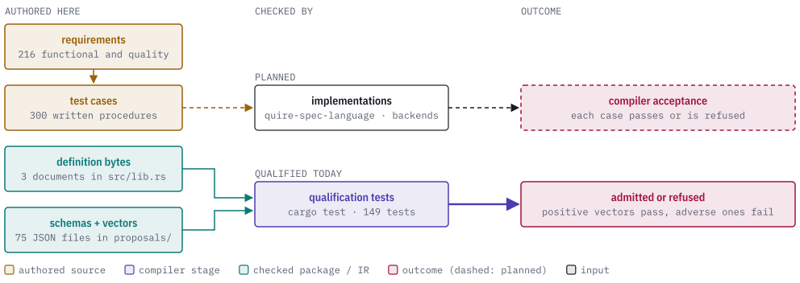
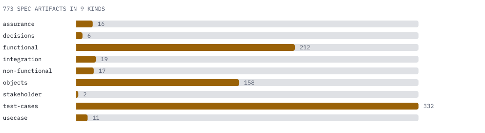
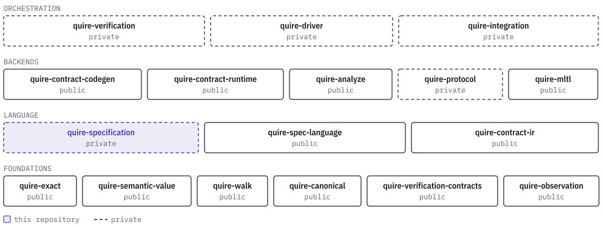

# quire-specification

A formal language is only useful if two programs that read the same rule agree
on what it means. This repository is where Quire writes that agreement down: the
semantics of the Quire language, the profiles that select parts of it, the
interchange formats programs use to hand each other checked results, and the
test cases an implementation has to pass.

It exists so the layers above it do not each invent their own reading. The
compiler ([quire-spec-language](https://github.com/agent-ix/quire-spec-language)),
the proof and code-generation backends and the verification tools all read the
same requirements, the same JSON schemas and the same vectors, instead of
copying them into their own repositories.

<picture>
  <source media="(prefers-color-scheme: dark)" srcset="docs/images/hero-dark.svg">
  
</picture>

> **Status: prerelease, private repository.** There is no released standard.
> The grammar, profiles and formats are drafts and are still changing, and no
> draft becomes normative until it has been reviewed. The Rust tests here check
> the authored schemas, vectors and canonical identities; they do not run a
> compiler. Compiler acceptance of the written test cases is planned and lives in
> quire-spec-language.

## What is in the repository

| Path | What it holds |
| --- | --- |
| `spec/` | The requirements and everything that hangs off them, as Markdown artifacts. See the chart below. |
| `proposals/` | Draft grammar, profiles, JSON schemas and the vector and fixture files that pin them down. One folder per proposal. |
| `docs/` | [The atomic V1 capability inventory](docs/v1-capability-inventory.md), which is the binding statement of scope, and [the complete architecture](docs/v1-complete-architecture.md). |
| `plan/`, `reviews/` | Delivery plans and review records for the work above. |
| `src/lib.rs` | A dependency-free Rust library that exposes three authored documents as constants: the value definition lock, its selection vectors and the native diagnostics catalog. |
| `tests/` | The qualification tests. |

<picture>
  <source media="(prefers-color-scheme: dark)" srcset="docs/images/corpus-dark.svg">
  
</picture>

Every chart number is counted from the tree by `docs/images/figures.py`.

The proposals are:

| Proposal | What it defines |
| --- | --- |
| [`quire-v1`](proposals/quire-v1/README.md) | The V1 language research, capability assessment and the versioned definition documents (edition, value and model packages, diagnostics, state, temporal, protocol and observation profiles). |
| [`state-core`](proposals/state-core/README.md) | The finite-state profile: grammar, snapshots, identity-preserving references and the fixture cases. |
| [`native-source-1-draft`](proposals/native-source-1-draft/README.md) | The native source ruling, with the superseded state-finite candidate kept as history. |
| [`shared-reference-2-draft`](proposals/shared-reference-2-draft/README.md) | The artifact roles and canonical identity (JCS plus SHA-256) that verification records use. |
| [`checked-package-v2`](proposals/checked-package-v2/README.md) | The checked-package schema and its identity, model and operation vectors. |
| [`backend-provider-v1`](proposals/backend-provider-v1/README.md) | The schema and vectors for how a backend advertises what it can check. |

## A first conformance case

A case is an input and the answer an implementation must give. The state-core
proposal ships a rule and a set of snapshots to run it on. The rule is
`proposals/state-core/fixtures/parent-order.native`:

```
language "ix:native" edition "0-draft";
profile "state-finite/0-draft";
model M = "example/config" digest "unresolved-model-package";
invariant ParentPrecedes on M::ConfigVersion at current {
  present(self.parent) implies deref(value(self.parent)).versionNumber < self.versionNumber
}
```

`proposals/state-core/fixtures/state-cases.json` lists the snapshots and what
each must produce. The cases from that file:

| Case | Expected |
| --- | --- |
| `healthy-parent-order` | completed, true |
| `violating-parent-order` | completed, false |
| `absent-parent-guard` | completed, true |
| `equal-valued-distinct-identities` | completed, false |
| `cycle-reachability`, `self-loop` | completed, true |
| `dangling-parent` | refused, `dangling_reference` |
| `duplicate-object` | refused, `duplicate_object` |
| `incomplete-population` | incomplete, `incomplete_population` |

The file says of itself that its status is
`manually-authored-expectations-not-evaluator-output`, and the fixture's model
digest is deliberately unresolved. Treat these as the draft's authored
expectations, not as results any program has produced yet.

## Using the authored documents from Rust

The library crate is named `quire_specification`. A consumer reads the
documents by reference instead of holding a copy. From
`tests/checked_package_v2.rs`:

```rust
use quire_specification::{
    COMPLETE_VALUE_LOCK, COMPLETE_VALUE_SELECTION_VECTORS, NATIVE_DIAGNOSTICS,
};
```

The same file's test checks that each constant holds exactly the bytes of the
file under `proposals/quire-v1/definitions/`. The crate does no parsing.

## How the tests qualify the drafts

| Test file | What it checks |
| --- | --- |
| `tests/backend_provider_v1.rs` | Every positive backend-provider vector is admitted by the schema, every adverse one is refused, and the request carries exactly the checked package its identifier names. |
| `tests/checked_package_v2.rs` | The checked-package and complete-value vectors, and the definition constants against their files. |
| `tests/checked_package_model.rs` | The model definition lock and the effective-declaration vectors. |
| `tests/model_member_types.rs` | Model-owned member vectors: owner recovery, member resolution and member type derivation. |
| `tests/record_conformance.rs` | Record conformance and event-equality vectors, against the shared operation catalog. |
| `tests/shared_reference.rs` | The producer structure of the verification-reference fixtures, and that Quire's canonicalizer gives the same identities. |

These are producer checks. They do not show that an independent reader accepts
the same data, and they do not discharge the written test cases under
`spec/test-cases/`, which describe compiler acceptance and are planned.

## The Quire ecosystem

This repository is the language standard: it sits in the language band, below
the compiler and the backends that implement and consume it.

<picture>
  <source media="(prefers-color-scheme: dark)" srcset="docs/images/ecosystem-dark.svg">
  
</picture>

Its only dependencies are for the tests: the public
[quire-verification-contracts](https://github.com/agent-ix/quire-verification-contracts)
crate (canonical JSON identity and the operation catalog) and ix-trace-rs, which
ties each test to the criterion it verifies. The library itself has no
dependencies. The compiler that implements the standard is
[quire-spec-language](https://github.com/agent-ix/quire-spec-language).

## Building and testing

No hosted workflow exists on purpose; every check runs locally.

```sh
cargo test --locked
cargo fmt --all -- --check
cargo clippy --locked --all-targets --all-features -- -D warnings
quire validate --scope . 'spec/**/*.md' 'plan/**/*.md' 'reviews/2026-*.md' --summary
```

The first Cargo run fetches the git dependencies; later runs can add
`--offline`. The dated review glob selects the typed review artifacts, because
the older review note has no type frontmatter and an unrestricted glob reports
that structural error.

To regenerate the figures, run the docs-figures skill from
[dev-tools](https://github.com/agent-ix/dev-tools) on `docs/images/figures.py`.

## Contributing and licence

Every contribution needs a signed contributor agreement: read
[CONTRIBUTING.md](CONTRIBUTING.md) and [CLA.md](CLA.md) first. Executable code
here is Rust; see [AGENTS.md](AGENTS.md) for the language and review rules.
Research and private issue links must not enter a public release. This
repository is licensed under `AGPL-3.0-or-later`; see [LICENSE](LICENSE).
Publishing it needs a fresh review.
