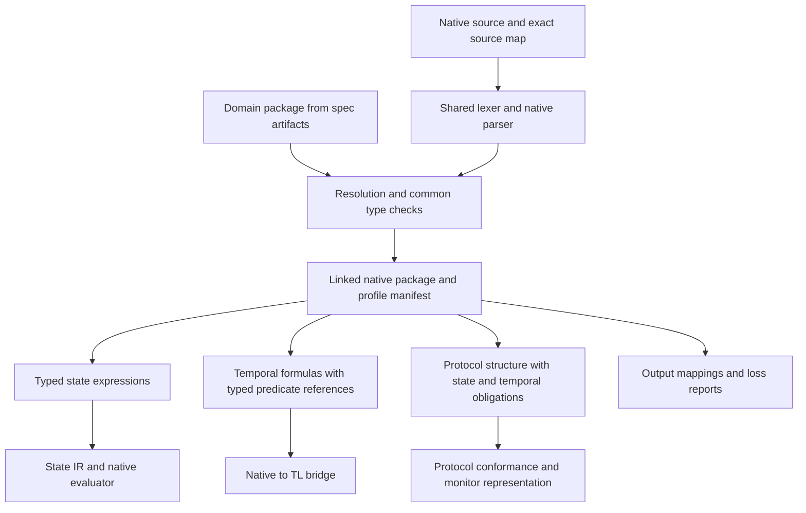

# Composed native Quire architecture

FS01 accepts this architecture boundary and its subsystem decomposition. That
acceptance does not adopt every referenced draft semantic definition or claim
that every compiler, runtime, backend or qualification path is implemented.

## System Boundary

Native Quire is the editable language for formal obligations. The standard owns
syntax, meaning, selected profiles and conformance. Its compiler owns native
parsing, resolution, typing and source-preserving lowering. A spec's domain
model is declared in its own artifacts and reaches Quire as a domain package, as
[AD-006](AD-006-model-graph-state-contracts.md) defines. Quire owns the meaning
of that model. Existing IR, TL and protocol components own
their specialized representations and execution; Quoin owns evidence retention
and authored assurance decisions. No single executable IR defines the language.

V1 includes the entire atomic capability inventory: language/package
evolution; complete values, models and expressions; bounded and unbounded
temporal semantics; dynamic protocol/choreography; composed runtime and
workflow adapters; verification methods; exact IR/backends; tooling/mappings;
and evidence/qualification. Its authoritative scope is recorded in
[`docs/v1-capability-inventory.md`](../../docs/v1-capability-inventory.md).
The [shared drafting foundation](../../proposals/quire-v1/shared-foundation.md)
defines cross-system, related-instance and selected population/window inputs.
Runtime workflow, role, message, delivery, attempt and business-effect identities
remain distinct. A single trace ID cannot replace their declared relationships.
The language's long-term architecture accommodates additional semantic families
and methods without treating current evaluator restrictions as product limits.
Unknown or unimplemented capabilities remain explicit, located refusals.

OCL, FRETish, SysML and KerML textual forms are output mappings. TL syntax is an
internal temporal boundary. Domain types come from the domain package that the
spec's artifacts declare; no other source can declare the same type a second
time. Executing external business actions, deploying monitors and
certifying a consuming system are outside the language evaluator's boundary.

## Views

The following views describe source processing, execution and monitoring, and
the identity/evidence boundaries shared by all selected semantic families.

### Source and static structure

One lexer owns token and span rules. The parser dispatches on explicit native
clause forms using a shared token cursor; expression parsing is reused for
guards, parameters and payload conditions. It does not recognize protocols by
searching text or extend a long command-level if/else chain. Each family has a
typed AST and semantic checker. The package root distinguishes families without
putting every protocol transition, temporal operator and scalar expression in
one evaluator enum. Formatting consumes the same syntax structures.

The common layer owns source/declaration identity, scalar/value types, imports,
definedness and profile selection. Temporal nodes reference checked Boolean
predicates; they do not contain a second arithmetic expression language.
The [native temporal grammar](../../proposals/quire-v1/shared-grammar.md)
uses explicit `holds(expr)` leaves, distinct current and activation inputs,
immutable captures and a named clock role. Temporal constants remain separate
from atomic valuations so false-extension boundaries survive optimization and
lowering. E's selected temporal profiles retain their own meaning.
The [state contract](../../proposals/quire-v1/state-contract.md) defines the
proposed query/graph extensions, exact arithmetic and pre-state/capture rules;
they preserve first-profile restrictions under separate definition identities.
Protocol nodes own control structure, participants and message relationships;
they refer to state predicates, operation contracts and temporal obligations.
The [choreography surface](../../proposals/quire-v1/choreography-surface.md)
requires explicit sequence, branch/join and iteration identities, with definite
value availability along the causal graph. Compensation captures are bound at
registration and activation separately; observing a transport receipt cannot
create a successful effect or a compensating action.
Composition is a typed dependency graph, not interpolation between strings.

The [package contract](../../proposals/quire-v1/package-contract.md) closes the
source inventory and exact definition/model selections before publication of
checked declarations. The linker derives typed binding requirements with source
correspondence; request binding maps those roles to explicit runtime inputs.
Equal local names or field shapes cannot collapse distinct roles. Configuration
is retained in full at the stage consuming it; a changed run budget changes
assessment provenance without rewriting the static language subject.

Ordinary Boolean expressions cannot inspect a pending monitor result. Temporal
or protocol status is not a nullable Boolean or an implicit truthy value.
Cross-profile references select an admitted semantic interface, with explicit
anchor and capture bindings. Circular semantic dependencies refuse at linking.

### Execution and monitoring

One immutable linked package supports concrete state evaluation, finite replay
and incremental monitoring. An observation binding maps supplied
records to typed events, populations, role instances, correlation and clocks.
It is a separately identified input with its own verification cases. A raw span
name, queue receipt or telemetry trace ID is insufficient to establish a domain
effect or business instance.

State evaluation consumes validated snapshots and operation captures. Temporal
evaluation consumes total or explicitly partial valuations under a selected
finite or infinite-trace time/history profile.
Protocol evaluation consumes event identity, causal relationships and its
participants' state/temporal obligations. A shared request identifies the
semantic package, requested capability, concrete inputs and execution controls.
Changing runtime inputs does not mutate the static package identity.

Incremental monitors consume event batches and explicit progress/completeness
updates. Quiet time is meaningful only under that authority. Retention depends
on pending obligations, captured values, past history, active instance limits,
event sizes and lateness rules, not solely on formula lookahead. Exhaustion
returns incomplete execution and never silently evicts a live obligation.
Offline replay of the same admitted history and progress must agree with the
monitor's settled per-obligation results.

Missing or ambiguous observations remain distinct from valid open-prefix
pending. A malformed binding or unsupported clock refuses the affected request.
Source-valid clauses remain inspectable even when a particular requested backend
cannot execute them. Per-clause results identify their actual prerequisites;
package-level reporting never hides an unsupported clause behind another pass.

### Identity and evidence

The package records one native language/edition and exact semantic profile
definitions. Profiles describe meaning; backend capabilities describe accepted
subjects and requested claims. These identities must not be conflated.
Definition identities, source digest/spans, requirement and clause
identities, model closure, observation binding, runtime trace/snapshots,
adapter/implementation and result identity remain distinguishable.

Every lowered node retains its source and typed declaration correspondence,
including captures and execution anchors. An exporter accounts for every
selected obligation as preserved, conditional, unrepresented or refused, with
its conditions and source identity. Parser acceptance of the output proves
neither preservation nor equivalence.

Native execution emits facts about work attempted, outcome, activation,
participation, assumptions, observation completeness and provenance. B's shared
result contracts carry those facts to Quoin. Qualification consumers additionally
select an exact implementation/tool/binding and conformance scope. A completed
monitor evaluation does not assert adequate testing, local realizability,
deployment correctness or overall qualification.

## Decisions

| Choice | Alternatives assessed | Reason and consequence |
| --- | --- | --- |
| One native language with a reviewed v1 bundle of semantic facets | State-only product; multiple independent authoring languages | The owner requires all three families. Shared names/types/captures need common rules, while specialized evaluators remain useful. |
| Separate semantic admission from requested backend capability | Make the current executable AST the language definition | Permits richer native meaning and later analyzers; unsupported method requests stay explicit. |
| Typed family ASTs over one lexer and common predicate layer | String dispatch; duplicate parsers; one universal execution AST | Preserves source spans and avoids reimplementing expression semantics in temporal/protocol adapters. |
| Specify identity, type, observation and composition contracts together | Design each feature in isolated implementation tickets | These interfaces are expensive to retrofit and caused the discovered scope drift. |
| Complete V1 choreography with owned choices, concurrency, proved loops, dynamic roles and compensation | Temporal templates alone; static finite choreography only | Meets the complete language scope while requiring explicit population, termination and resource contracts. |
| Projection, realizability, assume-guarantee and refinement are distinct required V1 analyzers | Collapse every analysis into global conformance or defer the analyzers | Each claim has explicit premises, witnesses/counterexamples and non-conclusive outcomes. |
| Declare the domain model in spec artifacts; reuse IR, TL and evidence owners through reviewed contracts | A separate model or evidence store; flatten everything into the executable IR | The spec's artifacts are the one source of the domain model. Source, meaning, runtime observations and evidence stay independent. |
| No external business side effects in an evaluator | Run compensators from the monitoring language | V1 checks observed effects/recovery. Actual orchestration is an independently authorized application consumer. |

## Risks

| Risk / scenario | Design response | Owner and next review |
| --- | --- | --- |
| V1 choices merely rename today's state subset | Every required family has native syntax/semantics and execution/monitor acceptance cases; the capability matrix is the release inventory. | A; complete-baseline PR review. |
| A delivery sequence is mistaken for permission to defer product scope | Trace every inventory row to normative semantics, one epic and qualification work; tickets may sequence work but cannot close it as deferred. | A; complete-V1 campaign review. |
| Graph identity/closure conflicts with first state admission restrictions | Propose a separate graph facet explicitly; keep the minimum-only ConfigVersion design gate. | A/D; state facet and baseline review. |
| Missing temporal source-to-TL correspondence, especially past time | Native meaning precedes bridge implementation; #64 and TL #33 own the missing contracts rather than relabeling future-only support. | A/E; temporal baseline review. |
| Timestamp order or sampled telemetry produces a false deadline claim | Require clock, correlation, ordering and completeness contracts and independent binding controls. | E/F with A; observation baseline review. |
| Parallel branches or repeated triggers cause unbounded retained state | Authored finite bounds and per-run resource ceilings are separate; charge before expansion and preserve incomplete results. | Protocol/observation owners; baseline resource review. |
| Current draft specs disagree with historic definitions | Scope new normative requirements to the new definition; do not rewrite adopted bytes or silently reuse old evidence. | A/B; migration review in the same baseline. |
| A schema, passing trace or successful export is called qualification | Results name the actual claim and evidence scope; conformance and adequacy remain separately assessed. | B/Quoin/QA01; conformance baseline review. |
