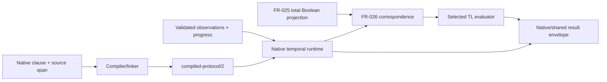

# Native temporal vertical-slice architecture

## System Boundary

This architecture refines AD-001 for native temporal obligations. It makes one
end-to-end subject out of an authored temporal clause, its exact meaning,
validated observations and any derived TL request without making any lower
representation a second authoring language.

Native Quire source remains the only editable formal-clause authority. The
compiler admits and links it; the observation provider establishes runtime
facts; Contract IR builds strict predicate/correspondence artifacts; a selected
TL implementation consumes only a supported derived request. An evaluator does
not deploy a monitor, execute business actions, infer an observation authority,
or certify a system.

## Views

The following views define the source-to-result path and the selections that
remain visible at each boundary.

### End-to-end contract

The arrows denote typed, versioned contracts, not in-process calls. Every
reader validates its own input and names the rejected semantic axis. No arrow
permits an ambient registry lookup, source-text reparsing, network action or
truth default.

| Boundary | Owner | Required selections | Failure behavior |
| --- | --- | --- | --- |
| Native source → linked temporal subject | A | source/span; language edition; temporal profile definition identity; typed predicates; anchor/scope/capture roles | located compiler refusal |
| Linked subject → `quire.compiled-protocol/2` | A | all subject identities plus tagged clock: `sequence_authority`, or `epoch`/`period`/`unit`, or `timestamp_unit` | strict `/2` refusal; `/1` stays readable but is not authenticated temporal input |
| Observation → runtime | F | semantic-event/correlation identity; causal order; payload; duplicate rule; completeness; progress/closure assertion | unavailable, incomplete or typed contradiction; never false padding |
| Native predicate → TL proposition | Contract IR #63 | exact checked predicate, result/availability contract, valuation and proposition-map identity | typed non-value; no numeric/nullable/pending coercion |
| Native subject → TL request | Contract IR #64 | profile/operator/interval; predicate map; anchor/capture; clock/history/progress/closure; formula/evaluator identities | unsupported/refused with no formula |
| Evaluation → result | runtime/shared result owner | execution, activation, truth, decision support, completeness, resource and supersession axes | closed non-Boolean disposition for an affected obligation; preserve settled siblings |

### Semantic admission

The compiler selects exactly one temporal profile and clock before evaluation.
The three v1 clock forms are structurally distinct:

- Event-position uses an authoritative sequence and makes no elapsed-time claim.
- Fixed-sample uses an exact epoch, positive rational period and unit; a missing
  required sample is incomplete, not a skipped event.
- Timestamped-event uses an exact timestamp unit, admitted order and explicit
  completeness assertion; timestamp or ingestion order alone establishes no
  causality.

`quire.compiled-protocol/2` is the only wire that may carry this admission
decision. `/1` is retained for strict backwards reading but cannot be
reinterpreted as a `/2` temporal subject. Missing, unknown, stale, digest-
mismatched or multiply selected fields refuse before a runtime or bridge call.

### Runtime and resource model

The runtime maintains a per-obligation state machine with independent axes for
activation, execution, temporal truth, observation completeness and provenance.
False guards create no obligation; an unestablished guard is incomplete/refused;
an identical duplicate receipt is idempotent while conflicting payload reuse is
a contradiction. Trigger captures are immutable for the obligation lifetime.

Future and past Boolean connectors are evaluated pointwise at each temporal
position. An open valid prefix may be pending; required present/past absence is
incomplete. A deadline settles from an identified inclusive progress assertion,
not EOF, quiet wall time or a later unrelated receipt. Past false extension
requires an authoritative origin; a merely visible suffix is missing history.

The complete-V1 temporal system additionally admits partial valuations,
uncertain clock intervals, revisioned out-of-order repair and an explicit
infinite-trace profile. A partial atom retains its possible truth set and reason;
it is never coerced to false. Interval arithmetic uses exact declared units and
widens the possible temporal result when ordering cannot be established. Repair
invalidates and recomputes only the affected suffix/window, retains superseded
results and links both revisions.

An infinite-trace property is a checked native subject distinct from a bounded
monitor formula. Finite-prefix execution may refute a safety property when it
has a valid finite counterexample, but it cannot establish infinite-trace
satisfaction. A selected sound analysis provider returns proved, refuted,
inconclusive, unsupported or failed with premises and lineage. The support table
below describes the currently implemented TL bridge, not the complete language
scope.

All externally supplied sizes, counts, interval bounds and conversions are
checked. The runtime reserves bounded work and retained state before expansion.
Exhaustion, overflow, active-instance limits or required-state loss produce a
typed non-Boolean result with the relevant limit identity. They cannot shorten
a semantic window, silently evict a live obligation, or erase independently
settled sibling results.

### Native-to-TL support table

| Native request | Current target | Result |
| --- | --- | --- |
| Event-position false-extension bounded future, closed complete execution | `mltl.closed-trace/v1` | supported only under an exact reviewed correspondence |
| Event-position false-extension bounded future, open prefix | `mltl.online-prefix/v1` | supported only with complete correspondence and non-final result treatment |
| Fixed-sample false-extension bounded future | matching selected TL profile | supported only with exact epoch/period/unit and one valuation per sample |
| Timestamped finite-window | current TL profiles | unsupported: no event-index conversion is inferred |
| Any bounded past | current TL profiles | unsupported until a reviewed past-time target exists |
| Finite-window future | `mltl.closed-trace/v1` | unsupported: false extension changes semantics |

The discriminator is normative: on a one-position closed trace with `p=true`,
finite-window `always[0,1] p` is true while false-extension
`always[0,1] p` is false. Equal formula bytes or equal observed truth cannot
override this mismatch. All unmatched selections return a typed decision with
no substitute formula.

## Decisions

- Use domain newtypes for clause, profile, clock, event, capture, proposition,
  correspondence and result identities; do not exchange plain strings.
- Use closed versioned wire structs/enums and exhaustive matching at every
  reader; retain unknown/missing versions as refusals, not defaults.
- Use checked conversions and arithmetic at wire, persistence and horizon
  boundaries; never saturate semantic indices or durations.
- Canonically order emitted collections and reserve bounded capacity before
  materialization so equal validated inputs are reproducible.
- Keep bridge construction pure: no `unsafe`, evaluator invocation, callback,
  plugin, ambient registry or network access.

| Decision | Alternatives rejected | Consequence |
| --- | --- | --- |
| `/2` is required for temporal execution | infer a clock/profile from `/1` or a backend | Old documents remain readable; missing new meaning refuses. |
| Native source is the only authoring authority | editable TL/FRETish side language | Every lower representation is a derived, source-correspondent artifact. |
| Result axes remain independent | nullable Boolean or diagnostic-message parsing | Pending, incomplete, refusal, settled truth and resource loss cannot be conflated. |
| Correspondence is admitted by exact support table | approximate timestamp/future/past translation | Unsupported domains remain visible rather than yielding a plausible wrong verdict. |
| Infinite-trace meaning is native and provider-independent | Define unbounded meaning by one solver encoding | Providers prove correspondence and soundness; finite monitors cannot overclaim. |
| Partial valuations and clock intervals remain explicit | Default missing values or select interval midpoints | Uncertainty propagates soundly into multi-valued results. |

## Risks

| Risk | Control | Owner |
| --- | --- | --- |
| Profile/clock selection disappears at a wire boundary | `/2` strict reader and TC-110/TC-113 mutation cases | A |
| Progress, closure or duplicate semantics fabricate truth | identified observation assertions and TC-114 through TC-116 | F / runtime |
| TL formula equality masks different native semantics | false-extension discriminator and TC-117 differential corpus | Contract IR / TL |
| Bounded implementation silently loses required state | checked reservation, closed resource disposition and TC-118 fault injection | runtime |

## Acceptance and handoff

FS04 accepts this refinement after Task-001 ratification and the `/2` admission
seam. Observation owner contracts (Task-003) and predicate projection
(Task-004) are implemented. TL owner APIs are merged; qcir #71 retains exact
correspondence/result joining before the cross-repository Task-007 gate.
TC-110 through TC-118, TC-038 and TC-039 are the evidence inventory; no
implementation milestone may claim complete native temporal support before
Task-007 publishes the selected versions and outcomes.
