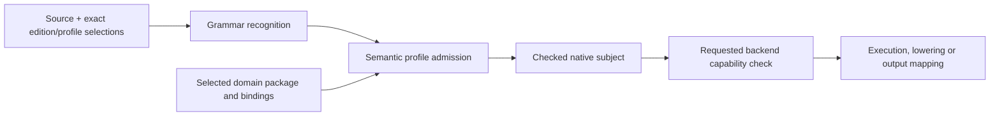

# Native Quire language charter and profile boundaries

## System Boundary

Quire is the product and language name. “Native Quire” distinguishes the sole
editable formal-clause language from generated mappings. `ix:native` is its
stable machine identity; it is not a display-name placeholder.

The language standard owns grammar, semantic profile definitions and their
composition rules. The compiler recognizes syntax, selects exact definitions,
checks and lowers admitted subjects. A backend advertises support for a requested
claim over an already checked subject. These three decisions are independent:
knowing a definition does not implement it, compiler admission does not imply a
backend, and a capable backend cannot admit source prohibited by its profile.

Native Quire is the only editable clause authority. A spec's artifacts declare
its domain model. The domain package lifted from them supplies typed
declarations, not another clause language. OCL 2.4, SysML v2,
FRETish and later external forms are output mappings with explicit preservation,
condition, loss or refusal results. TL representations and evaluators remain an
internal temporal boundary. No external mapping or IR is normative source.

The released `ix:native` / `0-draft` / `state-finite/0-draft` definition remains
an immutable historical profile. FS01 accepts and reserves the composed hierarchy
under `ix:native` / `1-draft`; the owning FS02–FS06 requirements still determine
when each semantic definition is accepted, implemented or qualified. The earlier
`state-finite/1-draft` replacement candidate is superseded as an adoption target.
Its carried-forward constraints survive in the composed state definitions; its
identity is neither enabled nor aliased to a composed profile.

## Views

The following views fix the selection pipeline, hierarchy, refusal taxonomy,
extension seams and retained acceptance examples.

### Selection and support stages

Each arrow preserves the exact definition, source and subject identities. A
failure stops only its dependent path and retains the originating location and
typed cause. No stage retries under an older edition, a wider profile or a more
capable backend.

### Accepted profile hierarchy

| Layer | Accepted identity boundary | Semantic ownership after FS01 |
| --- | --- | --- |
| Language edition | `ix:native` / `1-draft` | Shared grammar, package composition and evolution under FS01/FS05 |
| State core | `quire.state.core/v1` | Bounded scalar, presence/control and operation-anchor semantics under FS03 |
| State queries | `quire.state.queries/v1` requiring state core | Acyclic predicates and ordered duplicate-preserving queries under FS03 |
| State graph | `quire.state.graph/v1` requiring state queries | Finite typed universes, references, identity and reachability under FS02/FS03 |
| Complete value and expression system | `quire.value.complete/v1` requiring state core | Complete scalar, record, recursive-value, collection, function and equality semantics under AD-005 |
| Complete model system | `quire.model.complete/v1` requiring state graph and complete values | Conformance, redefinition, dispatch and systems-model structure under AD-006 |
| Complete timed-model system | `quire.temporal.complete/v1` requiring complete model | Time source, clocks, resets, clock constraints, time invariants and urgency of a state model under FR-415 |
| Temporal facet and roots | `quire.temporal.bounded-facet/v1` plus event-position, fixed-sample and timestamped-window roots | Clock/history/progress semantics under FS04; TL is a derived target |
| Infinite-trace temporal facet | `quire.temporal.infinite-trace/v1` | Unbounded property meaning and sound-provider contract under AD-002/009; its unbounded temporal operator grammar edition under AD-012; when it governs a refinement it requires `quire.value.complete/v1` and `quire.model.complete/v1` for the refinement's rows (FR-250), and a plain temporal clause requires neither |
| Protocol | `quire.protocol.complete/v1` | Static/dynamic choreography, compensation, conformance, projection, realizability, composition and refinement under AD-007 |
| Observation | `quire.observation.binding/v1`, `.progress/v1` and `.range/v1` | Correlation, completeness, progress and range authority under the observation owner |
| Runtime, method and backend facets | `quire.runtime.composed/v1`, `quire.verification.plan/v1`, `quire.contract-ir.complete/v1` | Execution, workflow, analysis and exact backend contracts under AD-008/009/010 |
| Package and diagnostics | `quire.package.composed/v1` and `quire.native.diagnostics/v1` | Exact composition and diagnostic interpretation under FS02/FS05 and the owning compiler interfaces |

Acceptance here fixes the identity roles and dependency direction. It does not
claim all profile implementations.

### Required diagnostic dispositions

| Input state | Required disposition | Required locus |
| --- | --- | --- |
| Ungrammatical or lexically invalid source | Invalid syntax; no semantic subject | Exact token or source span and expected syntactic category when available |
| Recognized form prohibited by the selected profile | `unsupported_construct`; no checked subject | Exact construct span, owning declaration and selected profile |
| Recognized form whose type, definedness, bound, anchor or model contract fails | Typed checking refusal; no Boolean result | Exact expression/declaration span plus typed domain, path, anchor or binding cause |
| Valid checked subject with an unsupported requested backend capability | `unsupported_projection`; retain the checked subject and emit no substitute result | Source correspondence plus requested claim, target and backend selection |
| Known profile semantics not implemented by the selected compiler/backend | Explicit unsupported/unimplemented capability; never fall back or approximate | Selected definition and source correspondence at the refusing stage |
| Missing observation, population closure or required history | Incomplete/unavailable input, distinct from false | Required role/scope and source-linked obligation; input/runtime path where the missing fact has no source span |
| Resource exhaustion or cancellation | Incomplete execution, distinct from invalid source and false | Originating stage, charged work item and effective limit/cancellation source |

The diagnostic catalog may refine these typed causes. It cannot merge
invalid, unsupported, unimplemented, incomplete and logically false outcomes.

### Extension points

| Extension point | Rule |
| --- | --- |
| Edition syntax | Add grammar only under a new exact edition definition; never steal a historical identifier or reinterpret old bytes. |
| Semantic profile | Add a definition and explicit dependency edges; a child may add named forms but cannot weaken inherited rules. |
| Model/type capability | Add an artifact feature, its extraction rule, its semantic IR member and its Quire meaning together under AD-006; downstream IR shape cannot invent authoring semantics. |
| Semantic family | Add a typed family AST/interface and package capability; do not flatten it into scalar truth or string dispatch. |
| Backend or analyzer | Advertise support for exact checked subjects and requested claims; unsupported requests preserve the source subject. |
| Output mapping | Version the mapping and report loss/correspondence per obligation; generated text remains non-authoritative. |
| Diagnostic interpretation | Version code/cause interpretation separately from language meaning and response wire layout. |

[AD-012](AD-012-unbounded-temporal-operator-grammar.md) is one instance of the
edition-syntax rule above: it accepts the unbounded temporal operator grammar
(no interval bound) as its own exact edition definition under the existing
`ix:native` / `1-draft` edition, admitted only under the selected
`quire.temporal.infinite-trace/v1` profile, without reinterpreting the
bracketed-interval productions or any `0-draft` bytes.

### Q1–Q11 disposition

| Question | Final FS01 disposition / owner |
| --- | --- |
| Q1 unbounded logic | No global decidability claim. The infinite-trace facet defines unbounded temporal properties and sound proved/refuted/inconclusive results; finite evidence alone cannot prove infinite satisfaction. |
| Q2 identity/name | Product/display name Quire, descriptive name native Quire, stable identity `ix:native`. |
| Q3 rejection depth | Lexical/syntax invalidity is distinct from recognized-but-unsupported source; both retain exact loci. |
| Q4 object environment | Explicit finite typed current/pre/post universes and identity-bearing references; FS02/FS03 own model intake from the domain package and its semantics. |
| Q5 collections | Sequence, set, bag and ordered-set semantics, explicit conversions, map/collect, flatten and fold/reduce are required in the complete value facet; the historical bounded profile remains unchanged. |
| Q6 subtyping | The complete model facet defines closed conformance/substitutability, subsetting, redefinition and dispatch; ambiguous or unavailable closure refuses. |
| Q7 fuel | Runtime work ceilings are distinct from semantic maxima; exhaustion is incomplete and cannot truncate meaning. |
| Q8 identity dimensions | Edition, semantic profile, artifact wire, canonicalization and backend identities remain independent. |
| Q9 temporal | Native temporal profiles own meaning; TL profiles are internal targets behind exact correspondence. FS04 and temporal owners close delivery. |
| Q10 crate layout | The current Rust package/module boundary remains implementation-owned; split only for an independent consumer interface. |
| Q11 ADR-0053 | Contract-IR PR #72 accepted native Quire-only source authority; external languages are mappings and the reference/bounds gate remains explicit. |

### Example discriminators

| Example | Distinctions that must survive |
| --- | --- |
| State / ConfigVersion | Parent ordering true versus false; a cycle; missing/unknown population closure; dangling/foreign reference; resource exhaustion; original minimum-only integer and recursive parent design gate versus the bounded 0..1000 worked corpus. |
| Timed refund | Matching versus wrong order/payment/refund identity; correct versus wrong amount; observed failure/timeout versus silence; untriggered compensation; missing progress/completeness; attempt, receipt, business effect and achieved recovery remain separate. |
| Verification portfolio | Exact source, model, definition, tool, harness and package identities; missing harness, unsupported method and failed execution cannot become a source-language pass or adequate evidence. |

## Decisions

| Choice | Rejected alternative | Consequence |
| --- | --- | --- |
| Accept one native Quire language charter and the composed profile hierarchy | Adopt the temporary `state-finite/1-draft` replacement or separate family languages | Historical bytes remain stable while state, temporal and protocol grow through explicit dependent facets. |
| Accept profile identity separately from semantic acceptance and implementation | Mark every PR #15 draft implemented or leave all identities ambiguous | Owners can build against stable roles without overstating delivery. |
| Fix exact rational, inheritance and pre-state rules in the composed definition set | Leave the old amendment's open questions attached to a dead candidate | `rational(n,d)`, normalization, nonzero/range proofs, child-profile monotonicity and eligible pre-state reads now have one drafted meaning for FS03 delivery. |
| Retain the original ConfigVersion reference/bounds gate | Invent a maximum, erase `parent`, or treat the bounded worked example as the original model | The original subject refuses until its spec artifacts declare the finite domain and the relationship explicitly. |
| Accept the PR #15 architecture boundary | Make an executable IR, TL form or backend the language | Normative language meaning remains independent of each consumer representation and support set. |

## Risks

| Risk / scenario | Required control | Owner / next work |
| --- | --- | --- |
| The superseded first-profile candidate is silently enabled | Frontends refuse its unavailable identity; no alias maps it to historical or composed profiles. | A; compiler inventory/evolution tests |
| A backend capability widens source admission | Admission completes before backend selection; unsupported source never reaches lowering as an admitted subject. | Compiler/backend owners |
| A model gap is repaired in the language by inference | Missing bounds, presence, relationships and closure refuse until the spec artifacts declare them. | A; FS02/FS03 |
| Cross-family work collapses distinct state/refund/portfolio evidence | Preserve the discriminators above in specifications, cases and result contracts. | A with family/result owners |
