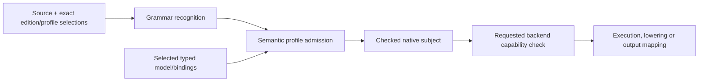

# Native Quire language charter and profile boundaries

## System Boundary

Quire is the product and language name. “Native Quire” distinguishes the sole
editable formal-clause language from generated mappings. `ix:native` is its
stable machine identity; it is not a display-name placeholder. A future public
brand change requires an explicitly versioned edition and FS05 migration. It
cannot reinterpret source, definitions, reports or evidence already bound to
`ix:native`.

The language standard owns grammar, semantic profile definitions and their
composition rules. The compiler recognizes syntax, selects exact definitions,
checks and lowers admitted subjects. A backend advertises support for a requested
claim over an already checked subject. These three decisions are independent:
knowing a definition does not implement it, compiler admission does not imply a
backend, and a capable backend cannot admit source prohibited by its profile.

Native Quire is the only editable clause authority. Shared model packages supply
typed declarations and bindings, not another clause language. OCL 2.4, SysML v2,
FRETish and later external forms are output mappings with explicit preservation,
condition, loss or refusal results. TL representations and evaluators remain an
internal temporal boundary. No external mapping or IR is normative source.

The released `ix:native` / `0-draft` / `state-finite/0-draft` definition remains
an immutable historical profile. FS01 accepts and reserves the composed hierarchy
under `ix:native` / `1-draft`; the owning FS02–FS06 requirements still determine
when each semantic definition is accepted, implemented or qualified. The earlier
`state-finite/1-draft` replacement candidate is superseded as an adoption target.
Its carried-forward constraints survive in the composed state definitions; its
identity is neither enabled nor aliased to a composed profile.

## Views

The following views fix the selection pipeline, hierarchy, current delivery
status, refusal taxonomy, extension seams and retained acceptance examples.

### Selection and support stages

Each arrow preserves the exact definition, source and subject identities. A
failure stops only its dependent path and retains the originating location and
typed cause. No stage retries under an older edition, a wider profile or a more
capable backend.

### Accepted profile hierarchy

| Layer | Accepted identity boundary | Semantic ownership after FS01 |
| --- | --- | --- |
| Language edition | `ix:native` / `1-draft` | Shared grammar, package composition and evolution under FS01/FS05 |
| State core | `quire.state.core/v1` | Bounded scalar, presence/control and operation-anchor semantics under FS03 |
| State queries | `quire.state.queries/v1` requiring state core | Acyclic predicates and ordered duplicate-preserving queries under FS03 |
| State graph | `quire.state.graph/v1` requiring state queries | Finite typed universes, references, identity and reachability under FS02/FS03 |
| Temporal facet and roots | `quire.temporal.bounded-facet/v1` plus event-position, fixed-sample and timestamped-window roots | Clock/history/progress semantics under FS04; TL is a derived target |
| Protocol | `quire.protocol.finite-global/v1` | Choreography, compensation and conformance semantics under the protocol owner |
| Observation | `quire.observation.binding/v1`, `.progress/v1` and `.range/v1` | Correlation, completeness, progress and range authority under the observation owner |
| Package and diagnostics | `quire.package.composed/v1` and `quire.native.diagnostics/v1` | Exact composition and diagnostic interpretation under FS02/FS05 and the owning compiler interfaces |

Acceptance here fixes the identity roles and dependency direction. It does not
freeze the current draft revision labels or claim all profile implementations.
An owning semantic ticket freezes its exact revision and digest when it accepts
that definition.

### Construct and delivery status

| Construct or family | Profile disposition | Merged implementation at FS01 close | Backend / Kani disposition |
| --- | --- | --- | --- |
| Edition/profile selection, Boolean expressions and bounded integers | Historical `state-finite/0-draft` remains admitted; composed equivalents belong to state core | Released in quire-spec-language `v0.2.0` for the bounded scalar slice | Boolean, integer and state-scalar oracle lowering is merged; broader proof is tracked separately |
| `present`, guarded `value`, short-circuit control, `let` and `if` | State-core meaning retains distinct absence, invalidity and Boolean result channels | Released bounded state-scalar behavior is partial evidence, not producer presence qualification | Unsupported distinctions refuse; no truthiness or null-to-false approximation |
| `rational(n,d)` and rational `/` | Recognized composed state-core form with exact normalization, positive denominator, authored component bounds and proved nonzero/range obligations | Source/runtime support remains unimplemented | Refuse until the selected frontend and backend implement the exact contract; integer `/`, `div`, `rem` and `mod` remain refused |
| Ordered sequences, `size`, `contains`, `forall`, `exists` | State core; authored maximum at most 10,000 per wrapper | Native finite-sequence admission/evaluation is merged | Broader backend proof remains tracked; bound or kind gaps refuse |
| Named predicates, `filter`, `map`, `count`, `sum` | State-query extension only; general or recursive functions remain refused | Native query admission/evaluation is merged | Backend support is per requested claim and cannot widen the profile |
| Object/reference identity, `deref` and positive-length `reaches` | State-graph extension only; no scalar cast, ambient lookup or recursive record expansion | Native finite-graph admission/evaluation is merged for explicit bounded universes | Object/graph/collection Kani remains qcir #69; unavailable closure or correspondence refuses |
| Bounded future/past temporal syntax | Temporal profiles only; exact clock/root selection required | Native syntax and compiled-package production are merged | TL lowering/evaluation is limited to exact reviewed correspondences; unmatched clocks/history/operators refuse |
| Finite choreography, compensation and protocol claims | Protocol profile only; business attempts, receipts, effects and recovery remain distinct | Native syntax and compiled-package production are merged | Consumer conformance remains protocol #14; no evaluator executes business actions |
| External OCL, SysML and FRETish forms | Output mappings only | Not source frontends | Each mapping reports preserved, conditional, unrepresented or refused meaning; no approximation |
| Unbounded logic, float, implicit numeric conversion, recursion, reflection, I/O and ambient stores | Not admitted by the selected v1 profiles | No implementation claim | Explicit located refusal; a wider IR or analyzer does not change admission |

### Required diagnostic dispositions

| Input state | Required disposition | Required locus |
| --- | --- | --- |
| Ungrammatical or lexically invalid source | Invalid syntax; no semantic subject | Exact token or source span and expected syntactic category when available |
| Recognized form prohibited by the selected profile | `unsupported_construct`; no checked subject | Exact construct span, owning declaration and selected profile |
| Recognized form whose type, definedness, bound, anchor or model contract fails | Typed checking refusal; no Boolean result | Exact expression/declaration span plus typed domain, path, anchor or binding cause |
| Valid checked subject with an unsupported requested backend capability | `unsupported_projection`; retain the checked subject and emit no substitute result | Source correspondence plus requested claim, target and backend selection |
| Known profile semantics not implemented by the selected compiler/backend | Explicit unsupported/unimplemented capability; never fall back or approximate | Selected definition and source correspondence at the refusing stage |
| Missing observation, population closure or required history | Incomplete/unavailable input, distinct from false | Required role/scope and source-linked obligation; input/runtime path where the missing fact has no source span |
| Resource exhaustion or cancellation | Incomplete execution, distinct from invalid source and false | Originating stage, charged work item and effective limit/cancellation source |

The versioned diagnostic catalog may refine these typed causes. It cannot merge
invalid, unsupported, unimplemented, incomplete and logically false outcomes.

### Extension points

| Extension point | Rule |
| --- | --- |
| Edition syntax | Add grammar only under a new exact edition definition; never steal a historical identifier or reinterpret old bytes. |
| Semantic profile | Add a versioned definition and explicit dependency edges; a child may add named forms but cannot weaken inherited rules. |
| Model/type capability | Extend the producer contract and native correspondence explicitly; downstream IR shape cannot invent authoring semantics. |
| Semantic family | Add a typed family AST/interface and package capability; do not flatten it into scalar truth or string dispatch. |
| Backend or analyzer | Advertise support for exact checked subjects and requested claims; unsupported requests preserve the source subject. |
| Output mapping | Version the mapping and report loss/correspondence per obligation; generated text remains non-authoritative. |
| Diagnostic interpretation | Version code/cause interpretation separately from language meaning and response wire layout. |

### Q1–Q12 disposition

| Question | Final FS01 disposition / owner |
| --- | --- |
| Q1 unbounded logic | No global decidability claim. Finite evaluation, finite search, validity and cost are separate; unbounded forms refuse in selected v1 profiles. FS03 owns state bounds. |
| Q2 identity/name | Product/display name Quire, descriptive name native Quire, stable identity `ix:native`; any later public rename uses FS05 migration. |
| Q3 rejection depth | Lexical/syntax invalidity is distinct from recognized-but-unsupported source; both retain exact loci. |
| Q4 object environment | Explicit finite typed current/pre/post universes and identity-bearing references; FS02/FS03 own producer correspondence and semantics. |
| Q5 collections | Ordered duplicate-preserving sequences and named bounded queries; set/bag/implicit flattening remain refused. FS03 owns semantics. |
| Q6 subtyping | Refused in selected v1 profiles; any extension needs explicit substitutability/cast rules and its own versioned profile. |
| Q7 fuel | Runtime work ceilings are distinct from semantic maxima; exhaustion is incomplete and cannot truncate meaning. |
| Q8 compatibility | Edition, semantic profile, artifact wire, canonicalization, backend and release versions remain independent; FS05 owns migration. |
| Q9 temporal | Native temporal profiles own meaning; TL profiles are internal targets behind exact correspondence. FS04 and temporal owners close delivery. |
| Q10 crate layout | The current Rust package/module boundary remains implementation-owned; split only for an independently versioned consumer interface. |
| Q11 ADR-0053 | Contract-IR PR #72 accepted native Quire-only source authority; external languages are mappings and the reference/bounds gate remains explicit. |
| Q12 tracking | QS #1 and this capability ledger are the plan of record; owning tickets and ledgers are updated immediately after merge. |

### Example discriminators

| Example | Distinctions that must survive |
| --- | --- |
| State / ConfigVersion | Parent ordering true versus false; a cycle; missing/unknown population closure; dangling/foreign reference; resource exhaustion; original minimum-only integer and recursive parent design gate versus the bounded 0..1000 worked corpus. |
| Timed refund | Matching versus wrong order/payment/refund identity; correct versus wrong amount; observed failure/timeout versus silence; untriggered compensation; missing progress/completeness; attempt, receipt, business effect and achieved recovery remain separate. |
| Verification portfolio | Exact source, model, definition, tool, harness and package identities; missing harness, stale package, unsupported method and failed execution cannot become a source-language pass or adequate evidence. |

## Decisions

| Choice | Rejected alternative | Consequence |
| --- | --- | --- |
| Accept one native Quire language charter and the composed profile hierarchy | Adopt the temporary `state-finite/1-draft` replacement or separate family languages | Historical bytes remain stable while state, temporal and protocol grow through explicit dependent facets. |
| Accept profile identity separately from semantic revision acceptance and implementation | Mark every PR #15 draft implemented or leave all identities ambiguous | Owners can build against stable roles without overstating delivery; each semantic ticket freezes its exact definition. |
| Fix exact rational, inheritance and pre-state rules in the composed definition set | Leave the old amendment's open questions attached to a dead candidate | `rational(n,d)`, normalization, nonzero/range proofs, child-profile monotonicity and eligible pre-state reads now have one drafted meaning for FS03 delivery. |
| Retain the original ConfigVersion reference/bounds gate | Invent a maximum, erase `parent`, or treat the bounded worked example as the original model | The original subject refuses until its producer/native finite-domain and relationship correspondence is explicit. |
| Accept the PR #15 architecture boundary | Make an executable IR, TL form or backend the language | Normative language meaning remains independent of each consumer representation and support set. |

## Risks

| Risk / scenario | Required control | Owner / next work |
| --- | --- | --- |
| Identity acceptance is mistaken for complete semantic adoption | Every definition and ledger keeps separate defined, implemented and qualified status. | A; FS02–FS06 |
| The superseded first-profile candidate is silently enabled | Frontends refuse its unavailable identity; no alias maps it to historical or composed profiles. | A; compiler inventory/evolution tests |
| A backend capability widens source admission | Admission completes before backend selection; unsupported source never reaches lowering as an admitted subject. | Compiler/backend owners |
| A producer gap is repaired in the language by inference | Missing bounds, presence, relationships and closure refuse until their producer contract supplies them. | D/A; FS02/FS03 |
| Cross-family work collapses distinct state/refund/portfolio evidence | Preserve the discriminators above in specifications, cases and result contracts. | A with family/result owners |
