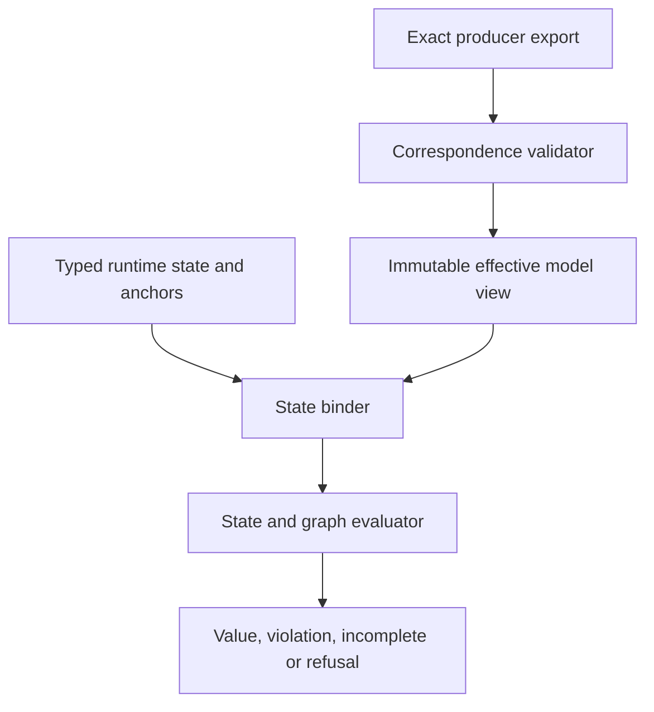

# Authoritative model, graph and state-contract architecture

## System Boundary

S3 owns Quire's read-only semantic view of an exact authoritative model export
and the runtime state environments bound to it. Filament remains the declaration
producer. QSL validates correspondence and supplies reference state/graph
semantics; it never edits producer resources or invents missing bounds,
relationships, specialization or closure.

## Views

The model view retains original and effective declaration identities,
normalization provenance, conformance/inheritance edges, subsetting,
redefinition, closed dispatch sets, parts, ports, interfaces, connections,
allocations, operations and relationships. Ambiguous precedence or dispatch
refuses at checking rather than selecting by source or registration order.

Runtime state is an explicit finite environment containing typed values,
qualified object identities, reference edges, population/membership identity
and named pre/current/post/result/capture anchors. Frames enumerate permitted
updates and created/deleted identities. Graph traversal declares roots,
relationships, direction, zero/positive-length policy, closure and work bounds.

## Decisions

| Choice | Rejected alternative | Consequence |
| --- | --- | --- |
| Preserve original and effective declarations | Replace originals after normalization | Diagnostics, migrations and evidence can trace both meanings. |
| Closed conformance and dispatch sets | Ambient runtime lookup | The same package resolves deterministically and missing closure refuses. |
| Explicit state anchors and frames | Infer state from map position or time | Pre/post/capture meaning survives lowering and replay. |
| Qualified object identity separate from records | Structural objects or opaque scalar references | Equality and graph reachability remain typed and authority-bound. |

## Risks

| Risk | Control |
| --- | --- |
| Producer and language disagree about effective structure | Versioned correspondence contract with exact export and definition digests. |
| Dynamic dispatch becomes open-world | Require the selected complete method set and report ambiguity or incompleteness. |
| Graph bounds are mistaken for semantic truncation | Exhaustion is incomplete; no cutoff returns false. |
