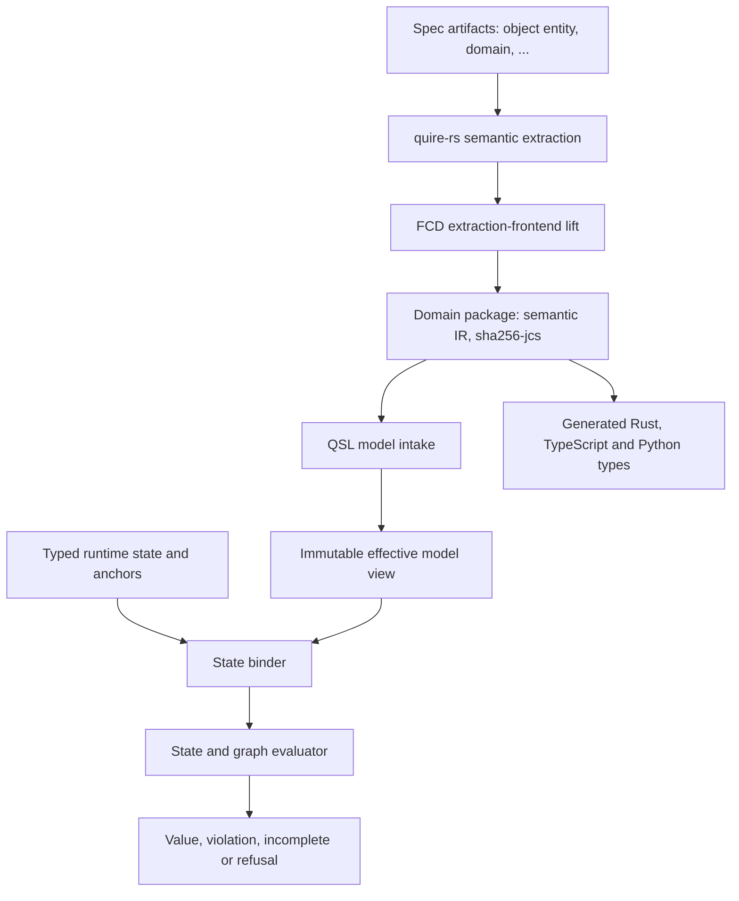

# Domain model declared in spec artifacts

## System Boundary

Quire is a typed formal specification language. A spec's domain model, such as
`Order`, `Customer` and their relationships and operations, is declared in the
spec's own artifacts. Quire reads those declarations, types them and checks
them. S3 owns that model view and the runtime state environments bound to it.

### Object types and instances

| Layer | Example | Defined where | Defined how often |
| --- | --- | --- | --- |
| Object type | `entity`, `domain`, `aggregate_root`, `value_object` | An FCD-based module (TypeSpec, manifest, skeleton) | Once, for every spec |
| Domain object | `Order`, `Customer` | One artifact in the spec, `object: entity` | Once per domain object |

- An object type fixes the shape of a document: its frontmatter, sections,
  table columns and fences.
- A domain object is an instance of an object type. Declaring `Customer` means
  authoring one `entity` artifact. No type, schema, TypeSpec or other record is
  written for it.
- FCD types documents and generates native Rust, TypeScript and Python types
  for both layers: artifact types and object types from their module, and
  domain objects from the domain package. Quire owns the meaning of the
  domain model the artifacts declare.

```markdown
---
id: entity-001
title: "Customer"
type: entity
object: entity
---
# [entity-001] Customer

## Properties

| Field | Type | Multiplicity | Constraints |
|---|---|---|---|
| customer_id | UUID | 1..1 | identity |
| email | String | 1..1 | minLength: 3 |
```

## Views



1. **Extraction.** `quire_rs::semantic::extract_semantic` reads each artifact
   under the module manifest's `semantic:` and `body_extraction` blocks. It
   yields field, relationship, operation and clause declarations with source
   spans. quire-rs is the only parser of spec artifacts.
2. **Lift.** FCD `extraction-frontend` lowers the extracted declarations of one
   spec package into a semantic IR document: the **domain package**. The
   lowering is deterministic, serialized with RFC 8785 and fingerprinted with
   `sha256-jcs`.
3. **Intake.** QSL admits a domain package by identity, version and digest
   and builds Quire model declarations from its IR nodes. It checks every model rule in
   this document. A domain package that fails a rule refuses with a located
   diagnostic that names the artifact and span.
4. **Consumers.** FCD code generation reads the same domain package and emits
   Rust, TypeScript and Python types. Those types and Quire's formal model
   therefore describe the same `Order`, which is what lets a proof over
   generated code cite a Quire clause.

## Model features

Each feature is declared in an artifact. It is carried by one extraction rule
in quire-rs, one member of the semantic IR and one manifest section in the
object type's module. Quire gives it meaning.

| Feature | Declared in the artifact | Semantic IR member | Quire meaning |
| --- | --- | --- | --- |
| Fields | `## Properties` rows: `Field`, `Type`, `Multiplicity`, `Constraints` | `TypeDefinition.fields[]` with `typeRef`, `multiplicity`, `presence` | Typed attributes with checked bounds |
| Presence | `Presence` column (`required`, `optional`) | `Field.presence` | Absent versus empty stay distinct |
| Identity and name | Artifact `id`; declared name (artifact title) | `TypeDefinition.identity` (artifact); `TypeDefinition.displayName` (declared name) | A declaration's identity is its artifact; its class name is the declared name that clauses use |
| Generalization | Frontmatter relationship `specializes` | `TypeDefinition.supertypes[]` | Acyclic conformance; closed subtype sets |
| Abstract types | Frontmatter `abstract: true` | `TypeDefinition.abstract` | No direct instances; dispatch covers concrete subtypes |
| Subsetting | `Subsets` column | `Field.subsets[]` | Values of the field are contained in the named supertype field |
| Redefinition | `Redefines` column | `Field.redefines` | Narrowed type or bounds; the target must exist on a supertype |
| Relationships | `## Relationships` rows with target and multiplicity | `TypeDefinition.relationships[]` with `multiplicity` | Typed reference edges with checked bounds |
| Operations | `## Operations` signature, `Requires:`, `Ensures:` | `Operation.params`, `returns`, `pre[]`, `post[]` | Typed contracts over pre and post anchors |
| Effect frames | `Modifies:`, `Creates:`, `Deletes:` lines under an operation | `Operation.frame` | Everything outside the frame is unchanged |
| Invariants | `## Invariants`, one `### <clauseId>` with one `quire` fence | `Clause` with `language: quire` | Checked and evaluated by Quire |
| Populations | `population` artifact listing member types and extent | Population node | Closed extents for quantification |
| Systems structure | `interface`, `part`, `port`, `connection`, `allocation` artifacts (spec-objects-architecture) | Corresponding IR kinds | Interfaces, parts, ports, connections and allocations resolved in the model view, interfaces first |

Clauses in any language other than `quire` are carried with their span and are
never evaluated or used as proof obligations.

## Language surface

- A Quire package imports a domain package by identity, version and
  `sha256-jcs` digest. The import is part of the package identity.
- Clauses name domain types by qualified name, for example `Orders::Order`.
- Native `record`, `enum` and `tuple` declarations remain the way to write value
  types that are not domain objects.

## Model view

The model view keeps original and effective declaration identities,
normalization provenance, conformance edges, subsetting, redefinition, closed
dispatch sets, parts, ports, connections, allocations, operations and
relationships. Ambiguous precedence or dispatch refuses at checking rather than
selecting by source or registration order.

An effective declaration is keyed by (domain package identity, IR node identity,
digest domain `sha256-jcs`). CheckedPackage `model_selections` name the domain
package. Runtime subject references in observation and protocol records use
these declaration keys.

Runtime state is an explicit finite environment of typed values, qualified
object identities, reference edges, population membership and named
pre/current/post/result/capture anchors. Frames enumerate permitted updates and
created or deleted identities. Graph traversal declares roots, relationships,
direction, zero or positive length, closure and work bounds.

## Decisions

| Decision | Why |
| --- | --- |
| The spec's artifacts declare the domain model | One authority. Reviewers, generators and the checker read the same text. |
| One artifact per domain object, typed by a module object type | Authors add a domain object without touching any type system. |
| quire-rs is the only artifact parser | One reading of the markdown. Extraction spans point at the real source. |
| The semantic IR domain package is the exchange form | Generated code and Quire's model share one fingerprinted shape. |
| Quire owns model semantics | Conformance, redefinition, dispatch, frames and populations are checked by the language that proves over them. |
| Keep original and effective declarations | Diagnostics and evidence trace both meanings. |
| Closed conformance and dispatch sets | The same package resolves deterministically; a missing closure refuses. |
| Explicit state anchors and frames | Pre, post and capture meaning survives lowering and replay. |
| Qualified object identity kept separate from records | Equality and reachability stay typed. |

## Risks

| Risk | Control |
| --- | --- |
| An artifact declares a feature its module manifest cannot extract | Extraction refuses with the artifact, section and span. No feature is inferred. |
| Generated types and the model view drift | Both read one domain package, pinned by `sha256-jcs` digest in the CheckedPackage. |
| Dynamic dispatch becomes open-world | Dispatch requires the closed subtype set and reports ambiguity or incompleteness. |
| Graph bounds are mistaken for semantic truncation | Exhaustion is incomplete; no cutoff returns false. |
