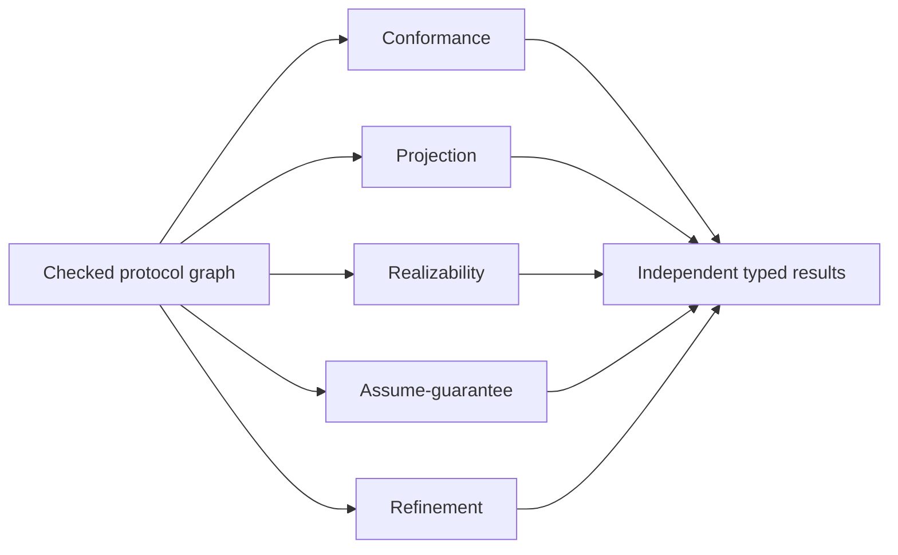

# Complete protocol and choreography architecture

## System Boundary

S5 owns immutable checked protocol graphs and pure conformance, projection,
realizability, assume-guarantee and refinement analyses. QSL owns source
checking; `quire-protocol` owns the portable graph, runtime and analyzers.
External business effects are outside S5 and require S6 authorization.

## Views

The graph contains typed role definitions and dynamic instances, messages,
channels, delivery premises, queues, causal edges, sequence, owned choice,
parallel fork/join, loops, bounded dynamic spawn, state guards, temporal
obligations and compensation/recovery relations. Queue ordering, duplication,
capacity, overflow and symbolic bounds are explicit. Missing premises never
default to reliable or FIFO delivery.

Projection, realizability, composition and refinement are separate claims over
the same graph. Each publishes exact premises, selected analysis profile,
witness or counterexample, and conclusive/inconclusive/refused/failed outcome.
No analyzer weakens a graph or drops a branch to obtain success.

## Decisions

| Choice | Rejected alternative | Consequence |
| --- | --- | --- |
| Dynamic roles have authored population/lifetime contracts | Static-only V1 or unbounded ambient spawn | Dynamic topology is V1 and finite execution requires discharged bounds. |
| Queue semantics are part of the graph | Treat transport as an informal premise | Ordering, capacity and overflow affect conformance explicitly. |
| Loops use invariants/variants plus resource contracts | Reject every non-literal loop or trust runtime fuel | Termination claims and execution exhaustion remain distinct. |
| Analyses remain independent typed claims | One protocol pass/fail flag | Counterexamples and non-conclusive outcomes preserve their actual meaning. |

## Risks

| Risk | Control |
| --- | --- |
| Receipts are mistaken for effects | Retain message, delivery, attempt, effect and compensation identities separately. |
| Choice visibility is asserted without evidence | Require explicit role-observation evidence before projection/realizability discharge. |
| Partial compensation is flattened | Closed lifecycle and orthogonal execution/truth/adequacy/closure axes in every result. |
