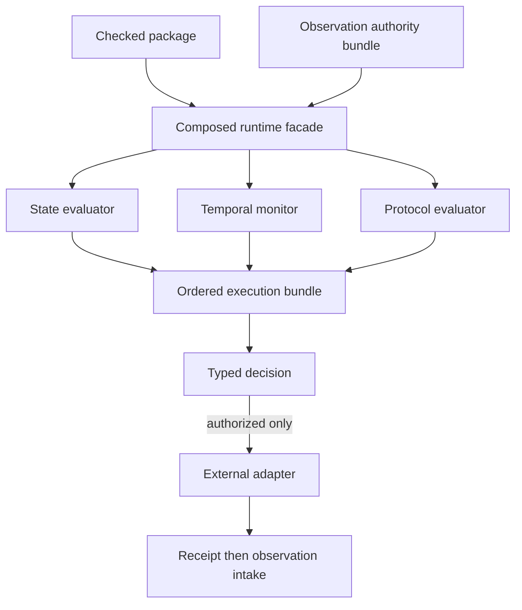

# Composed execution, monitoring and workflow architecture

## System Boundary

S6 is a Rust composition facade in the already-planned `quire-integration`
repository. It coordinates exact QSL, temporal, observation and protocol
interfaces without absorbing their semantics. `quire-contract-runtime` remains
a small generated-oracle helper and is not the composed application runtime.

S6 may issue a typed recommended decision. Only an explicitly authorized
adapter may request an external effect. The adapter uses a stable idempotency
identity and returns an attributed receipt; observations of the effect re-enter
through the observation authority boundary. Evaluators remain pure.

## Views

Replay and incremental monitoring preserve identical semantic subjects and
settled verdicts. Cross-workflow aggregates declare grouping keys, population
scope and duplicate policy. Simulation declares nondeterministic choices,
schedules, bounds and replay seeds. The reference corpus fixes exact packages,
inputs and expected multidimensional results for ConfigVersion, timed refund,
fan-out/join and compensation workflows.

## Decisions

| Choice | Rejected alternative | Consequence |
| --- | --- | --- |
| Composition in `quire-integration` | Put orchestration in QSL, Protocol or the oracle helper | Domain owners stay independent and the application boundary is explicit. |
| Pure evaluators and authorized adapters | Execute business actions from clauses | Formal results cannot silently cause external effects. |
| One ordered bundle without flattening | Convert all domain outcomes to Boolean | Per-domain truth, execution, adequacy and provenance survive composition. |

## Risks

| Risk | Control |
| --- | --- |
| Retry duplicates an external effect | Stable decision/idempotency identities and receipt reconciliation. |
| Replay differs from monitoring | Same immutable package and input identities and explicit repair/supersession tests. |
| Aggregate membership changes silently | Population and grouping identity in every result. |
