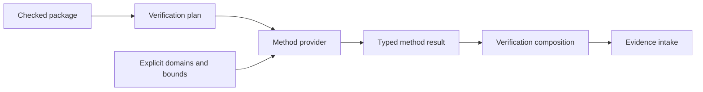

# Verification method and plan architecture

## System Boundary

S7 owns versioned verification plans and pure method-provider contracts for
model-based testing, relational and finite-trace-set hyperproperties,
continuous/hybrid analysis and bounded synthesis. `quire-verification` owns
planning and result composition; providers execute methods. A plan selects
methods but cannot widen language admission or relabel a provider outcome.

## Views

Plans name clauses, methods, assumptions, domains, bounds, dependencies,
required evidence and method providers. Model-based tests derive values from
model domains, use the native runtime as oracle, shrink while retaining domain
validity and serialize replay provenance. Relational and hyperproperty methods
bind multiple executions or trace sets explicitly. Hybrid providers declare
state/time models, solver contracts and soundness envelopes. Synthesis keeps
candidate discovery separate from proof of candidate correctness.

## Decisions

| Choice | Rejected alternative | Consequence |
| --- | --- | --- |
| Plans are linked artifacts outside the clause AST | Encode tools and commands in semantic clauses | Meaning remains stable while methods evolve. |
| Every method returns typed non-conclusive outcomes | Force pass/fail | Unknown, incomplete, unsupported and failed remain actionable. |
| Generated candidates are not proofs | Treat synthesis success as validation | A candidate needs an independent checking obligation. |

## Risks

| Risk | Control |
| --- | --- |
| Shrinking leaves the declared domain | Validate every candidate and retained counterexample against the same model domain. |
| Solver limitations become semantic failures | Provider capability and non-conclusive result are explicit. |
| Circular assume-guarantee reasoning | Plans and results expose dependency graphs and reject undischargeable cycles. |
