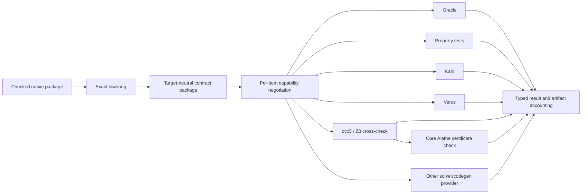

# Target-neutral semantic IR and exact backend architecture

## System Boundary

S8 owns the cycle-free target-neutral contract package and exact provider
protocol for oracle, property-test, Kani, solver and code-generation backends.
Native Quire remains semantic authority. The lowest `quire-contract-model`
package contains portable descriptors only; adapters, generators and runtimes
remain in their owning crates to preserve the acyclic dependency graph.

Backends register under one exact provider contract. Kani, cvc5 (with Z3 as
an independent cross-check) and Verus are its present registrants, each
discharging claims within its own advertised capability without a second
contract shape, and further solver or code-generation backends may register
the same way. cvc5 advertises unbounded quantification, induction,
composition and mathematical-integer capabilities; Verus emits
`requires`/`ensures`/loop-invariant clauses onto named implementation Rust
functions through the FR-353 abstraction relation. The qualified core's
Alethe checker is no registrant: it checks cvc5's Alethe proof certificates
against the queries the core encodes, giving a `proved` settlement its FR-331
certification `certified`, or `uncertified` when the certificate is absent
or cannot be verified (FR-354). A claim no registered backend can
discharge settles `unsupported` with a warning naming the required
capability.

## Views

IR nodes retain exact types, definitions, source occurrences, anchors,
identities and bounds. Capability negotiation happens at one point,
`quire-contract-codegen`'s `negotiate_*`
([AD-016](AD-016-semantic-family-extension-path.md)), which settles each item
before generation as exactly one of `supported`, `requires-bound`,
`unsupported` (warned, naming the required capability) or `invalid-request`,
over the capabilities registered backends advertise. Unsupported
constructs emit no approximating artifact. Generated artifacts name the tool
version and options they ran and account for every requested obligation.

Counterexamples use one canonical typed serialization, retain source and run
lineage, and replay through the QSL complete-V1 executor (FR-197, AD-016 arrow 7) under the
same package and input domain. Backend and runtime verdict disagreement is an explicit parity failure.

## Decisions

| Choice | Rejected alternative | Consequence |
| --- | --- | --- |
| Cycle-free model beneath full IR | Make codegen/runtime dependencies part of the model | All consumers can share contracts without dependency cycles. |
| Negotiate exact support per item before emission | Best-effort lowering | No proof can be claimed over approximated meaning. |
| Bounds derive from model domains | Backend-invented constants | Kani/property domains correspond to authored semantics. |
| One replayable counterexample envelope | Backend-specific opaque text | Every proof failure can be checked by the native runtime. |
| Settle unsupported with a capability-naming warning when no registered backend can discharge a claim | Hold delivery pending a new backend's registration | Solver absence never stalls admitted results; the claim-discharging registrant set (Kani, cvc5/Z3 and Verus) can grow independently of already-admitted claims, and the core's certificate-checking role composes with it without adding a second registrant shape. |
| A proved settlement records `certified` only when the core's Alethe checker verifies the cvc5 certificate for the exact query, otherwise `uncertified` | Treat every proved settlement as equally trusted | The trusted base is explicit per settlement; certificate absence never hides a weaker basis behind an unqualified `proved`. |

## Risks

| Risk | Control |
| --- | --- |
| Generated code silently omits a clause | Per-obligation accounting and package-level completeness rule. |
| Runtime and proof models diverge | Bounded corpus parity plus counterexample replay as qualification gates. |
| SMT encoding and native runtime disagree on meaning | Differential corpus parity check (FR-355) records every disagreement as an explicit failure. |
| An `uncertified` proof is mistaken for a checked one | The FR-331 `certification` is a required member of every `proved` result (FR-354). |
