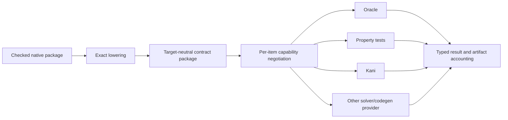

# Target-neutral semantic IR and exact backend architecture

## System Boundary

S8 owns the cycle-free target-neutral contract package and exact provider
protocol for oracle, property-test, Kani, solver and code-generation backends.
Native Quire remains semantic authority. The lowest `quire-contract-model`
package contains portable descriptors only; adapters, generators and runtimes
remain in their owning crates to preserve the acyclic dependency graph.

## Views

IR nodes retain exact types, definitions, source occurrences, anchors,
identities and bounds. A provider returns supported, requires-bound,
unsupported or invalid-request for each item before generation. Unsupported
constructs emit no approximating artifact. Generated artifacts record complete
toolchain/options pins and account for every requested obligation.

Counterexamples use one canonical typed serialization, retain source and run
lineage, and replay through `runtime::execute` under the same package and input
domain. Backend and runtime verdict disagreement is an explicit parity failure.

## Decisions

| Choice | Rejected alternative | Consequence |
| --- | --- | --- |
| Cycle-free model beneath full IR | Make codegen/runtime dependencies part of the model | All consumers can share contracts without dependency cycles. |
| Negotiate exact support per item before emission | Best-effort lowering | No proof can be claimed over approximated meaning. |
| Bounds derive from model domains | Backend-invented constants | Kani/property domains correspond to authored semantics. |
| One replayable counterexample envelope | Backend-specific opaque text | Every proof failure can be checked by the native runtime. |

## Risks

| Risk | Control |
| --- | --- |
| Generated code silently omits a clause | Per-obligation accounting and package-level completeness rule. |
| Backend version changes a verdict | Exact Rust/Kani/solver/options pins in run identity. |
| Runtime and proof models diverge | Bounded corpus parity plus counterexample replay as qualification gates. |
