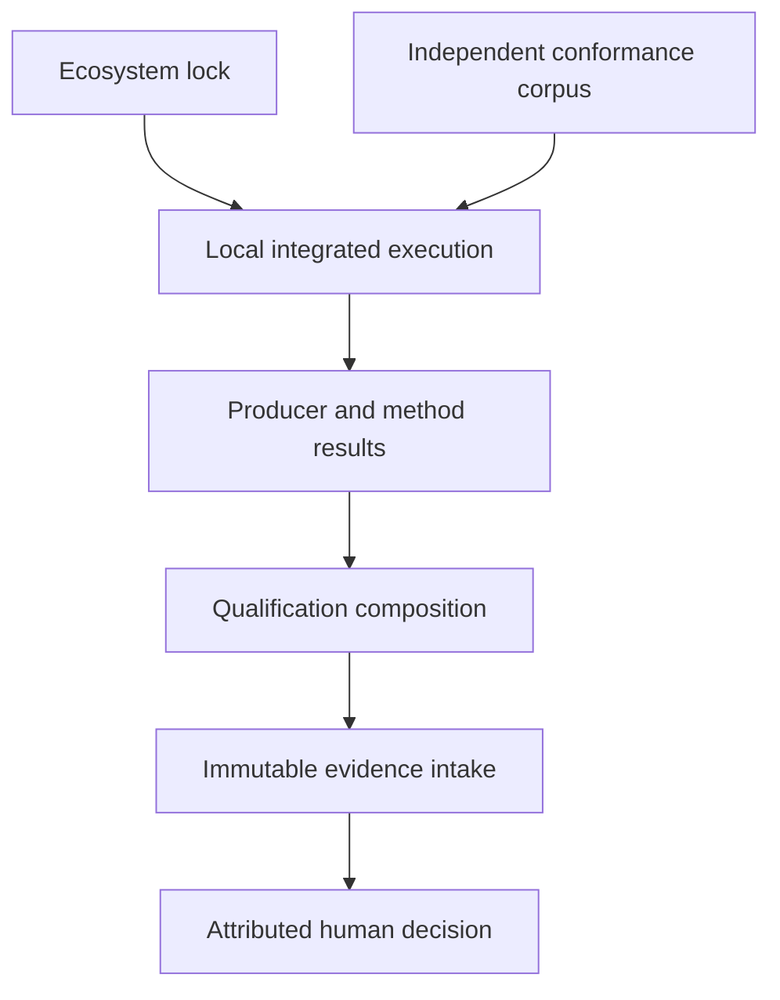

# Integration, evidence and qualification architecture

## System Boundary

S10 owns version-locked ecosystem configurations, independent conformance
corpora, result/evidence provenance and qualification profiles. Runtime and
method producers emit immutable structured results. Quoin retains evidence
through its Rust boundary when available but does not execute producers.
Only an attributed human or gated workflow record makes a release decision.

## Views

The ecosystem lock identifies repositories, packages, semantic definitions,
providers, tools, compiler/toolchain options and deployment selections in their
own identity domains. Each semantic subject links to requirements, assumptions,
methods and evidence without substituting one identity for another.

The feature corpus covers all 200 inventory rows, including positive, boundary
and explicit-refusal vectors. A qualification profile distinguishes language,
runtime, monitor, analyzer/backend and consuming-system claims. Partial evidence
cannot satisfy a broader profile. Counterexamples retain canonical inputs,
minimization lineage and native replay results.

## Decisions

| Choice | Rejected alternative | Consequence |
| --- | --- | --- |
| Exact ecosystem lock for every qualification run | Depend on moving default branches or ambient tools | Results are reproducible and attributable. |
| Independent corpus plus native/reference parity | Producer self-tests alone | Qualification detects shared assumptions and omitted capabilities. |
| Human decision is a separate artifact | Promote on score or proof automatically | Scope, rationale and supersession remain accountable. |

## Risks

| Risk | Control |
| --- | --- |
| Evidence from another subject is reused | Typed identity domains and exact requirement/assumption/method links. |
| Coverage appears complete while capabilities are absent | Inventory-derived 200-row matrix and refusal vectors. |
| Quoin coupling blocks producers | Stable Rust intake envelope; producers retain local artifacts until the port lands. |
