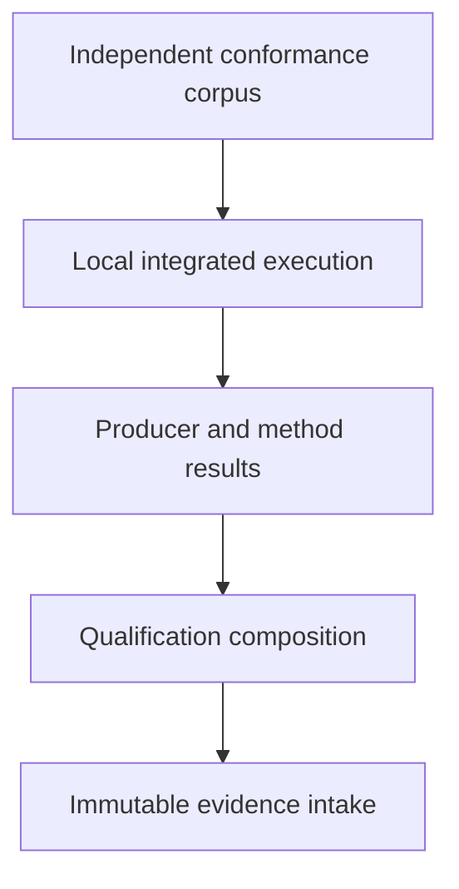

# Integration, evidence and qualification architecture

## System Boundary

S10 owns independent conformance corpora, result/evidence intake and
qualification profiles. Runtime and method producers emit immutable structured
results. Quoin retains evidence through its Rust boundary when available but
does not execute producers.

## Views

Each semantic subject links to requirements, assumptions,
methods and evidence without substituting one identity for another.

The feature corpus covers every inventory row, including positive, boundary
and explicit-refusal vectors. A qualification profile distinguishes language,
runtime, monitor, analyzer/backend and consuming-system claims. Partial evidence
cannot satisfy a broader profile. Counterexamples retain canonical inputs,
minimization lineage and native replay results.

## Decisions

| Choice | Rejected alternative | Consequence |
| --- | --- | --- |
| Independent corpus plus native/reference parity | Producer self-tests alone | Qualification detects shared assumptions and omitted capabilities. |

## Risks

| Risk | Control |
| --- | --- |
| Evidence from another subject is reused | Typed identity domains and exact requirement/assumption/method links. |
| Coverage appears complete while capabilities are absent | Inventory-derived matrix and refusal vectors. |
| Quoin coupling blocks producers | Stable Rust intake envelope; producers retain local artifacts until the port lands. |
