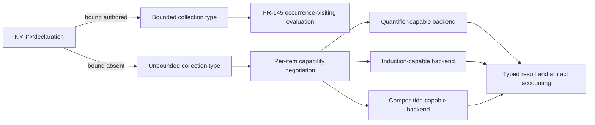

# Unbounded declaration and quantifier-negotiation architecture

## System Boundary

Extends S2's (AD-005) collection type algebra with an optional cardinality
bound and extends S7/S8's (AD-009, AD-010) per-item provider negotiation to
quantification, induction and compositional obligations that an unbounded
domain places outside occurrence-visiting evaluation. FR-144 owns the bound's
optionality and type-identity meaning; FR-346, FR-347 and FR-348 own the
negotiated obligations an unbounded or recursively-defined domain produces.

## Views

FR-144's cardinality bound is authored, never defaulted: an absent bound means
unbounded, and bound presence or absence is part of collection type identity,
so a bounded and an unbounded collection of the same kind and element type are
different types. A bounded collection is unaffected by this decision and
remains decided by FR-145's occurrence-visiting evaluation. An unbounded
collection, a recursive value domain, or a system decomposed into
independently verified components places its obligation outside direct
evaluation; that obligation is lowered as a target-neutral IR obligation per
AD-010 and negotiated per item with a registered backend that declares the
matching capability. No backend is privileged: Kani is one possible registrant
among quantifier-, induction- and composition-capable providers, never the
only one a claim may target.

## Decisions

| Choice | Rejected alternative | Consequence |
| --- | --- | --- |
| One rule: an absent FR-144 bound means unbounded, no compatibility layer | A parallel unbounded collection kind, or a migration/compat path for pre-existing bounded declarations | Every existing bounded declaration is unaffected; no reader or backend carries two bound conventions. |
| Bound presence is part of collection type identity | Treat a bound as a refinement that does not affect type identity | Equality and conversion between bounded and unbounded collections stay explicit through FR-145 `convert`, never implicit widening. |
| Unbounded quantification, induction and composition are negotiated per item with a registered backend | Refuse every unbounded claim outright, or silently approximate with a finite sample | A claim is proved, refuted or settles `unsupported` naming the missing capability; no claim is answered by an unsound finite check. |
| Generalize FR-171's proved-invariant/well-founded-variant admission path rather than invent a second termination mechanism | A separate, unrelated well-foundedness rule for induction | One well-founded-order vocabulary spans bounded iteration and inductive proof. |

## Risks

| Risk | Control |
| --- | --- |
| An unbounded claim is silently narrowed to a finite check and reported as proof | Per-item capability negotiation returns `unsupported` with a named capability rather than substituting a sample. |
| A bounded/unbounded sibling pair is confused as the same type by a consumer | Bound presence is part of FR-144 type identity; equality between them is `ill_typed`. |
| No backend registers a required capability at V1 launch | The absence path is a first-class, tested disposition (`unsupported` plus warning), not an unhandled error. |
