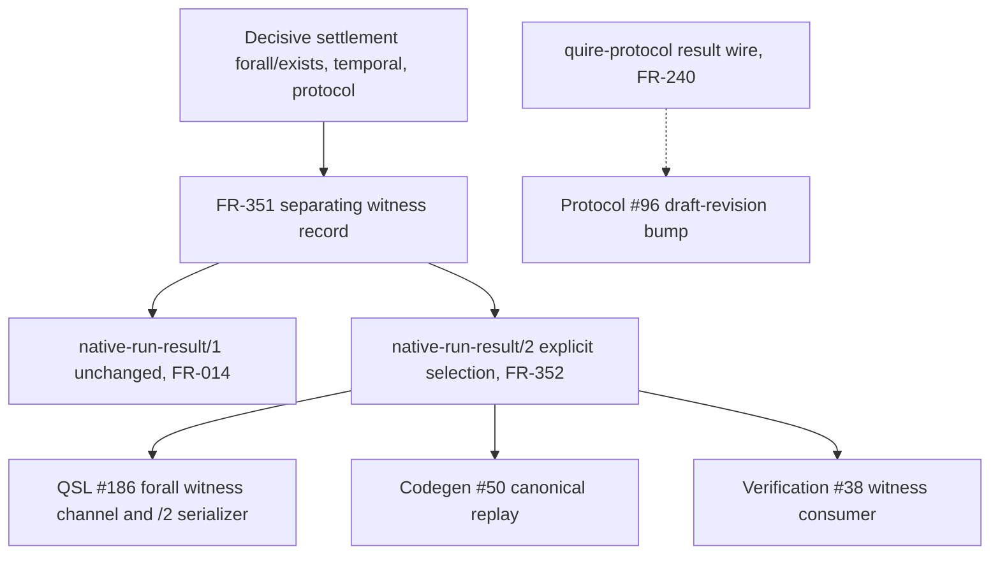

# Separating witness record and native-run-result/2 wire architecture

## System Boundary

FR-351 owns one family-neutral separating witness record shared by the
collection, temporal and protocol families' decisive settlements. FR-352 owns
minting `native-run-result/2` as a new, explicitly selected closed wire that
adds that record to the unchanged `native-run-result/1` wire FR-014 governs.
Neither artifact amends quire-protocol's own canonical result wire
(`quire.protocol.result/v1-draft.1`, FR-240); that wire's corresponding
draft-revision bump is a separate, owned change.

## Views

`native-run-result/1` retains every FR-014 member and refusal rule unchanged.
`native-run-result/2` is a distinct wire identifier, fixed by the producer at
production time and never inferred from payload content; it carries the
FR-351 record exactly when the settlement basis is `decisive-witness` or
`decisive-counterexample`. Each version's bytes are read only under that
version's own identifier.

## Decisions

| Choice | Rejected alternative | Consequence |
| --- | --- | --- |
| Mint `native-run-result/2` as an explicit, separately selected wire | Read an optional witness member on `/1` inferred from payload shape | `/1` evidence stays byte-for-byte immutable; a reader never infers a version from content. |
| One family-neutral separating witness record for collection, temporal and protocol | A per-family witness shape for `forall`/`exists`, temporal and protocol results | Every consumer that replays a counterexample (codegen, verification, protocol) replays one record shape. |
| Exhausted, cancelled and unsupported results stay witness-free | Emit a placeholder or best-effort witness for an incomplete or unsupported result | Matches AD-003's incomplete-execution and `unsupported_projection` dispositions; no substitute witness is invented. |

## Risks

| Risk | Control |
| --- | --- |
| A consumer infers `/2` from payload shape instead of an explicit selection | FR-352 requires an explicit production-time selection; an unselected or unrecognized version refuses under FR-014's unsupported-version rule. |
| A partial or foreign-shaped record is accepted as a witness | FR-351's one-axis-substitution refusal, extending FR-094-AC-7 to the witness axis. |
| quire-protocol's own result wire drifts out of step with this witness shape | Its draft-revision bump is owned separately by [agent-ix/quire-protocol#96](https://github.com/agent-ix/quire-protocol/issues/96), referenced here and not amended by this architecture. |
