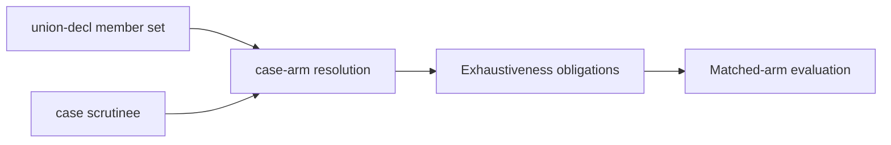

# Sum types and case-expression exhaustiveness

## System Boundary

This decision extends AD-005's complete value system with one closed sum-type
declaration and one matching expression: `union-decl` (FR-143) and the `case`
expression (FR-146). Their unproved exhaustiveness obligation is catalogued at
`quire.native.diagnostics/v1`. It does not introduce a new
value kind outside the record/tuple/union
composite family, a new declaration-identity scheme, or a new code family; a
union declaration identity is the same opaque I04 `composite_type` node key
already used for records and tuples, and an unproved `case` exhaustiveness
obligation is one new cause of the existing `undefined_expression` code.

`quire.value.complete/v1` admits unions and `case` wherever it admits records
and tuples, with no further selection (FR-143 "Value profile"). A union value
has an FR-144 canonical key, so it is admitted as a set, bag or ordered-set
element exactly when its payload types admit `=`. A `case` result type follows
FR-146 "Case result type". Union construction charges the existing
`composite.result-retain`, and arm selection makes no charge. In a checked
package, a union is a `composite_type`/`union` node, a construction a
`value`/`union_value` node and a `case` an `expression`/`case` node whose arms
lower in member declaration order (FR-440), and each member is keyed by the
`quire.union-member-node/v1` preimage (FR-441).

## Views

A `case` expression's arm set is checked against its scrutinee's declared
union in one fixed obligation order — `duplicate-arm`, `unknown-member`,
`arm-arity`, `missing-arm` — mirroring the fixed obligation order FR-146
already uses for a recursive component's `decreases` measure
(`missing-measure`, `measure-arity`, `measure-kind`, `nonnegative`,
`decrease`). Both report the first violated obligation as one cause with a
structured payload naming which obligation failed, rather than minting one
cause per obligation.

## Decisions

| Choice | Rejected alternative | Consequence |
| --- | --- | --- |
| Fresh keyword `union` for the sum-type declaration | Reusing `variant` | `variant` is already the loop-measure/proof-obligation keyword (shared-grammar.md); reusing it for a declaration would collide two unrelated grammar roles under one spelling. `sum` and `match`/`choice` were also rejected: `sum` already names the collection-aggregate intrinsic, and `match`/`choice` already name protocol choreography constructs. |
| Reusing the `case` keyword spelling for the new expression, syntactically distinguished from the existing protocol `choice`/`case` construct | Minting a second matching keyword (e.g. `switch`) | This grammar already reuses one spelling across unrelated syntactic contexts (`case`, `first`, `value`, `result`); a second matching keyword would break that established convention without adding distinguishing power the syntactic context does not already supply. |
| Union member payload positions are named edges, admitted only when they escape, exactly like record fields | A union-level escape rule admitting recursion once any one member is non-recursive | The named/escaping mechanism is already proved sound for records and tuples (FR-143's recursion rule); reusing it exactly keeps one recursion admission rule for every composite kind. The rejected alternative would need an independent soundness argument and would admit `Cons(Integer, List)` directly; the adopted rule instead requires `Cons(Integer, Option<List>)`, matching how `List { head: Integer; tail: List?; }` already requires `?` today. |
| Case exhaustiveness is one obligation sequence reported as one new `undefined_expression` cause (`unproved-exhaustiveness`) | A dedicated new code family for pattern-match coverage | FR-146's own `decreases`-measure obligations (`missing-measure`, `measure-arity`, `measure-kind`, `nonnegative`, `decrease`) already fold five distinct structural and proof failures into one cause (`unproved-decrease`) with a payload subfield naming the failed obligation; exhaustiveness follows the same, already-accepted shape instead of growing FR-271's closed code-family list. |
| Duplicate and unknown-member arms are exhaustiveness obligations, checked in the same ordered sequence as the missing-arm obligation | Splitting duplicate/unknown-member into `ill_typed` and reserving `undefined_expression` for missing arms only | The measure-obligation precedent (`missing-measure`, `measure-arity`, `measure-kind`, `nonnegative` are all structural, yet share `unproved-decrease`) already establishes that a purely structural check can share a proof-obligation's cause when it gates the same admission; one ordered sequence and one cause keep `case` admission a single obligation to discharge, consistent with that precedent. |

## Risks

| Risk | Control |
| --- | --- |
| A union recursion rule looser than records/tuples reopens an unbounded value | Reused the identical named/escaping admission graph and acyclicity check from FR-143, with no union-specific relaxation. |
| A new pattern-matching form silently duplicates the `if`/`else` totality argument instead of composing with it | `case` exhaustiveness is specified as its own obligation sequence, discharged before arm evaluation, alongside (not inside) the existing path-sensitive `if`/`else` totality contract. |
| Adding a cause without updating every extracting document leaves FR-271/FR-272 inconsistent with the canonical catalog | `unproved-exhaustiveness` is added in the same PR to the canonical `native-diagnostics.md` table and revision-4 paragraph, and to both FR-271 and FR-272's extracted mirrors. |

## Unrelated measure element

The cardinality element of a `decreases` measure (FR-146) has no source form
that strictly decreases it, so it can never discharge a `decrease` obligation.
It is independent of `union` and `case` and this decision does not change it.

## Status

Accepted design for the FR-143 `union-decl` and FR-146 `case` amendments.
