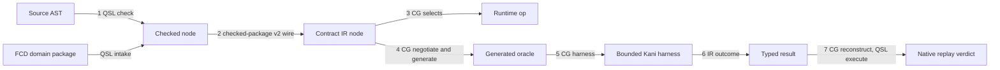
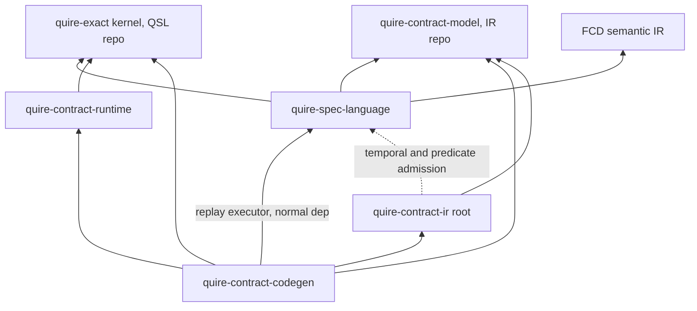

# Semantic-family extension path

## System Boundary

This architecture fixes, at the Rust-boundary level, how one semantic family
travels from native source to native counterexample replay. It refines
[AD-008](AD-008-composed-runtime-workflow.md) and
[AD-010](AD-010-target-neutral-ir-backends.md); it adds no language semantics
and no V1 scope.

| Short name | Repository | Role on the path |
| --- | --- | --- |
| QSL | `agent-ix/quire-spec-language` | Language authority: parse, check, domain-package intake, checked-package/v2 emission, native executor. Owns the `quire-exact` kernel crate (proposed; see Shared-type strategy). |
| IR | `agent-ix/quire-contract-ir` | Target-neutral Contract IR: v2 reader and lowering, `requires_bound`, typed Kani outcome, counterexample packet. |
| RT | `agent-ix/quire-contract-runtime` | `no_std` native runtime ops and host-callable function ABI. |
| CG | `agent-ix/quire-contract-codegen` | Capability negotiation, generated oracles, bounded Kani harnesses, replay reconstruction and parity. |
| FCD | `agent-ix/filament-core-data` | Domain-package producer (semantic IR bytes). |
| QI | `agent-ix/quire-integration` | Current-head integration workspace (`heads/`). |

Adding a semantic family means one edit per owning layer plus compiler-forced
mapping arms. No layer reinterprets another layer's semantics, and every
requested item reaches exactly one terminal disposition.

## Views

The pipeline view walks one semantic family across all seven arrows; the
sections after it fix each arrow's typed contract.

### Terminal-disposition rule

Every requested item ends in exactly one of `completed`, `refused(code)`,
`unsupported(code, warned)`, `requires_bound` or `incomplete(limit)`. CG's
`GenerationTerminalState` ledger is the single record of that disposition; a
ledger-completeness test fails when any requested item has zero or more than
one entry. A refused, unsupported or `requires_bound` item emits no substitute
artifact at any later arrow.

### Extension contract per arrow

Arrows 1–2 are QSL-owned. Arrows 3–7 are co-authored with Agent E; open
decisions are marked `OPEN — decided in WP<n>`, naming the work package that
resolves them.

#### Arrow 1: source AST → checked semantic node

| Field | Contract |
| --- | --- |
| Owner | QSL, crate `quire-spec-language`, module `value::expression` (`check.rs`); domain-package input from `model::intake`. The native `syntax`/`checking`/`lowering.rs` path is fixed at its three targets and admits no new families. |
| Typed in → out | `Expression` + admitted `DomainPackage` → `CheckedPackage` of checked `NodeKind` |
| Identity retained | QSL mints the checked node id (`quire.checked-semantic-node/v1`, FR-201) and `model::key::DeclarationKey{package,node}` (`sha256-jcs` digest domain) |
| Model / bound | `DomainPackageRef` (FR-321), `Extent{Closed,Open}`, `ValueType::Population(u64)`, `ValueTypeRef{Native(NativeValueType),Package(DeclarationKey)}` (see Domain-package intake boundary) |
| Refusal / unsupported / incomplete / failure | `Diagnostic{Code}` from the closed catalog (`native-diagnostics.md`). Language admission is independent of backend capability. Declaration forms outside the admitted set refuse as `unsupported_construct`/`declaration-form`. |
| Accounting | `quire.value.accounting/v1` `ChargePoint`/`Meter` from the `quire-exact` kernel |
| Source location | QSL is the only minter. `Span`/`LocatedSpan`/`SourceMap`, keyed by checked node id. FCD `Locus` maps to `LocatedSpan` in intake. |
| Capability point | Language admission only (QSL `Capability`, FR-290 six kinds). Records `capability_report`; negotiates nothing. |
| Canonical vectors / agreement | QSpec complete-value vectors, vendored by `xtask revendor` with `VENDOR.json` digests; `revendor-check` offline |
| Rejected item → substitute? | No. A package with an error diagnostic emits no checked package. |
| Replay input / parity | QSL complete-V1 value evaluation is the semantics arrow 7 executes |

#### Arrow 2: checked node → Contract IR node

| Field | Contract |
| --- | --- |
| Owner | Wire `quire.checked-package/v2` (QSpec I04 schema). Producer: QSL `checked_handoff` emitter. Consumer: IR `checked_package::v2::read` + `v2::lower` in `quire-contract-model`. |
| Typed in → out | `CheckedPackage` → v2 JSON bytes → `CheckedPackageV2` → IR node |
| Identity retained | Checked node id and `DeclarationKey`, as v2 wire strings; IR holds them as `CheckedNodeId`/`CheckedDomainPackageRef` and never re-derives them |
| Model / bound | v2 `bounded_domain` and `model_population` forms; the finite domain travels once, in this form |
| Refusal / unsupported / incomplete / failure | IR `CheckedPackageRefusalCode`, each mapped by one exhaustive `catalog_code()`. Unsupported families are carried in `capability_report`, not dropped. |
| Accounting | IR `CheckedPackageLimit` on the reader |
| Source location | `source_map` carried as `CheckedSourceMapEntry` by node id; never re-minted |
| Capability point | None. IR is not a second language authority; `capability_report` is data for arrow 4. |
| Canonical vectors / agreement | QSpec I04 vectors; QSL-emit ↔ IR-read round trip over I04 and function fixtures (heads workspace); wire string ↔ enum conversions total and mutation-tested |
| Rejected item → substitute? | No. A refused package yields no IR package. |
| Replay input / parity | The v2 `source_map` is arrow 7's node → span resolver input |

#### Arrow 3: IR node → native runtime operation

| Field | Contract |
| --- | --- |
| Owner | RT: `quire-exact` kernel ops plus host-call `Frame`/`Body` ABI (RT AD-002). CG selects the op per IR node. `OPEN — decided in WP5a/D-2 owner decision`: RT module path of the host ABI once the kernel is extracted. |
| Typed in → out | IR node → RT function or `Body = Box<dyn Fn(&Frame,&[Value])->Outcome<Value>>`. `OPEN — decided in WP8`: IR-node → RT-op selection table and its owning file. |
| Identity retained | Node id passed to `Frame`; package identity is an `AtomicUsize` counter, never address-based (see Function-application call state) |
| Model / bound | Typed bound passed in the call (`BoundedInteger`, `CardinalityBound`) |
| Refusal / unsupported / incomplete / failure | Kernel `Outcome{Completed,Undefined,Refused,Incomplete}`; a reentrant `Meter` borrow refuses via `try_borrow_mut` → `Refusal` |
| Accounting | Kernel `Meter`, passed explicitly |
| Source location | RT reports the location tag it is handed and populates `Evaluation.location`; it computes none |
| Capability point | RT exposes pure capability predicates (`negotiate_ieee`, `negotiate_integer_division`). `OPEN — decided in WP7 (closed Operator table + typed capability enum)`: full predicate list consumed by arrow 4. |
| Canonical vectors / agreement | Kernel vs QSpec vectors; RT `conformance/qsl-agreement` retargeted to shared kernel vs QSpec canonical vectors (see Shared-type strategy) |
| Rejected item → substitute? | No op is selected for an item arrow 4 did not settle `supported` |
| Replay input / parity | — |

#### Arrow 4: → generated oracle

| Field | Contract |
| --- | --- |
| Owner | CG `oracle`, `composite_equality`, `exact_scalar` |
| Typed in → out | IR package → Rust source + `oracle-source-map-v1` |
| Identity retained | Node id → location tag in generated bodies |
| Model / bound | From IR `bounded_domain`/`model_population` only |
| Refusal / unsupported / incomplete / failure | Exactly one `GenerationTerminalState` per requested obligation. `OPEN — decided in WP8`: `GenerationTerminalState` → disposition-set and catalog-code table. |
| Accounting | CG emits kernel charge calls. `OPEN — decided in WP8`: charge emission for function bodies. |
| Source location | CG tags; the source map is copied from arrow 2. `OPEN — decided in WP8`: `oracle-source-map-v1` ↔ v2 `source_map` relation and location-tag type; requires v2 `source_map` frozen in WP7. |
| Capability point | The single negotiation point: `negotiate_*` over IR forms → `supported`/`requires_bound`/`unsupported`/`invalid_request` |
| Canonical vectors / agreement | Generated oracle vs direct RT vs QSL reference (three-way) |
| Rejected item → substitute? | No oracle file; ledger entry only |
| Replay input / parity | — |

#### Arrow 5: → bounded Kani harness

| Field | Contract |
| --- | --- |
| Owner | CG `kani_obligations` (answers ADR-005's generation owner) |
| Typed in → out | Oracle + IR bounds → harness; `KaniObligationIdentity` with `arguments` (BTreeMap order) |
| Identity retained | Obligation id = clause node id |
| Model / bound | Harness bound = declared finite domain from IR `requires_bound` forms. `OPEN — decided in WP8`: `SemanticFamily::Function` bound representation. |
| Harness domain | The harness domain is a declared finite subset of the value type: Kani witnesses decode integers as 8-byte LE `i64`, while complete-V1 `Integer` is unbounded `BigInt` (RT `src/exact/integer.rs:20`). A `proved` result qualifies only over that declared subset; the subset (bound per argument) is part of the retained obligation identity and is reported with the result. Replay widens witness values into the complete-V1 value type losslessly. An unbounded domain with no declared bound is `requires_bound` (I13) and never narrowed implicitly. |
| Refusal / unsupported / incomplete / failure | `requires_bound` is a negotiation disposition, never an outcome (#129 Q4) |
| Accounting | `OPEN — decided in WP8`: harness-generation accounting owner |
| Source location | Inherited from arrow 4 tags |
| Capability point | Same point as arrow 4 |
| Canonical vectors / agreement | Harness goldens against the pinned Kani toolchain (see Kani tool pin table below). |
| Rejected item → substitute? | No harness for any item not settled `supported` |
| Replay input / parity | `KaniObligationIdentity.arguments` is the reconstruction schema for arrow 7 |

**Kani tool pin** (measured; source: CG `origin/main` `a4b2a73`, `tc_025` lane)

| Field | Value |
| --- | --- |
| `kaniVersion` | 0.67.0 |
| `cbmcVersion` | 6.8.0 (`cbmc-6.8.0`) |
| `rustToolchain` | `nightly-2025-11-21-x86_64-unknown-linux-gnu` |
| `targetTriple` | `x86_64-unknown-linux-gnu` |
| `launcherSha256` | `7f143a251d11c7e6e232bbf2cbccf56f9ce66a5f0107eeb3008698e6715f55d9` |
| `driverSha256` | `683f3ad1216e67686a39b2fcd6dc661f5090574f55fde9dd407966dca42cbfad` |
| Option set (in order) | `-Z function-contracts -Z concrete-playback --harness <symbol> --exact --unwind 4 --solver cadical --output-format regular --concrete-playback print` |
| Load-bearing note | The two `-Z` flags (`function-contracts`, `concrete-playback`) are unstable Kani features on a nightly toolchain, so this pin is load-bearing: changing any pinned field above is a recorded evidence-identity change. |

#### Arrow 6: → typed result

| Field | Contract |
| --- | --- |
| Owner | IR `KaniOutcomeKind` (target-neutral result), IR `src/kani` |
| Typed in → out | Kani run → `KaniOutcome`; on counterexample, `CounterexamplePacket{…, witness: Option<Witness>}` |
| Identity retained | Obligation id; harness symbol in `Witness.harness_symbol` |
| Model / bound | — |
| Refusal / unsupported / incomplete / failure | 10 `KaniOutcomeKind` kinds (see closed set below), each mapped to a catalog code where the code is emitted (CG replay PR). |
| Accounting | `CampaignCounts`, owned by RT (`src/accounting.rs`, base module, compiled unconditionally). |
| Source location | — (resolved at arrow 7) |
| Capability point | — |
| Canonical vectors / agreement | Seeded counterexample vector (see table under Arrow 7 below); further vectors land with CG replay PR (WP9). |
| Rejected item → substitute? | No packet without a counterexample; no placeholder witness (AD-014) |
| Replay input / parity | `CounterexamplePacket` is arrow 7's input |

**`KaniOutcomeKind` closed set** (declaration order, IR `src/kani/outcome.rs:8-29`)

| # | Kind |
| --- | --- |
| 1 | `Proved` |
| 2 | `Counterexample` |
| 3 | `Refused` |
| 4 | `InvalidInput` |
| 5 | `IncompleteInput` |
| 6 | `Unavailable` |
| 7 | `TimedOut` |
| 8 | `ResourceExhausted` |
| 9 | `Cancelled` |
| 10 | `Inconclusive` |

Catalog codes are defined where emitted (CG replay PR): every emitted
spelling has exactly one catalog row and every row is emittable, enforced by
a closure test on the IR `STD-003`/`TC-051` pattern.

#### Arrow 7: → native counterexample replay

| Field | Contract |
| --- | --- |
| Owner | Packet: IR. Reconstruction and parity comparator: CG replay adapter. Executor: QSL public complete-V1 entry (#129 Q14). |
| Authority | Q14 (QSpec #129) rules `ConfigVersion` replay onto the complete-V1 value runtime; this AD extends that ruling to Kani counterexample replay because the native-v1 path is fixed at its three targets and admits no new families, and function application exists only in the complete-V1 value runtime. IR `src/kani/replay.rs:80` currently calls native-v1 `runtime::execute`; WP9 moves it. **Decision pending owner acceptance with this AD.** |
| Typed in → out | `CounterexamplePacket` → `Witness::decode(&[WitnessBinding])` → QSL request → verdict. Executor entry (complete-V1 value runtime): `quire_spec_language::value::expression::CheckedPackage::call(&self, function: &str, arguments: Vec<Value>, objects: &ObjectEnvironment, meter: &mut Meter) -> Result<Evaluation, InputRefusal>` (src/value/expression/mod.rs). The native-v1 `runtime::execute` is not a replay target: native-v1 `ValueNode` (QSL `src/runtime/input.rs:94`) has no function variant, and `runtime::execute` is a state-observation model, not a function-call evaluator. |
| Identity retained | Obligation id, node id; `WitnessBinding`s derive from `KaniObligationIdentity.arguments` |
| Model / bound | Same finite domain as the harness |
| Refusal / unsupported / incomplete / failure | `decode` refuses on cover/arity/width/comment mismatch. Backend/native disagreement = `inconclusive` + typed cause; never repaired. |
| Accounting | Replay charges reported. `OPEN — decided in WP9`: carrier field in the parity result — IR PR #139's `ReplayAgreement`/`NativeReplayAgreement` gains a field distinguishing reproduced-with-evaluated-witness from reproduced-without-witness; WP9 extends that shape. |
| Source location | Replay resolves node id → nested span through the arrow-2 `source_map` |
| Capability point | — |
| Canonical vectors / agreement | `native-run-result/2` (FR-352) with the FR-351 separating witness record. Seeded counterexample vector (see table below); further vectors land with CG replay PR (WP9). |
| Rejected item → substitute? | No verdict is synthesized for a refused decode |
| Replay input / parity | Parity = identical verdict under the same package and input domain |

**Seeded counterexample vector** (canonical; CG replay PR lands further vectors in WP9)

| Field | Value |
| --- | --- |
| `obligationIdentitySha256` | `22ea5dc9297e696a8e7e9af8a1921403888c179aca9aa95a614cf94eab882d2b` |
| `harnessSha256` | `0d790018573893183738f63ae7bf4c0006ed9c0f7eefde4ca3c5a9a3768ec538` |
| `oracleDigest` | `3330ec9bcd3a211a90ce3230f97989ac7438dfb59d7291acb80287e8e0aef021` |
| `runtimeRevision` | `4e330525be513fe57c67717dc22b969d36656b85` |
| `unwind` | 4 |
| `solver` | `cadical` |
| `exitCode` | 1 |
| `concrete_vals` | `[[8,0,0,0,0,0,0,0],[224,3,0,0,0,0,0,0]]` (decoded 8, 992) |

### Replay ownership

| Role | Owner | Contract |
| --- | --- | --- |
| Packet | IR | `CounterexamplePacket.witness: Option<Witness>` |
| Witness shape | IR (IR PR #139, `src/kani/witness.rs`) | `Witness { harness_symbol, check, check_text, concrete_values: Vec<Vec<u8>>, transcript }`. `decode(&[WitnessBinding])` is the only typing step. |
| Reconstruction + parity comparator | CG replay adapter | Builds `WitnessBinding`s from `KaniObligationIdentity.arguments` |
| Native executor | QSL | Public complete-V1 entry |

Reconstruction is in CG for two reasons:

1. It resolves the conflicting assignments in IR AD-003 (replay adapters to CG) and CG AD-001:56-58 (counterexample → native input to QSL IT-010). Both are amended to cite this AD.
2. Kani 0.67.0 counterexamples are untyped `Vec<Vec<u8>>`: one entry per `kani::any()` in declaration order, `i64` as 8 bytes little-endian, decoded value only in a `//` comment. Typing them needs the generator's schema, `KaniObligationIdentity.arguments` (CG `src/kani_obligations.rs`), which lives in CG.

IR has no dependency on `quire_spec_language::runtime`.

### Witness allow-list

| Check kind | Playback result | Disposition |
| --- | --- | --- |
| `assertion` (falsified) | Concrete counterexample | Witnesses falsity — the only check kind that does |
| `cover` | Concrete playback | Refusal, never a counterexample |
| Unwinding assertion | Concrete playback | Refusal, never a counterexample |

### Shared-type strategy

The kernel row is a **proposal awaiting owner acceptance**. All other rows are
layer-owned with a total conversion.

| Concept | Shared / layer-owned | Owner | Total conversion and test |
| --- | --- | --- | --- |
| `Value`, `ValueType`, `Outcome`, `Refusal`, `BoundViolation`, `CardinalityBound`, `BoundedInteger`, `NodeKey`, `Origin`/`Location`, `ChargePoint`, `Meter`, `Incomplete` | **Shared (proposed)**: one `no_std` + `alloc` kernel, exactly RT `exact`'s closed list, MSRV 1.75 | `quire-exact` in QSL repo (`crates/quire-exact`); consumers QSL, RT, CG, footprint build | Kernel vs QSpec value/node-identity vectors. RT `conformance/qsl-agreement` is kept and retargeted to shared kernel vs QSpec canonical vectors. |
| Semantic identities: `DeclarationKey`, checked node id | Layer-owned | QSL `model::key` | Wire strings in v2; QSL emit ↔ IR `CheckedNodeId`/`CheckedDomainPackageRef` round trip on I04 and TC-195 vectors |
| Source locations | Layer-owned; QSL sole minter | QSL `SourceMap`/`LocatedSpan`; IR `CheckedSourceMapEntry`; RT reports kernel `Location` | FCD `Locus` → `LocatedSpan` (intake); node id → span at replay; nested-span replay test |
| IR value type, `ClauseKind` (6), `ExecutionPoint`, `CheckedNodeTag`, `Operator` | Layer-owned (target-neutral) | IR `quire-contract-model` | Total `From` from checked forms; exhaustive; `cargo mutants` on mapping fns |
| RT observation `ClauseKind{…,Guard,Consequent}` | Layer-owned | RT | Total IR `ClauseKind` → RT observation kind, with test |
| Capability descriptions | Layer-owned: QSL `Capability` = language admission (FR-290, six kinds); IR closed obligation-capability enum parsed at the wire edge | QSL / IR | Wire string ↔ enum total test |
| Finite/unbounded bounds | Layer-owned | QSL `Extent`/`Population`; IR `bounded_domain`/`model_population` + single `requires_bound` predicate | v2 round trip; `requires_bound` table test |
| Outcomes and stable diagnostic codes | Codes shared by catalog (QSpec `native-diagnostics.md`); typed causes layer-owned | Each layer: one `fn catalog_code(&self) -> CatalogCode`, exhaustive | Totality test against the vendored catalog (heads workspace) |
| Domain-package and model references | Layer-owned | QSL `DomainPackageRef` (FR-321), `ModelRef` | Crosses to IR only as v2 wire strings |
| Accounting/work categories | Shared via kernel `ChargePoint` = `quire.value.accounting/v1` (#129 Q9); `CampaignCounts` layer-owned | `quire-exact` (`ChargePoint`); RT (`CampaignCounts`) | RT has two accounting modules: `ChargePoint` in `src/exact/accounting.rs` (kernel-bound, moves with D-2) and `CampaignCounts` in `src/accounting.rs` (stays in RT under any D-2 outcome). CG charge emission maps to kernel charge points. `OPEN — decided in WP5b`: RT charge agreement vs kernel `ChargePoint`. |
| FCD identities | Layer-owned | FCD | Translated only in QSL `model::intake`; FCD conformance fixtures → admitted `DeclarationKey` set |

Distinct types that share a name stay distinct: `state::CanonicalDigest` vs
IR `CanonicalDigest`, QSL `linking::DeclarationKey` vs `model::DeclarationKey`,
and the four `CheckedPackage` types.

### Crate graph

An arrow means "depends on".

| Boundary | Form | Justification |
| --- | --- | --- |
| Source syntax/parsing | QSL module | Single consumer |
| Semantic checking / checked package | QSL module; output is the v2 wire | IR consumes the wire, not QSL types |
| Domain-package intake | QSL module `model::intake` with frozen typed output | Single consumer |
| Target-neutral Contract IR | `quire-contract-model` | Consumers: IR root, CG, QSL |
| `no_std` execution kernel | `quire-exact` (proposed) | Consumers: QSL evaluator, RT host ABI, CG oracles, footprint build |
| Provider/oracle generation | CG | — |
| Kani adapter + replay | CG | Replay needs the generator's schema |
| Replay executor's QSL edge | Normal (not feature-gated) git dependency, CG `Cargo.toml:28` pinned to rev `21c507e` | Executor needs QSL's public complete-V1 entry unconditionally; the pinned rev is not current QSL `main`, and the heads workspace detects that drift |

The crate graph is acyclic. QSL has no dependency on RT. The dashed IR root →
QSL edge is outside this pipeline. CG → QSL is a normal (not feature-gated)
git dependency (CG `Cargo.toml:28`, rev `21c507e`, not current QSL `main`);
the heads workspace detects that drift.

### Domain-package intake boundary

| Item | Contract |
| --- | --- |
| Adapter | `QSL:src/model/intake.rs` is the only FCD ↔ QSL translation point |
| Typestate | `SemanticIrBytes` → FCD decide → `IntakeRecords` → admit (FR-154 table) → `DomainPackage` |
| Output types | `DomainPackageRef` (FR-321), `DeclarationKey`, `Extent`, `ValueType::Population(u64)`; FCD `Locus` → `LocatedSpan` |
| Native type reference | `enum ValueTypeRef { Native(NativeValueType), Package(DeclarationKey) }` |
| `NativeValueType` set | Follows QSpec grammar `type-ref`. `Boolean`, `Integer`, `Float32`, `Float64` take no parameters; `Integer` with inline min/max is `Int[lo,hi]`. `Rational`, `Decimal`, `Text` are admitted only when inline constraints carry every grammar parameter, else `unsupported_construct`/`declaration-form`. |
| Multiplicity | Always carries `ordered` and `unique`; both `false` when upper ≤ 1 |
| Unresolved native refs | Refused; FCD emits native refs before intake |

### Function-application call state

| Point | Contract |
| --- | --- |
| ABI | RT AD-002 host-callable `Body`; RT is no second authority for function bodies |
| Location | `Frame` carries the location tag supplied by the generated body; `Evaluation.location` is populated |
| Meter | Explicit borrow; `Frame::meter` returns `Result` via `try_borrow_mut`; reentrancy test |
| Package identity | `AtomicUsize` counter, never address-based |

### Frames and unbounded constructs

| Construct | Disposition |
| --- | --- |
| Frame obligation | Arrows 2–5: `unsupported` (warned) with a catalog code until the v2 frame node exists. Runtime frame violations: `frame_violation`/`unauthorized-change` (#129 Q7). Subject ABI = set of `DeclarationKey` node identities; modification domains = modifies/creates/deletes. `OPEN — decided in WP10`: IR#109 v2 frame node shape. |
| Unbounded construct | IR `requires_bound` is the single predicate. CG negotiation maps it to `requires_bound` (finite bound available) or `unsupported` (warned, E07). Neither emits an oracle or harness. |

### Current-head integration

`quire-integration/heads/` is a separate Cargo workspace, outside QI's product
crate and qualified build.

| Part | Contract |
| --- | --- |
| `heads/heads.toml` | Checked manifest: repo → full SHA for QSL, IR, RT, CG, FCD, quire-rs, QSpec. `make heads-update` writes `origin/main` SHAs (optionally `--pr repo#n`). |
| `heads/Cargo.toml` | One member, `heads-check`; `[patch."<git url>"]` maps every pipeline crate to `.heads/` worktrees at the manifest SHAs, so every pinned rev of a source resolves to the one head |
| `make heads` | `git worktree add --detach` at manifest SHAs, refusing dirty or unmanifested trees; builds and tests `heads-check`; runs the checks below |

| # | Drift check | Detects |
| --- | --- | --- |
| 1 | QSL emits v2 for the I04 corpus; IR `read`+`lower` accept; clause/tag wire strings total both ways | QSL/IR vocabulary mismatch |
| 2 | FCD extraction-frontend on FCD conformance fixtures → QSL intake; `DeclarationKey` set and `Extent` equal expected | QSL/domain-package identity and population mismatch |
| 3 | CG compiles against RT head | Runtime/Codegen API gaps |
| 4 | Every `VENDOR.json`/`PROVENANCE*` file blob equals the source repo at its declared pin; pin ≤ manifest head; lag reported | Copied or stale vectors |
| 5 | RT footprint and Kani gate built with the union of consumer features (`exact`) | Missing feature flags |
| 6 | `cargo tree -d` empty for quire crates (one instance per package) | Downstream compiling against obsolete APIs |
| 7 | Every layer's `catalog_code()` total and inside the vendored catalog | Incompatible result/refusal mappings |

- Immutable release pins are unchanged: each repo's `Cargo.toml`/`Cargo.lock` keep exact revs, and `[patch]` lives only in `heads/Cargo.toml`.
- The heads workspace is never evidence or qualification input; AD-011 ecosystem locks remain the qualified mechanism.
- A green heads run precedes each per-repo pin-bump PR.
- Hosted CI in IR, RT and CG is `workflow_dispatch` only; cross-stage evidence runs on a dev machine with pinned `cargo-kani`. The heads workspace is the drift check.

### Change scenarios

Each table is the predicted touch set on the extension path. **All seven are
predictions, re-walked on landed code in WP11.**

#### 1. Add one exact semantic operator

| Kind | Changes |
| --- | --- |
| Files | QSL `value/expression/check.rs`, `evaluate.rs`, v2 emitter arm; `quire-exact` op; IR `Operator` table row; CG one `render` arm (no `_` arm) |
| Crates | `quire-spec-language`, `quire-exact`, `quire-contract-model`, `quire-contract-codegen` |
| Repos | QSL, IR, CG (+ QSpec vector) |
| Conversions | Checked node → v2 tag; IR `Operator` ↔ wire name (table row) |
| Tests | QSpec complete-value vector; heads round trip; CG three-way agreement; mutation test on mapping |

#### 2. Add one clause or execution-anchor kind

| Kind | Changes |
| --- | --- |
| Files | QSL checked clause kind / `Anchor`; IR `ClauseKind`/`ExecutionPoint`; RT observation kind; CG `obligation_kind` |
| Crates | `quire-spec-language`, `quire-contract-model`, `quire-contract-runtime`, `quire-contract-codegen` |
| Repos | QSL, IR, RT, CG |
| Conversions | QSL → IR (total); IR → RT observation (total); IR → CG obligation (exhaustive) — all compiler-forced |
| Tests | Wire-string totality; three mapping tests; mutation |

#### 3. Change an identity representation

| Kind | Changes |
| --- | --- |
| Files | `quire-exact` `NodeKey` or QSL `model/key.rs`; QSpec vectors re-vendored |
| Crates | `quire-exact` or `quire-spec-language` |
| Repos | QSL, QSpec; downstream pin bumps after a green heads run |
| Conversions | `DeclarationKey` wire round trip |
| Tests | Tests read expected digests from vendored vectors; heads stale-vendor check |

#### 4. Add an unbounded construct that Kani refuses

| Kind | Changes |
| --- | --- |
| Files | QSL admission (`NativeModelProfile`); IR `requires_bound` table row |
| Crates | `quire-spec-language`, `quire-contract-model` |
| Repos | QSL, IR |
| Conversions | None new; CG negotiation maps the existing predicate |
| Tests | Ledger completeness; no oracle or harness emitted |

#### 5. Add a model-bound construct with a domain-package finite domain

| Kind | Changes |
| --- | --- |
| Files | FCD emitter; QSL `model/intake.rs` |
| Crates | FCD semantic IR / extraction-frontend; `quire-spec-language` |
| Repos | FCD, QSL; nothing downstream |
| Conversions | Bound travels once as v2 `model_population` |
| Tests | Heads FCD fixture → admitted `Extent`; v2 round trip |

#### 6. Produce and replay a counterexample with a nested source location

| Kind | Changes |
| --- | --- |
| Files | QSL source map only |
| Crates | `quire-spec-language` |
| Repos | QSL |
| Conversions | Node id → nested span at replay (existing) |
| Tests | Seeded counterexample replays with identical verdict and resolved nested span |

#### 7. Add a frame obligation with typed subject ABI and modification domain

| Kind | Changes |
| --- | --- |
| Files | Now: none beyond the `unsupported` catalog code. With the v2 frame node: IR frame node + CG frame harness. `OPEN — decided in WP10`: file list. |
| Crates | `quire-contract-model`, `quire-contract-codegen` |
| Repos | IR, CG |
| Conversions | `DeclarationKey` set → IR frame subject; modifies/creates/deletes domains |
| Tests | Typed `unsupported` ledger test now; frame harness goldens with the node |

## Decisions

| Choice | Consequence |
| --- | --- |
| One owner and typed contract per pipeline arrow | Every family follows the same seven arrows; no stage chooses its own refusal. |
| `quire.checked-package/v2` is the only QSL → IR seam | IR reads a wire, never QSL types; QSL's native lowering admits no new families. |
| CG `negotiate_*` is the single capability negotiation point | QSL admission stays language-only; IR stays target-neutral. |
| QSL is the sole source-location minter; spans travel by node id | RT reports, CG tags, replay resolves; no layer re-mints a span. |
| Replay: packet in IR, reconstruction in CG, executor in QSL | Reconstruction sits with the schema that types Kani's byte vectors. |
| Shared `quire-exact` kernel in the QSL repo (proposed, owner decision) | One value/outcome/accounting implementation; RT agreement suite checks it against QSpec vectors. |
| All other concepts layer-owned with one exhaustive `catalog_code()` per layer | Codes stay stable; typed causes stay local. |
| Current-head workspace in QI `heads/` | Drift is detected before pin bumps without touching release pins. |

## Risks

| Risk | Control |
| --- | --- |
| A layer silently drops or approximates an item | Ledger-completeness test; no substitute artifact after refusal. |
| Cross-repo drift goes unseen (hosted CI is dispatch-only) | `make heads` drift checks precede every pin bump. |
| Kernel extraction weakens independent cross-checking | Agreement suite retargeted to QSpec canonical vectors. |
| Mapping tables go partial | Exhaustive matches with no `_` arm; `cargo mutants` on mapping fns. |
| RT call state does not hold under function application | The call-state contract's four points; a failed reentrancy or location test reopens the call-state/identity boundary. |

## Exit criteria

| # | Directive exit criterion | Satisfied by |
| --- | --- | --- |
| 1 | Cross-repository AD accepted | WP2 (this AD `accepted`; repo-local ADs amended) |
| 2 | One owner and typed contract per boundary | WP2 (decision); WP6, WP7, WP9 (implemented) |
| 3 | Shared vs layer types decided with total conversion tests | WP2; WP5a, WP5b; WP6; WP7 |
| 4 | Cycle-free, consumer-justified crate graph | WP2; WP5b; WP9 |
| 5 | Current-head build detects drift without weakening pins | WP4 (WP3 partial) |
| 6 | Function application end to end with agreement evidence | WP6, WP8, WP9 |
| 7 | Frame and unbounded scenarios yield typed refusal/qualification | WP2 (decision); WP10 |
| 8 | Exemplar needs no unrelated central edits or copied vocabularies | WP5a, WP5b, WP7; verified in WP11 |
| 9 | No new V1 scope | WP1, WP2 |
| 10 | A08–A14 and E03–E07 mapped onto the path | WP11 |

Every `OPEN` cell whose home is D-2/WP5a/WP5b has a fallback owner if the
kernel proposal is not accepted: RT keeps `src/exact/` as the owner of those
types, and the cell is decided in WP8 against RT's module path instead.
