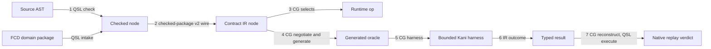
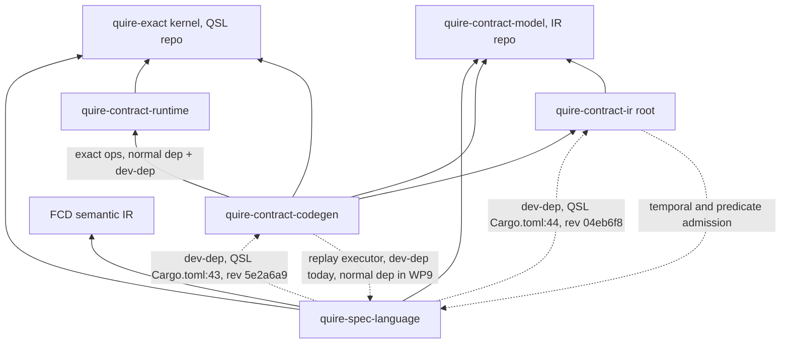

# Semantic-family extension path

## System Boundary

This architecture fixes, at the Rust-boundary level, how one semantic family
travels from native source to native counterexample replay. It refines
[AD-008](AD-008-composed-runtime-workflow.md) and
[AD-010](AD-010-target-neutral-ir-backends.md); it adds no language semantics
and no V1 scope.

| Short name | Repository | Role on the path |
| --- | --- | --- |
| QSL | `agent-ix/quire-spec-language` | Language authority: parse, check, domain-package intake, checked-package/v2 emission, native executor. Owns the `quire-exact` kernel crate (Owner decision 2; see Shared-type strategy). |
| IR | `agent-ix/quire-contract-ir` | Target-neutral Contract IR: v2 reader and lowering, `requires-bound`, typed Kani outcome. IR defines no counterexample packet, `Witness` or `ReplaySource` and names no QSL type. |
| RT | `agent-ix/quire-contract-runtime` | `no_std` native runtime ops and host-callable function ABI. |
| CG | `agent-ix/quire-contract-codegen` | Capability negotiation, generated oracles, bounded Kani harnesses, replay reconstruction and parity. |
| FCD | `agent-ix/filament-core-data` | Domain-package producer (semantic IR bytes). |
| QI | `agent-ix/quire-integration` | Cross-repository integration tests. |

Adding a semantic family means one edit per owning layer plus compiler-forced
mapping arms. No layer reinterprets another layer's semantics, and every
requested item reaches exactly one terminal disposition.

## Views

The pipeline view walks one semantic family across all seven arrows; the
sections after it fix each arrow's typed contract.

### Terminal-disposition rule

Every requested item ends in exactly one FR-331 terminal record. Negotiation
(CG `ObligationRecord.disposition`, one per `request_index`) settles
`supported`, `requires-bound`, `unsupported` (warned) or `invalid-request`. A
`supported` item then settles exactly one FR-331 result (`proved`, `refuted`,
`tested`, `inconclusive`, `incomplete`, `failed`) from IR `KaniOutcomeKind`
through one total IR-owned map. The FR-331 accounting record joins both on
`request_index`; a completeness test fails on zero or two records. Semantic
outcomes (`completed`, `undefined`, `refused`, `incomplete`, AD-005) are
evaluator results and are not dispositions. `GenerationTerminalState` is the
per-call Interface-001 state. A `requires-bound`, `unsupported` or
`invalid-request` item emits no substitute artifact at any later arrow.

### Extension contract per arrow

Arrows 1–2 are QSL-owned. Arrows 3–7 are co-authored with Agent E; open
decisions are marked `OPEN — decided in WP<n>`, naming the work package that
resolves them, or `OPEN — decided in QSL ADR-013 TK-<nn>` or
`OPEN — decided in QSL #<n>`, naming the QSL ADR-013 ticket or QSL issue that
resolves them. A ticket with an opened issue cites it, as in TK-04 (IR #144).

#### Arrow 1: source AST → checked semantic node

| Field | Contract |
| --- | --- |
| Owner | QSL, crate `quire-spec-language`, module `value::expression` (`check.rs`); domain-package input from `model::intake` (QSL #200). The native `syntax`/`checking`/`lowering.rs` path is fixed at its three targets and admits no new families. |
| Typed in → out | `Expression` + admitted `DomainPackage` → `CheckedPackage` of checked `NodeKind` |
| Identity retained | QSL mints the checked node id (`quire.checked-semantic-node/v1`, FR-201) at this step. QSL does not mint `DeclarationKey{package,node}` (`sha256-jcs` digest domain) here; that minting belongs to QSL ADR-013 O-03. The source map is keyed by occurrence key. |
| Model / bound | `DomainPackageRef` (FR-321), `Extent{Closed,Open}`, `ValueType::Population(u64)`, `ValueTypeRef{Native(NativeValueType),Package(DeclarationKey)}` (QSL #200; see Domain-package intake boundary) |
| Refusal / unsupported / incomplete / failure | `Diagnostic{Code}` from the closed catalog (`native-diagnostics.md`). Language admission is independent of backend capability. Declaration forms outside the admitted set refuse as `unsupported_construct`/`declaration-form`. |
| Accounting | `quire.value.accounting/v1` `ChargePoint`/`Meter` from the `quire-exact` kernel |
| Source location | QSL is the only minter. `Span`/`LocatedSpan`/`SourceMap`, keyed by occurrence key (`node_id`, `role`, `ordinal`; FR-322 `source_map`). FCD `Locus` maps to `LocatedSpan` in intake. |
| Capability point | Language admission only (QSL `Capability` takes its members from the FR-290 capability kinds; A08 #185 — QSL `main` has 4, `requests.rs:36`). Records `capability_report`; negotiates nothing. |
| Canonical vectors / agreement | QSpec complete-value vectors, read by reference from the `quire_specification` crate |
| Rejected item → substitute? | No. A package with an error diagnostic emits no checked package. |
| Replay input / parity | QSL complete-V1 value evaluation is the semantics arrow 7 executes |

#### Arrow 2: checked node → Contract IR node

| Field | Contract |
| --- | --- |
| Owner | Wire `quire.checked-package/v2` (QSpec I04 schema). Producer: QSL checked-package/v2 emitter (new in WP6; module path `OPEN — decided in WP6`, distinct from `protocol_artifact::checked_handoff`). Consumer: IR `CheckedPackageV2::read` (`v2/mod.rs:622`) + `CheckedPackageV2::lower` (`v2/lower.rs:135`) in `quire-contract-model`. |
| Typed in → out | `CheckedPackage` → v2 JSON bytes → `CheckedPackageV2` → IR node |
| Identity retained | Checked node id and `DeclarationKey`, as v2 wire strings; IR holds them as read-only `CheckedNodeId`/`CheckedDomainPackageRef` and never re-derives them |
| Model / bound | v2 `bounded_domain` and `model_population` forms; the finite domain travels once, in this form |
| Refusal / unsupported / incomplete / failure | IR `CheckedPackageRefusalCode`, each mapped by one exhaustive `catalog_code()`. Unsupported families are carried in `capability_report`, not dropped. |
| Accounting | IR `CheckedPackageLimit` on the reader |
| Source location | `source_map` carried as `CheckedSourceMapEntry` by occurrence key (`node_id`, `role`, `ordinal`), as minted by QSL; never re-minted |
| Capability point | None. IR is not a second language authority; `capability_report` is data for arrow 4. |
| Canonical vectors / agreement | QSpec I04 vectors; QSL-emit ↔ IR-read round trip over I04 and function fixtures (QI); wire string ↔ enum conversions total and mutation-tested |
| Rejected item → substitute? | No. A refused package yields no IR package. |
| Replay input / parity | The v2 `source_map` is arrow 7's occurrence-key → span resolver input |

#### Arrow 3: IR node → native runtime operation

| Field | Contract |
| --- | --- |
| Owner | RT: `quire-exact` kernel ops plus host-call `Frame`/`Body` ABI (RT AD-002). CG selects the op per IR node. `OPEN — decided in WP5a (Owner decision 2)`: RT module path of the host ABI once the kernel is extracted. |
| Typed in → out | IR node → RT function or `Body = Box<dyn Fn(&Frame,&[Value])->Outcome<Value>>`. `OPEN — decided in WP8`: IR-node → RT-op selection table and its owning file. |
| Identity retained | Node id passed to `Frame`; package identity is an `AtomicUsize` counter value independent of address (see Function-application call state) |
| Model / bound | Typed bound passed in the call (`BoundedInteger`, `CardinalityBound`) |
| Refusal / unsupported / incomplete / failure | Kernel `Outcome{Completed,Undefined,Refused,Incomplete}`; a reentrant `Meter` borrow refuses via `try_borrow_mut` → `Refusal` |
| Accounting | Kernel `Meter`, passed explicitly |
| Source location | RT reports the location tag it is handed and populates `Evaluation.location`; it computes none |
| Capability point | RT exposes pure capability predicates (`negotiate_ieee`, `negotiate_integer_division`). `OPEN — decided in WP7 (closed Operator table + typed capability enum)`: full predicate list consumed by arrow 4. |
| Canonical vectors / agreement | Kernel vs QSpec vectors; RT `conformance/qsl-agreement` retargeted to shared kernel vs QSpec canonical vectors (see Shared-type strategy) |
| Rejected item → substitute? | No op is selected for an item arrow 4 did not settle `supported` |
| Replay input / parity | None: arrow 3 selects a runtime op; it contributes no replay-reconstruction schema (that begins at arrow 5). |

#### Arrow 4: → generated oracle

| Field | Contract |
| --- | --- |
| Owner | CG `oracle`, `composite_equality`, `exact_scalar`. Generated oracles call RT `exact` operators directly (`src/exact_scalar.rs:1370`, `use quire_contract_runtime::exact as rt;`); under the kernel fallback rule (Shared-type strategy) these calls read as RT `src/exact/`. |
| Typed in → out | IR package → Rust source + `oracle-source-map-v1` |
| Identity retained | Node id → location tag in generated bodies |
| Model / bound | From IR `bounded_domain`/`model_population` only |
| Refusal / unsupported / incomplete / failure | Exactly one `ObligationRecord` per requested item. `OPEN — decided in WP8`: `GenerationTerminalState` → disposition-set and catalog-code table. |
| Accounting | CG emits kernel charge calls. `OPEN — decided in WP8`: charge emission for function bodies. |
| Source location | CG tags; the source map is copied from arrow 2. `OPEN — decided in WP8`: `oracle-source-map-v1` ↔ v2 `source_map` relation and location-tag type; requires v2 `source_map` frozen in WP7. |
| Capability point | The single negotiation point: `negotiate_*` over IR forms → `supported`/`requires-bound`/`unsupported`/`invalid_request` |
| Canonical vectors / agreement | Generated oracle vs direct RT vs QSL reference (three-way). For a proof of a `quire-exact` operation, or of an RT op that calls one, this three-way comparison is not an independent expectation, because the generated oracle calls `quire-exact` directly; the independent expectation is the QSpec operation vectors or a checked-in specification model that calls no `quire-exact` operation (QSL ADR-013 O-13; ADR-011 rule 8). |
| Rejected item → substitute? | No oracle file; ledger entry only |
| Replay input / parity | None: generated-oracle text is not consumed by replay; replay reconstruction begins at arrow 5's `KaniObligationIdentity`. |

#### Arrow 5: → bounded Kani harness

| Field | Contract |
| --- | --- |
| Owner | CG `kani_obligations` (Owner decision 4; answers ADR-005's generation owner) |
| Typed in → out | Oracle + IR bounds → harness; `KaniObligationIdentity.arguments: Vec<ObligationBinding>`, ascending by identifier |
| Identity retained | Obligation identity = the digest over exactly the members that the FR-201 `quire.ir-proof.obligation-identity/v1` domain lists: the subject node id, its occurrence key, the obligation kind and `arguments`. The other `KaniObligationIdentity` members (resource ceilings, embedded oracles, module, harness and contract symbols, subject path, results, solver, unwind and options) describe how the harness is generated and run and are outside the preimage, as is `source_span`. Clause node id, obligation kind and `arguments` are the members that tell apart the obligations of one clause: one clause yields one obligation per obligation kind it requests, so the clause node id alone never identifies an obligation. `source_span` is outside the preimage, because occurrence regions are excluded; the O-09 obligation identity includes the clause occurrence key — (`node_id`, `role`, `ordinal`), FR-322 `source_map` — because node ids are content-addressed and structurally identical nodes share one id (QC-8; QSL ADR-013 O-07). Its FR-201 digest domain is `quire.ir-proof.obligation-identity/v1`. |
| Model / bound | Harness bound = declared finite domain from IR `requires-bound` forms. `OPEN — decided in WP8`: `SemanticFamily::Function` bound representation. |
| Harness domain | The harness domain is a declared finite subset of the value type: Kani witnesses decode integers as 8-byte LE `i64`, while complete-V1 `Integer` is unbounded `BigInt` (RT `src/exact/integer.rs:20`). A `proved` result qualifies only over that declared subset; the subset (bound per argument) is part of the retained obligation identity and is reported with the result. Replay widens witness values into the complete-V1 value type losslessly. An unbounded domain with no declared bound is `requires-bound` (I13) and never narrowed implicitly. |
| Refusal / unsupported / incomplete / failure | `requires-bound` is a negotiation disposition (#129 Q4), never an outcome |
| Accounting | `OPEN — decided in WP8`: harness-generation accounting owner |
| Source location | Inherited from arrow 4 tags |
| Capability point | Same point as arrow 4 |
| Canonical vectors / agreement | Harness goldens. |
| Rejected item → substitute? | No harness for any item not settled `supported` |
| Replay input / parity | `KaniObligationIdentity.arguments` is the reconstruction schema for arrow 7 |

The harness runs with Kani's unstable `function-contracts` and
`concrete-playback` features; CG's own toolchain files select the Kani and
Rust versions.

#### Arrow 6: → typed result

| Field | Contract |
| --- | --- |
| Owner | IR `KaniOutcomeKind` (target-neutral result), IR `src/kani` |
| Typed in → out | Kani run → IR `KaniOutcome`; on counterexample, CG builds the packet as QSL `qsl-replay` `WitnessEnvelope{…, source: ReplaySource::Witness(Witness)}` over QSL's types (QSL FR-070; QSL ADR-013 O-25, QC-29; see Replay source) |
| Identity retained | Obligation identity, which includes the failing node's occurrence key (QC-8; see arrow 5); harness symbol derived from the transcript by `Witness::harness_symbol()` |
| Model / bound | The declared per-argument bound subset from arrow 5, carried in the `KaniOutcome` context; a `proved` result qualifies only over it. |
| Refusal / unsupported / incomplete / failure | 10 `KaniOutcomeKind` kinds, each mapped to one outcome category and one FR-331 terminal record by the closed-set table below. `OPEN — decided in WP9`: IR `KaniOutcomeKind` → catalog-code table, owned by IR `src/kani/outcome.rs` as one exhaustive `catalog_code()`; closure test on the IR `STD-003`/`TC-051` pattern. |
| Accounting | Kani run budget and use are reported in `KaniOutcome`'s profile/bound context (IR `src/kani`, `ResourceBounds` in `abi.rs:21`); no value-kernel charges occur at this arrow. `OPEN — decided in WP8`: Kani run-budget field. |
| Source location | None: resolved at arrow 7. |
| Capability point | None: no negotiation happens at this arrow; negotiation is settled at arrow 4. |
| Canonical vectors / agreement | Seed counterexample vector (see table under Arrow 7 below). IR owns the agreement vectors, as data only; further vectors land in WP9. The crossing behaviour test (backend counterexample → native replay → parity) lives in QSL, because the `replay` facade is the only component that composes CG output with replay. CG owns a TC for its own half: emitting the harness and the packet. A criterion whose test lives in another repo gets its own test-case row, marked as discharged by the test that repo owns, and never shares a row with a criterion whose test is local: IR FR-031-AC-4 (witness vocabulary) keeps TC-221, and IR FR-031-AC-3 (the crossing behaviour) has its own row, discharged by the QSL test. |
| Rejected item → substitute? | No packet without a counterexample; no placeholder witness (AD-014) |
| Replay input / parity | The `WitnessEnvelope` packet is arrow 7's input |

**`KaniOutcomeKind` closed set and WP9 category map** (declaration order, IR
`src/kani/outcome.rs:8-29`; categories are QSL ADR-013 O-16's proof column)

| # | Kind | Category | FR-331 terminal record |
| --- | --- | --- | --- |
| 1 | `Proved` | success | result `proved`, only when the obligation has one or more SUCCESS checks (see the vacuous-proof rule below) |
| 2 | `Counterexample` | violation | result `refuted` |
| 3 | `Refused` | refusal | one result with a typed refusal cause |
| 4 | `InvalidInput` | refusal | one result with a typed refusal cause |
| 5 | `IncompleteInput` | refusal | one result with a typed refusal cause |
| 6 | `Unavailable` | unsupported | one result with a typed unavailability cause |
| 7 | `TimedOut` | incomplete | result `incomplete`, cause kept |
| 8 | `ResourceExhausted` | incomplete | result `incomplete`, cause kept |
| 9 | `Cancelled` | incomplete | result `incomplete`, cause kept |
| 10 | `Inconclusive` | inconclusive | result `inconclusive` |

The map is IR-owned, total and has no `_` arm; one test per row. `OPEN — decided in QSL ADR-013 TK-06`: the FR-331 result value for the
refusal and unsupported rows (QC-9). A backend result `tested` is category success, keeps the value
`tested`, and never counts as proof evidence; only `proved` does. A replay
parity disagreement at arrow 7 is `inconclusive` with a typed cause. An IR
invariant that breaks while mapping yields result `failed`.

A Kani `Proved` run with zero SUCCESS checks in the obligation maps to kind 10
(`Inconclusive`) with the typed cause `kani_vacuous_proof`, never to kind 1
(`Proved`); this is not an eleventh kind (QSL ADR-013 FND-005, O-16
proof column, C-09).

`OPEN — decided in WP9`: IR `KaniOutcomeKind` → catalog-code table, owned by IR
`src/kani/outcome.rs` as one exhaustive `catalog_code()`; closure test on the
IR `STD-003`/`TC-051` pattern.

#### Arrow 7: → native counterexample replay

| Field | Contract |
| --- | --- |
| Owner | Packet: QSL `qsl-replay` `WitnessEnvelope` (QSL FR-070), built by CG over QSL's types (QSL ADR-013 O-25, QC-29). Reconstruction and parity comparator: CG replay adapter. Executor: QSL public complete-V1 entry (#129 Q14), reached only through the QSL layer-6 `replay` facade (QSL ADR-011 E9; QSL ADR-013 O-26, OQ-5). |
| Authority | Q14 (QSpec #129) rules `ConfigVersion` replay onto the complete-V1 value runtime; this AD extends that ruling to Kani counterexample replay because the native-v1 path is fixed at its three targets and admits no new families, and function application exists only in the complete-V1 value runtime. The packet type is QSL's `WitnessEnvelope`; IR holds no packet type, and the executor call lives in the CG replay adapter (WP9). IR TK-04 (IR #144) implements this contract. **(Owner decision 3.)** |
| Typed in → out | `WitnessEnvelope.source` → replay input (`Witness`: `Witness::decode(&[WitnessBinding])` of the transcript; `Input`: the stored canonical assignments) → QSL request → verdict. The `replay` facade selects the function by a typed `QualifiedName`, resolved against the declarations of the package it recompiles from digest-addressed source. The facade passes `CheckedPackage::call` the name of the declaration it has already resolved, so the R-06 lookup happens once. Executor entry (complete-V1 value runtime): `quire_spec_language::value::expression::CheckedPackage::call(&self, function: &str, arguments: Vec<Value>, objects: &ObjectEnvironment, meter: &mut Meter) -> Result<FamilyOutcome, CallFailure>` (src/value/expression/mod.rs; `FamilyOutcome` is the QSL ADR-011 #209 FND-008 S6a-stage result type and `InternalFault` is its cause type), where `CallFailure` is `{ Input(InputRefusal), Fault(InternalFault) }`; arguments are admitted before evaluation. The native-v1 `runtime::execute` is not a replay target: native-v1 `ValueNode` (QSL `src/runtime/input.rs:94`) has no function variant, and `runtime::execute` is a state-observation model, not a function-call evaluator. |
| Identity retained | Obligation identity (arrow 5), which includes the failing node's occurrence key rather than node id alone, because structurally identical nodes are content-addressed to one shared node id (QC-8); `WitnessBinding`s derive from `KaniObligationIdentity.arguments` |
| Model / bound | Same finite domain as the harness |
| Refusal / unsupported / incomplete / failure | `Witness::parse` refuses cover playback; `decode` refuses arity/width/comment mismatch. The `replay` facade returns each O-26 refusal before execution, including: a `QualifiedName` that resolves to no function; a recompiled `package_id` that differs; a source digest that differs; source bytes missing from the provision; `DependencyIdentityMismatch` (`stale_dependency`); an unknown version; an arity or type mismatch; a value outside the declared domain; a limit above the reader limit; an `Input` value with no parameter; and a parameter with no value. Each is category `refusal` with a typed cause and yields no verdict and no parity result (QSL ADR-013 O-26). Backend/native disagreement = `inconclusive` + typed cause; never repaired. `OPEN — decided in WP9`: the check that the harness symbol derived from the transcript equals the harness arrow 5 generated for the packet's obligation identity. |
| Accounting | Replay charges reported. Parity carrier (WP9): the packet's `ReplaySource` arm. A `Witness` replay yields a `reproduced-with-evaluated-witness` result and an `Input` replay yields a `reproduced-without-witness` result, as distinct result types (see Replay source). No result stores a witness-backed flag. |
| Source location | Replay resolves occurrence key → nested span through the arrow-2 `source_map` |
| Capability point | None: no negotiation happens at replay; negotiation is settled at arrow 4. |
| Canonical vectors / agreement | `native-run-result/2` (FR-352) with the FR-351 separating witness record. Seed counterexample vector (see table below). IR owns the agreement vectors, as data only; further vectors land in WP9. The crossing behaviour test (backend counterexample → native replay → parity) lives in QSL, because the `replay` facade is the only component that composes CG output with replay. CG owns a TC for its own half: emitting the harness and the packet. A criterion whose test lives in another repo gets its own test-case row, marked as discharged by the test that repo owns, and never shares a row with a criterion whose test is local: IR FR-031-AC-4 (witness vocabulary) keeps TC-221, and IR FR-031-AC-3 (the crossing behaviour) has its own row, discharged by the QSL test. |
| Rejected item → substitute? | No verdict is synthesized for a refused decode |
| Replay input / parity | Parity = identical verdict under the same package and input domain |

**Seed counterexample vector** (source: measured on the CG tc_025 lane, local
run; the `concrete_vals` also appear in IR tc_042; IR owns the full vector as
data)

| Field | Value |
| --- | --- |
| `obligationIdentitySha256` | `OPEN — decided in QSL ADR-013 TK-05`: regenerated under the arrow-5 obligation identity in the FR-201 `quire.ir-proof.obligation-identity/v1` domain (QC-4, QC-14) |
| `oracleDigest` | `3330ec9bcd3a211a90ce3230f97989ac7438dfb59d7291acb80287e8e0aef021` |
| `unwind` | 4 |
| `solver` | `cadical` |
| `exitCode` | 1 |
| `concrete_vals` | `[[8,0,0,0,0,0,0,0],[224,3,0,0,0,0,0,0]]` (decoded 8, 992) |

### Replay ownership

| Role | Owner | Contract |
| --- | --- | --- |
| Packet | QSL `qsl-replay` `WitnessEnvelope` (QSL FR-070), built by CG (QSL ADR-013 O-25, QC-29) | `WitnessEnvelope.source: ReplaySource { Witness(Witness), Input(values) }`. A packet holds exactly one arm, never both, and carries the failing node's occurrence key (QC-8; see arrow 5). Arrow 6 builds `Witness` packets. `OPEN — decided in WP9`: the component that builds `Input` packets. |
| Replay request | QSL (#231) | Carries the S1–S4 stage limits copied from the package's proving run; the replay recompile runs under exactly those limits (QC-8; QSL ADR-013 O-26). |
| Witness shape | QSL `qsl-replay` `Witness` (QSL FR-070; QSL ADR-013 OQ-H). IR's copy is deleted (QSL ADR-013 TK-04). | `Witness { transcript: String }`. `transcript` is the only field, and it is private. A `Witness` is admitted only through `Witness::parse`, including on deserialization; the stored transcript is the selected, trimmed assertion block, and `parse` refuses cover playback and a transcript with zero or several assertion blocks (QSL ADR-013 O-25). `harness_symbol()`, `check()`, `check_text()` and `concrete_values()` are fallible methods that re-derive their answer from `transcript` on every call. `decode(&[WitnessBinding])` is the only typing step and also reads `transcript`. |
| Reconstruction + parity comparator | CG replay adapter | Builds `WitnessBinding`s from `KaniObligationIdentity.arguments` |
| Native executor | QSL | Public complete-V1 entry `CheckedPackage::call`, reached only through the QSL layer-6 `replay` facade, which selects the function by a typed `QualifiedName` (arrow 7) |
| Replay result | QSL (#231) | One per-item replay result (QSL ADR-013 O-27) whose one member, `arm`, is a sum of two distinct arm types: the `Witness`-arm result and the `Input`-arm result. Each arm result holds exactly its arm's payload (`witness` or `input`), the native outcome (`native`) and a `settlement`: on agreement, `reproduced-with-evaluated-witness` for the `Witness` arm and `reproduced-without-witness` for the `Input` arm. |
| Backend-evidence verdict | CG parity comparator | One sealed type. Its only construction path takes an agreeing `Witness`-arm result. It has no public field and implements no `Deserialize`, `Default`, `From` or `TryFrom`. |

The transcript is the only stored state that carries meaning; every other value
is derived from it, so a witness cannot disagree with its own backend evidence.

A `Witness` is held only through `parse`, the step that establishes that it is a
Kani assertion playback block. The only way to hold the fact is the way that
establishes it, so a transcript that is not a playback block cannot be
represented. `ReplaySource` applies the same rule to witness-backing.

Reconstruction is in CG for two reasons:

1. It resolves the conflicting assignments in IR AD-003 (replay adapters to CG) and CG AD-001:56-58 (counterexample → native input to QSL IT-010). IR AD-003 and CG AD-001 cite this AD for reconstruction ownership.
2. Kani 0.67.0 counterexamples are untyped `Vec<Vec<u8>>`: one entry per `kani::any()` in declaration order, `i64` as 8 bytes little-endian, decoded value only in a `//` comment. Typing them needs the generator's schema, `KaniObligationIdentity.arguments` (CG `src/kani_obligations.rs`), which lives in CG.

IR has no dependency on QSL and names no QSL type. CG maps IR's `KaniOutcome` into QSL's `TerminalValue` (QSL ADR-013 C-09).

### Replay source

`ReplaySource` is the one record of where a replay's input comes from.

| Arm | Replay input | Agreement settles | Backend evidence |
| --- | --- | --- | --- |
| `Witness(Witness)` | `Witness::decode` of the transcript; no input is stored beside it | `reproduced-with-evaluated-witness` | Yes |
| `Input(values)` | Canonical assignments keyed by parameter `WireNodeId` (QSL ADR-013 C-11), for a counterexample that did not come from a backend transcript (a corpus counterexample) | `reproduced-without-witness` (WP9) | Never |

The arm is the fact. Whether a replay is witness-backed is a match on
`ReplaySource`; no packet or replay result stores it as a second field, so no
constructed value can hold two answers to one question. This is the rule the
Witness shape row applies: what carries meaning is stored once, and everything
else is derived from it. Each arm's result type holds that arm's payload and
never a `ReplaySource`, and a `native-run-result/2` record of an `Input` replay
decodes only into the `Input`-arm result type. Every counterexample has exactly
one arm: one with a backend transcript is `Witness`, and one that did not come
from a backend transcript is `Input`.

`reproduced-with-evaluated-witness` and `reproduced-without-witness` are parity
settlements under category success (QSL ADR-013 O-16), not new categories.

An `Input` replay reproduces an answer supplied with its input, so its
agreement cannot show that a backend counterexample reproduces natively. Type
structure carries the rule. The two arms yield distinct replay-result types, a
backend-evidence verdict is constructible only from the `Witness` arm,
and `reproduced-without-witness` cannot occupy any position that accepts a
backend-evidence verdict. A replay of either arm that disagrees with its
expected verdict settles `inconclusive` with a typed cause and builds no
verdict ([FR-197](../functional/ir-proof/FR-197-replay-backend-counterexamples.md)
AC-6 to AC-20).

### Witness allow-list

| Check kind | Playback result | Disposition |
| --- | --- | --- |
| `assertion` (falsified) | Concrete counterexample | Witnesses falsity — the only check kind that does |
| `cover` | Concrete playback | `Refusal`, never a counterexample |
| Unwinding assertion | Concrete playback | `Refusal`, never a counterexample |

### Shared-type strategy

The kernel row is **Owner decision 2**. All other rows are
layer-owned with a total conversion.

| Concept | Shared / layer-owned | Owner | Total conversion and test |
| --- | --- | --- | --- |
| `Value`, `ValueType`, `Outcome`, `Refusal`, `BoundViolation`, `CardinalityBound`, `BoundedInteger`, `NodeKey`, `EffectiveId`, `UniverseId`, `ObjectId`, `UnitId`, `VariantId`, `MemberId`, `Origin`/`Location`, `ChargePoint`, `Meter`, `Incomplete` | **Shared (Owner decision 2)**: one `no_std` + `alloc` kernel holding exactly the types listed in this row plus `Undefined` and the scalar/collection operations over them. Checked node ids are the kernel `NodeKey`; this row is their only listing. The `Value` component types are exactly `EffectiveId` (reference type), `UniverseId` and `ObjectId` (reference), `UnitId` (quantity), `VariantId` (enum and sum) and `MemberId` (record member): each is an opaque 32-byte digest newtype with one public constructor from a digest that QSL computes, and none depends on QSL `check` or `model`. `EffectiveId`'s FR-201 digest domain is `quire.model.effective-declaration/v2` (QSL ADR-013 QC-2), and only QSL `model` calls its constructor (QSL ADR-013 O-05; ADR-011 T-12). `OPEN — decided in QSL #213`: the FR-201 digest domain of `UniverseId`, `ObjectId`, `UnitId`, `VariantId` and `MemberId`, and whether ADR-011 T-12 limits their minting (S-2). RT `exact/expression.rs` (`Frame`, `Body`, `CheckedPackage`, `Evaluation`, `plan_call`) and the `negotiate_*` predicates stay in RT. | `quire-exact` in QSL repo (`crates/quire-exact`); consumers QSL, RT, CG, footprint build | Kernel vs QSpec value/node-identity vectors. RT `conformance/qsl-agreement` is kept and retargeted to shared kernel vs QSpec canonical vectors. `NodeKey` → v2 wire string → IR `CheckedNodeId` round trip on I04 vectors. |
| Semantic identity: `DeclarationKey` | Layer-owned | QSL `model::key` | Wire strings in v2; QSL emit ↔ IR `CheckedDomainPackageRef` round trip on I04 and TC-195 vectors |
| Source locations | Layer-owned; QSL sole minter | QSL `SourceMap`/`LocatedSpan`; IR `CheckedSourceMapEntry`; RT reports kernel `Location` | FCD `Locus` → `LocatedSpan` (intake); occurrence key → span at replay; nested-span replay test |
| IR value type, `ClauseKind` (6), `ExecutionPoint`, `CheckedNodeTag`, `Operator` | Layer-owned (target-neutral) | IR `quire-contract-model` | Total `From` from checked forms; exhaustive; `cargo mutants` on mapping fns |
| RT observation `ClauseKind{…,Guard,Consequent}` | Layer-owned | RT | Total IR `ClauseKind` → RT observation kind, with test |
| Capability descriptions | Layer-owned: QSL `Capability` = language admission (FR-290 capability kinds); IR closed obligation-capability enum parsed at the wire edge | QSL / IR | Wire string ↔ enum total test |
| Finite/unbounded bounds | Layer-owned | QSL `Extent`/`Population`; IR `bounded_domain`/`model_population` + single `requires-bound` predicate | v2 round trip; `requires-bound` table test |
| Outcomes and stable diagnostic codes | Codes shared by catalog (QSpec `native-diagnostics.md`); typed causes layer-owned | Each layer: one `fn catalog_code(&self) -> CatalogCode`, exhaustive | Totality test against the QSpec catalog |
| Domain-package and model references | Layer-owned | QSL `DomainPackageRef` (FR-321) | Crosses to IR only as v2 wire strings |
| Accounting/work categories | Shared via kernel `ChargePoint` (kernel type under D-2) = `quire.value.accounting/v1` (#129 Q9) | `quire-exact` (`ChargePoint`) | `ChargePoint` lives in RT `src/exact/accounting.rs` (kernel-bound, moves with D-2). CG charge emission maps to kernel charge points. `OPEN — decided in WP5b`: RT charge agreement vs kernel `ChargePoint`. |
| FCD identities | Layer-owned | FCD | Translated only in QSL `model::intake`; FCD conformance fixtures → admitted `DeclarationKey` set |

If the kernel proposal is not accepted, every cell naming `quire-exact` or
"kernel", decided or `OPEN`, reads as RT `src/exact/` (feature `exact`). QSL
`value` keeps its own implementation, cross-checked by RT
`conformance/qsl-agreement`. Scenario 1 then also touches RT. `OPEN` cells
homed in D-2/WP5a/WP5b are decided in WP8 against RT's module path.

Distinct types that share a name stay distinct: `state::CanonicalDigest` vs
IR `CanonicalDigest`, QSL `linking::DeclarationKey` vs `model::DeclarationKey`,
and the four `CheckedPackage` types.

### Crate graph

An arrow means "depends on".

| Boundary | Form | Justification |
| --- | --- | --- |
| Source syntax/parsing | QSL module | Single consumer |
| Semantic checking / checked package | QSL module; output is the v2 wire | IR consumes the wire, not QSL types |
| Domain-package intake | QSL module `model::intake` with frozen typed output | Single consumer |
| Target-neutral Contract IR | `quire-contract-model` | Consumers: IR root, CG, QSL |
| `no_std` execution kernel | `quire-exact` (Owner decision 2) | Consumers: QSL evaluator, RT host ABI, CG oracles, footprint build |
| Provider/oracle generation | CG | — |
| Kani adapter + replay | CG | Replay needs the generator's schema |
| Oracle-generation RT edge | Normal dependency with `features = ["exact"]`, CG `Cargo.toml:18`; plus a dev-dependency at `:27` with `["proptest","exact"]` | Generated oracles call RT `exact` operators directly (`src/exact_scalar.rs:1370`, `use quire_contract_runtime::exact as rt;`); under the kernel fallback rule these calls read as RT `src/exact/`. Because the oracle calls `quire-exact` directly, it is not an independent expectation for a proof of a `quire-exact` operation, or of an RT op that calls one (QSL ADR-013 O-13; ADR-011 rule 8). |
| Replay executor's QSL edge | Normal git dependency, added in WP9 (today CG `Cargo.toml:28` is a dev-dependency) | The executor needs QSL's public complete-V1 entry at run time. |

The crate graph is acyclic over normal dependencies. QSL has no normal
dependency on RT. The dashed IR root → QSL edge is outside this pipeline.
CG → QSL becomes a normal dependency in WP9. QSL's dev-dependency on CG is retired in WP9 (acceptance item),
removing the QSL -dev→ CG → QSL loop.

### Domain-package intake boundary

| Item | Contract |
| --- | --- |
| Adapter | `QSL:src/model/intake.rs` is the only FCD ↔ QSL translation point |
| Typestate | `SemanticIrBytes` → FCD decide → `IntakeRecords` → admit (FR-154 table) → `DomainPackage` |
| Output types | `DomainPackageRef` (FR-321), `DeclarationKey`, `Extent`, `ValueType::Population(u64)`; FCD `Locus` → `LocatedSpan` |
| Native type reference | `enum ValueTypeRef { Native(NativeValueType), Package(DeclarationKey) }` |
| `NativeValueType` set | The closed set `Boolean`, `Integer`, `Rational`, `Decimal`, `Float32`, `Float64`, `Text`, `String`, `UUID`, `Timestamp`, `Bytes`, `Duration`, `JsonObject`, named `ix://quire/native/<Name>` (FR-154); a `typeRef` carries no parameters, and a name outside the set is `invalid_model_binding`/`malformed-declaration`. |
| Multiplicity | Always carries `ordered` and `unique`; both `false` when upper ≤ 1 |
| Unresolved native refs | Refused; FCD emits native refs before intake |

### Function-application call state

| Point | Contract |
| --- | --- |
| ABI | RT AD-002 host-callable `Body`; RT is no second authority for function bodies |
| Location | `Frame` carries the location tag supplied by the generated body; `Evaluation.location` is populated |
| Meter | Explicit borrow; `Frame::meter` returns `Result` via `try_borrow_mut`; reentrancy test |
| Package identity | `AtomicUsize` counter value independent of address |

### Frames and unbounded constructs

| Construct | Disposition |
| --- | --- |
| Frame obligation | Capability kind FR-290 `operation-contract`. Arrows 3–5: `unsupported` (warned) with a catalog code until IR lowers the FR-340 `state`/`frame` node into its Kani form (IR#109). Arrow 2 already carries it. Runtime frame violations: `frame_violation`/`unauthorized-change` (#129 Q7). Subject ABI = the FR-340 `modifies`/`creates`/`deletes` sets of v2 node keys (`CheckedNodeId`) of `relation`/`model` nodes; each resolves to its `DeclarationKey` through the package's model correspondence. `OPEN — decided in WP10`: IR Kani frame lowering and CG frame-harness file list. |
| Unbounded construct | IR `requires-bound` is the single predicate. CG negotiation maps it to `requires-bound` (finite bound available) or `unsupported` (warned, E07). Neither emits an oracle or harness. |

### Union family

The union family follows the seven arrows like every other family. This table
fixes its per-repo owners and the contracts its kernel row needs.

| Field | Contract |
| --- | --- |
| Owner | QSL: `union-decl`, union construction and `case` checking (FR-143, FR-146), the checked-package/v2 emitter arms for the `composite_type`/`union`, `value`/`union_value` and `expression`/`case` nodes ([FR-440](../objects/interfaces/FR-440-checked-package-union-and-case-nodes.md)), and the `Value::Union` value, member-key derivation and `case` evaluation in the `quire-exact` kernel. QSpec: the union, union value and case wire forms (FR-440), the member key (FR-441) and the canonical vectors. quire-verification-contracts: the `union` family, the `quire.op.control.case` entry, the `arm_body` result form and the `union_arms` constraint kind in `quire.checked-operation-catalog/v1`. IR: reading and lowering the three node forms in `quire-contract-model`. RT and CG: selecting the kernel union operations and rendering `case`. |
| Value shape | A union value is its union's declaration key, its active member's [FR-441](../objects/interfaces/FR-441-union-member-key.md) member key (`quire.union-member-node/v1` over the union node's `NodeId` and the member identifier), and its payload values in position order, as many as the member's declared payload arity. A nullary member has no payload. A supplied union value carries the same three parts (FR-143). |
| Identity retained | The union node's checked node id (FR-201) and, derived from it, each member key; a checked package never carries a member key. Member keys of two unions, or a member key and an enum member key, are never equal. |
| Refusal / undefined | A supplied union value whose member key is no member of its union, whose payload count differs from the member's arity, or whose payload value has the wrong type refuses `invalid_runtime_input`/`wrong-value-kind` before any evaluation or charge (FR-143). A `case` whose scrutinee is undefined, refused or incomplete has that outcome, with no arm evaluated (FR-146). A `case` failing its type or exhaustiveness obligations refuses at check time with the first FR-146 refusal; the kernel never sees it. |
| Accounting | `quire.value.accounting/v1` charges from the kernel `Meter`. Construction charges one `composite.result-retain` after its payload arguments, with `occ` one plus each payload value's `occ` (FR-143). A union value used as a collection element is ordered and compared by the FR-144 union key, the active member's identifier bytes and then the payload keys, under the FR-144 collection charge points. A `case` charges its scrutinee's charges and then only its selected arm body's charges, with no charge for arm selection or payload binding (FR-146). |
| Canonical vectors / agreement | QSpec TC-262 to TC-265 and TC-395 to TC-400: the union member-key vectors (FR-441-AC-1, FR-441-AC-2), the union key and collection order vectors (FR-144-AC-14), the construction and `case` accounting vectors (FR-143-AC-14, FR-146-AC-13), the supplied-value refusals (FR-143-AC-15), and the `positive-union-nodes.json` checked package. The kernel runs them through the RT agreement suite like every other family. |
| Rejected item → substitute? | No. A refused union value or `case` yields no value and no partial charge. |

### Change scenarios

Each table is the predicted touch set on the extension path. **All seven are
predictions, re-walked on landed code in WP11.**

#### 1. Add one exact semantic operator

| Kind | Changes |
| --- | --- |
| Files | QSL `value/expression/check.rs`, `evaluate.rs`, v2 emitter arm; `quire-exact` op; IR `Operator` table row; CG one `render` arm (no `_` arm) |
| Crates | `quire-spec-language`, `quire-exact`, `quire-contract-model`, `quire-contract-codegen` |
| Repos | QSL, IR, CG (+ QSpec vector) |
| Conversions | Checked node → v2 tag; IR `Operator` ↔ wire name (table row) |
| Tests | QSpec complete-value vector; QSL-emit ↔ IR-read round trip; CG three-way agreement; mutation test on mapping |

#### 2. Add one clause or execution-anchor kind

| Kind | Changes |
| --- | --- |
| Files | QSL checked clause kind / `Anchor`; IR `ClauseKind`/`ExecutionPoint`; RT observation kind; CG `obligation_kind` |
| Crates | `quire-spec-language`, `quire-contract-model`, `quire-contract-runtime`, `quire-contract-codegen` |
| Repos | QSL, IR, RT, CG |
| Conversions | QSL → IR (total); IR → RT observation (total); IR → CG obligation (exhaustive) — all compiler-forced |
| Tests | Wire-string totality; three mapping tests; mutation |

#### 3. Change an identity representation

| Kind | Changes |
| --- | --- |
| Files | `quire-exact` `NodeKey` or QSL `model/key.rs`; QSpec vectors |
| Crates | `quire-exact` or `quire-spec-language` |
| Repos | QSL, QSpec |
| Conversions | `DeclarationKey` wire round trip |
| Tests | Tests read expected digests from QSpec vectors by reference; QSL-emit ↔ IR-read round trip |

#### 4. Add an unbounded construct that Kani refuses

| Kind | Changes |
| --- | --- |
| Files | QSL admission (`NativeModelProfile`); IR `requires-bound` table row |
| Crates | `quire-spec-language`, `quire-contract-model` |
| Repos | QSL, IR |
| Conversions | None new; CG negotiation maps the existing predicate |
| Tests | Ledger completeness; no oracle or harness emitted |

#### 5. Add a model-bound construct with a domain-package finite domain

| Kind | Changes |
| --- | --- |
| Files | FCD emitter; QSL `model/intake.rs` |
| Crates | FCD semantic IR / extraction-frontend; `quire-spec-language` |
| Repos | FCD, QSL; nothing downstream |
| Conversions | Bound travels once as v2 `model_population` |
| Tests | FCD conformance fixture → admitted `Extent`; v2 round trip |

#### 6. Produce and replay a counterexample with a nested source location

| Kind | Changes |
| --- | --- |
| Files | QSL source map only |
| Crates | `quire-spec-language` |
| Repos | QSL |
| Conversions | Occurrence key → nested span at replay (existing) |
| Tests | Seeded counterexample replays with identical verdict and resolved nested span |

#### 7. Add a frame obligation with typed subject ABI and modification domain

| Kind | Changes |
| --- | --- |
| Files | Now: none beyond the `unsupported` catalog code. With IR frame lowering: IR frame node + CG frame harness. `OPEN — decided in WP10`: file list. |
| Crates | `quire-contract-model`, `quire-contract-codegen` |
| Repos | IR, CG |
| Conversions | `DeclarationKey` set → IR frame subject; modifies/creates/deletes domains |
| Tests | Typed `unsupported` ledger test now; frame harness goldens with the node |

## Owner decisions

| # | Decision |
| --- | --- |
| 1 | Accept AD-016. |
| 2 | `quire-exact` kernel crate in the QSL repo (D-2), with the fallback rule. |
| 3 | Extend Q14 (complete-V1 executor) to Kani counterexample replay. |
| 4 | Answer ADR-005: CG `kani_obligations` generates harnesses. |
| 5 | CG → QSL normal dependency (WP9). |
| 6 | Renames of `CanonicalDigest`/`DeclarationKey`/`CheckedPackage` deferred until the owner asks. |

## Decisions

| Choice | Consequence |
| --- | --- |
| One owner and typed contract per pipeline arrow | Every family follows the same seven arrows; no stage chooses its own refusal. |
| `quire.checked-package/v2` is the only QSL → IR seam | IR reads the v2 wire only, never QSL types; QSL's native lowering admits no new families. |
| CG `negotiate_*` is the single capability negotiation point | QSL admission stays language-only; IR stays target-neutral. |
| QSL is the sole source-location minter; spans travel by occurrence key | RT reports, CG tags, replay resolves; no layer re-mints a span. |
| Replay: packet type in QSL (`qsl-replay` `WitnessEnvelope`) built by CG, reconstruction in CG, executor in QSL | Reconstruction sits with the schema that types Kani's byte vectors; IR names no QSL type, so IR stays off QSL. |
| Shared `quire-exact` kernel in the QSL repo (Owner decision 2) | One value/outcome/accounting implementation; RT agreement suite checks it against QSpec vectors. |
| All other concepts layer-owned with one exhaustive `catalog_code()` per layer | Codes stay stable; typed causes stay local. |

## Risks

| Risk | Control |
| --- | --- |
| A layer silently drops or approximates an item | Ledger-completeness test; no substitute artifact after refusal. |
| Kernel extraction weakens independent cross-checking | Agreement suite retargeted to QSpec canonical vectors. |
| Mapping tables go partial | Exhaustive matches with no `_` arm; `cargo mutants` on mapping fns. |
| RT call state does not hold under function application | The call-state contract's four points; a failed reentrancy or location test reopens the call-state/identity boundary. |

## Exit criteria

| # | Directive exit criterion | Satisfied by |
| --- | --- | --- |
| 1 | Cross-repository AD accepted | WP2 (this AD `accepted`; repo-local ADs amended) |
| 2 | One owner and typed contract per boundary | WP2 (decision); WP6, WP7, WP9 (implemented) |
| 3 | Shared vs layer types decided with total conversion tests | WP2; WP5a, WP5b; WP6; WP7 |
| 4 | Cycle-free, consumer-justified crate graph | WP2; WP5b; WP9 |
| 5 | Function application end to end with agreement evidence | WP6, WP8, WP9 |
| 6 | Frame and unbounded scenarios yield typed refusal/qualification | WP2 (decision); WP10 |
| 7 | Exemplar needs no unrelated central edits or copied vocabularies | WP5a, WP5b, WP7; verified in WP11 |
| 8 | No new V1 scope | WP1, WP2 |
| 9 | A08–A14 and E03–E07 mapped onto the path | WP11 |

## References

- Linear STD-142 (union family row).
