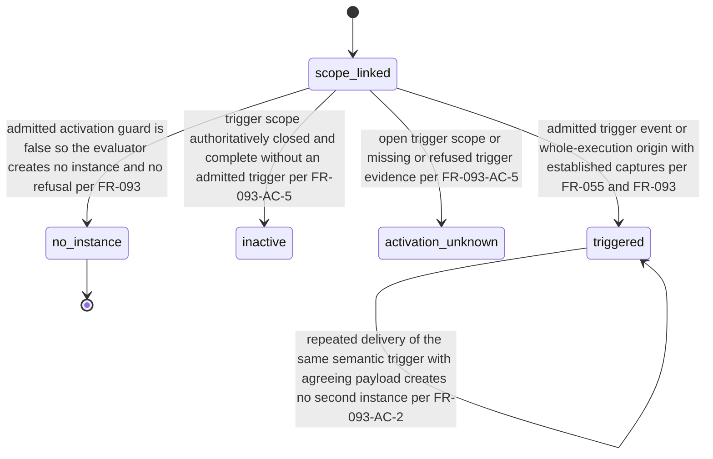

# FR-231: Obligation activation state

## Description

When a trigger scope is assessed, the evaluator SHALL report the obligation's activation as triggered, inactive or activation-unknown (FR-055, FR-093, FR-061).

FR-055 adds that the evaluator "SHALL NOT treat an inactive or unknown
obligation as satisfied or demonstrated", and FR-061 that the result producer
"SHALL NOT classify an inactive obligation as satisfied or demonstrated".

FR-093 states that "Activation, temporal truth and participation shall remain
separate dimensions", and FR-055 states that the evaluator "SHALL keep
activation independent from truth".

## States & Transitions

State meanings, each taken from the prose:

- `triggered` — an admitted trigger established the instance. FR-061 requires
  that a satisfied or violated truth has "activation is triggered".
- `inactive` — FR-093: "A trigger scope that is authoritatively closed and
  complete without an admitted trigger shall produce inactive activation; it is
  not a true obligation and is not evidence that recovery behavior was
  exercised." FR-061: "Activation is inactive" implies "truth is unavailable and
  the trigger scope is complete under an exact closure authority."
- `activation-unknown` — FR-093: "An open trigger scope shall produce
  activation-unknown with open completeness. Missing or refused trigger evidence
  shall produce activation-unknown with its incomplete or refused
  assessment-execution disposition." FR-061: "Truth is unavailable and
  completeness is open or incomplete with the missing trigger dependencies."
- `no_instance` — FR-093: "The evaluator shall create no instance and no refusal
  when an admitted activation guard is false." This is the absence of an
  obligation instance, not a fourth activation value.

No requirement states a transition out of `inactive` or `activation_unknown`
once reported, so none is drawn here.

## Identity and comparison

- **Identity kind** — *value*. An activation state has no identity of its own; it
  is compared componentwise as an exact label.
- **Key** — the state label itself, matched exactly. Diagnostic prose, display
  name, source path, span, message text, locale and rendering never participate
  (FR-009, FR-047); FR-061-AC-1 requires that the cases "remain discriminable
  without diagnostic prose".
- **Key order** — lexicographic over the label, for collection comparison only.
  It carries no precedence between activation values, and in particular no
  ordering from unknown towards triggered.
- **Causal order** — none. An activation state is a reported fact about an
  instance, not a node in the authored partial order of
  [FR-052](../../functional/FR-052-represent-bounded-control.md).
- **Absence** — an obligation whose activation has not been reported has an
  absent activation state. Absence compares only to absence; it is never
  defaulted to `inactive`. FR-055 states that "The evaluator SHALL NOT treat an
  inactive or unknown obligation as satisfied or demonstrated."
- **Digest domain** — not applicable; no key component of this object is a
  digest.

## Acceptance Criteria

| ID | Criteria | Verification |
| --- | --- | --- |
| FR-231-AC-1 | A closed and complete trigger scope with no admitted trigger reports `inactive`, and an open scope or missing or refused trigger evidence reports `activation-unknown`. | Analysis |
| FR-231-AC-2 | Neither `inactive` nor `activation-unknown` is readable as satisfied or demonstrated. | Analysis |
| FR-231-AC-3 | A false admitted activation guard produces no instance and no refusal, and is not recorded as an activation value. | Analysis |
| FR-231-AC-4 | An absent activation state compares only to absence and receives no default value. | Analysis |

## Dependencies

- [FR-055](../../functional/FR-055-activate-protocol-obligations.md).
- [FR-093](../../functional/FR-093-bind-temporal-activation-and-captures.md).
- [FR-061](../../functional/FR-061-report-orthogonal-results.md).
- [FR-200](../foundation/FR-200-quire-assessment-domain.md) supplies the identity
  discipline.

## Open gap

Three requirements describe the missing-trigger case, and they do not agree on
whether activation and assessment-execution/completeness are one axis or two.
This artifact records all three verbatim and reconciles none of them.

FR-055 Behavior reads as one axis choosing between two values:

> "An absent trigger under complete closed input yields inactive; an unavailable
> required trigger yields activation-unknown or incomplete."

FR-093 Behavior reads activation and assessment execution as two independent
axes, activation-unknown always being the activation value:

> "An open trigger scope shall produce activation-unknown with open
> completeness. Missing or refused trigger evidence shall produce
> activation-unknown with its incomplete or refused assessment-execution
> disposition."

FR-061 likewise carries activation and completeness as separate retained facts:

> "Activation is activation-unknown | Truth is unavailable and completeness is
> open or incomplete with the missing trigger dependencies."

Under FR-055 an unavailable required trigger may be reported as `incomplete`
instead of an activation value; under FR-093 and FR-061 it is always
`activation-unknown` carrying a separate incomplete completeness or
assessment-execution fact. The selection belongs to an owner ruling, not to this
artifact.

## Status

Draft. This artifact records existing meaning structurally. It establishes no new
obligation and claims no implementation coverage.
