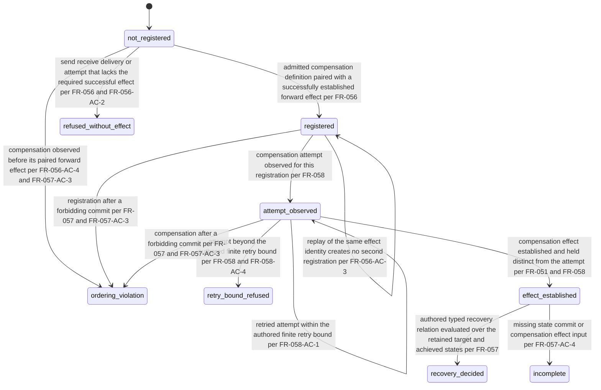

# FR-234: Compensation obligation lifecycle

## Description

When evaluating compensation, the conformance evaluator SHALL check authored commit ordering and decide recovery only through the compensation's exact typed recovery relation (FR-057).

FR-057 states that the evaluator "SHALL NOT infer recovery success from
compensation-operation success", and FR-056 states that the evaluator "does not
invoke the compensating operation".

## States & Transitions

State meanings, each taken from the prose:

- `registered` — the registration of [FR-233](FR-233-compensation-registration.md)
  exists. FR-056: "The evaluator SHALL NOT register compensation from a send,
  receive, delivery or attempt that lacks the required successful effect."
- `ordering_violation` — FR-057-AC-3 names them as distinct: "Registration after
  commit and compensation before the forward effect or after a forbidding commit
  are distinct ordering violations." FR-056-AC-4 adds that compensation observed
  before its forward effect "cannot retroactively validate registration."
- `retry_bound_refused` — FR-058: the evaluator "SHALL refuse attempts beyond the
  authored finite retry bound", and FR-058-AC-4 states that such attempts "cannot
  produce recovery success."
- `recovery_decided` — FR-057 Outputs: "A compensation obligation result with
  separate attempt, effect, commit and recovery facts". The decision is made only
  through the authored typed recovery relation
  ([FR-238](FR-238-recovery-relation.md)); success is never inferred from
  compensation-operation success.
- `incomplete` — FR-057-AC-4: "Missing state, commit or compensation-effect
  inputs yield incomplete/pending rather than recovery success."

Attempt-level outcomes are not states of this machine. FR-058 requires per-attempt
and aggregate facts to be retained separately, and the per-attempt outcome
vocabulary is [FR-236](FR-236-compensation-attempt-outcome.md).

## Identity and comparison

- **Identity kind** — *value*. A lifecycle state has no identity of its own; it
  is compared componentwise as an exact label, and it is read against the
  identified registration it describes.
- **Key** — the state label itself, matched exactly. Display name, source path,
  span, message text, locale, rendering and diagnostic prose never participate
  (FR-009, FR-047).
- **Key order** — lexicographic over the label, for collection comparison only.
  It carries no precedence, no progress meaning and no causal meaning; in
  particular it is not a lifecycle ordering.
- **Causal order** — the authored partial acyclic order of
  [FR-052](../../functional/FR-052-represent-bounded-control.md) supplies the
  orderings this machine checks. FR-056-AC-4 and FR-057-AC-3 name the specific
  violations: compensation before its paired forward effect, registration after a
  forbidding commit, and compensation after a forbidding commit. Those edges are
  authored and are never derived from key order, timestamp or source position
  (FR-052-AC-2).
- **Absence** — a registration whose lifecycle state has not been reported has an
  absent state, and absence compares only to absence. It is never defaulted to
  `not_registered` or to `recovery_decided`.
- **Digest domain** — not applicable; no key component of this object is a
  digest.

## Acceptance Criteria

| ID | Criteria | Verification |
| --- | --- | --- |
| FR-234-AC-1 | Registration after a forbidding commit, compensation before the paired forward effect, and compensation after a forbidding commit are three distinguishable outcomes. | Analysis |
| FR-234-AC-2 | A replayed forward effect identity leaves the registration in the same state and adds no second registration. | Analysis |
| FR-234-AC-3 | Recovery is reachable only through the authored typed recovery relation and never from compensation-operation success alone. | Analysis |
| FR-234-AC-4 | A missing state, commit or compensation-effect input yields incomplete or pending rather than recovery success. | Analysis |

## Dependencies

- [FR-056](../../functional/FR-056-register-compensation.md).
- [FR-057](../../functional/FR-057-enforce-commit-recovery.md).
- [FR-058](../../functional/FR-058-preserve-retry-and-partial-recovery.md).
- [FR-051](../../functional/FR-051-preserve-communication-identities.md).
- [FR-200](../foundation/FR-200-quire-assessment-domain.md) supplies the identity
  discipline.

## Open gap

No requirement names the lifecycle states as a closed labelled vocabulary; the
state names above are the prose's own conditions, not authored labels. No
requirement states whether `ordering_violation`, `retry_bound_refused` or
`incomplete` are terminal, nor whether a registration that reached `incomplete`
may later reach `recovery_decided` when the missing input arrives. Neither is
supplied here.

## Status

Draft. This artifact records existing meaning structurally. It establishes no new
obligation and claims no implementation coverage.
