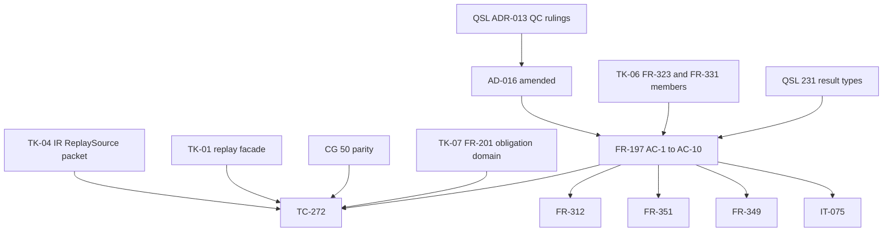

## Summary

This review builds the prerequisite graph around the amendment. It checks that
every edge the new text needs is declared, that each enablement item is ordered
before the feature that needs it, and that the graph has no cycle.

The amendment follows ADR-013 on every QC item (QC-7, QC-13 to QC-17, QC-20).
The kernel row keeps the right direction: the six new digest newtypes take a
digest QSL computes, and nothing in the kernel depends on QSL `check` or
`model`. The WP9 category map matches the O-16 proof column row for row.

The defects are in the edges. FR-197 AC-6 to AC-10 need serialized carriers and
result types that other owners have not yet changed, and FR-197 does not link
them. Three dependents of FR-197 still name `runtime::execute`, which FR-197 no
longer names. There is one new reference cycle, and TC-272 has prerequisites
that it does not state.

## Verdict

**ACCEPT WITH FINDINGS**: fix FND-001 to FND-003 (medium) in this PR. Fix FND-004
to FND-008 (low) in this PR or record them.

## Classification

| Requirement / item | Class | Rationale |
| --- | --- | --- |
| AD-016 (Replay source, kernel row, arrow 5 to 7 rows) | Enablement | Architecture that FR-197 AC-6 to AC-10 apply. It has no behavior of its own. |
| QSL ADR-013 TK-01 (layer-6 `replay` facade, QC-1 byte provision) | Enablement | Executor entry that TC-272 replays through |
| IR TK-04 (`CounterexamplePacket.source: ReplaySource`, C-09 map) | Enablement | The packet type that FR-197 AC-9 and AC-10 inspect. At `954c2f2` the packet still has `input` beside `witness: Option<Witness>`. |
| QSpec TK-06 (QC-6, QC-8: FR-331 `counterexamples`, FR-323 replay members) | Enablement | The serialized home of the one-arm entry and of `reproduced-without-witness` |
| QSpec TK-07 (QC-4: FR-201 obligation-identity domain) | Enablement | Needed for the arrow-5 identity digest and the regenerated seed vector |
| QSL #231 (O-27 result type), CG #50 (parity) | Enablement | The result types and the verdict that FR-197 AC-7 and AC-8 constrain |
| FR-197 (AC-1 to AC-10) | Feature | Replay behavior and the structural separation of the two arms |
| TC-272 | Verification of FR-197 | Runs only after all of the enablement items above |
| FR-312, FR-351, FR-354, FR-355, IT-075, FR-349 | Feature (dependents) | Each references FR-197 or uses its replay |

## Dependency Graph

The graph shows prerequisite edges only. The declared frontmatter edges also
include AD-016 → FR-197 (`references`) and FR-351 → FR-197 (`references`),
which together with AD-016 → FR-351 close the cycles in FND-005.

## Topological Order

1. QSL ADR-013 rulings (landed at `31b6054`), then this AD-016 amendment.
2. TK-06 and TK-07 in QSpec, TK-04 in IR, and TK-01 spine in QSL. These can run in parallel.
3. QSL #231 result types and CG #50 parity, after TK-06 and TK-04.
4. FR-197 AC-6 to AC-10 implementation, then TC-272.
5. Dependents: FR-312, FR-349, FR-351, FR-354, FR-355, IT-075.

## Cycles

There is one new reference cycle: AD-016 ⇄ FR-197 (FND-005). No cycle exists
among prerequisite edges once that back-reference is removed.

## Findings

| ID | Severity | Summary | Refs |
| --- | --- | --- | --- |
| FND-001 | medium | FR-197 AC-6 needs the value `reproduced-without-witness`, and TC-272 RS-09 needs a serialized packet that holds exactly one arm. Neither exists yet. No FR-323, FR-331 or FR-352 text in this repo carries `reproduced-without-witness`. The one-arm `counterexamples` entry is QC-6, and the `ReplaySource` member and the rule for the `Input` arm are QC-8. Both are TK-06, which has not landed. FR-197 frontmatter links none of FR-323, FR-331 or FR-352. FR-197 also says that "every requirement linked in frontmatter is a normative prerequisite", so a planner will not put TK-06 before AC-6 to AC-10. Fix: add `references` to FR-323, FR-331 and FR-352 in the FR-197 frontmatter. Add a Dependencies bullet that names FR-323 (per-item disposition vocabulary, per the OQ-2 ruling) as the home of `reproduced-without-witness`, and FR-331 `counterexamples` as the home of the one-arm entry. | FR-197-AC-6; TC-272 RS-09; FR-323; FR-331; FR-352; ADR-013 QC-6, QC-8, OQ-2 |
| FND-002 | medium | No owner is named for the per-arm replay-result types or for the backend-evidence verdict. The AD-016 Replay-ownership table has rows for Packet, Witness shape, Reconstruction + parity comparator and Native executor, but no row for the result types or the verdict. The upstream decision also conflicts: ADR-013 O-27 (implemented by QSL #231) fixes "one typed per-item result", while FR-197 AC-6 to AC-8 require one result type per arm. TC-272 RS-04 to RS-07 compile-fail "every parameter", "every field" and "every public constructor", so without an owning crate the scope of those tests is not defined. Fix: add a Replay-ownership row that names the owner of each arm's result type (the QSL executor through #231) and the owner of the backend-evidence verdict constructor (the CG replay adapter's parity comparator). Record the upstream owner action: ADR-013 O-27 moves to one result type per `ReplaySource` arm, and #231 follows. | AD-016 Replay ownership; FR-197-AC-6..AC-8; TC-272; ADR-013 O-27 |
| FND-003 | medium | The FR-197 Description now replays through the QSL complete-V1 executor (AD-016 arrow 7). Three items that depend on FR-197 still name native `runtime::execute`. FR-349 says "Counterexamples and witnesses ... replay through `runtime::execute` per AD-010". AD-010 §Decisions says counterexamples "replay through `runtime::execute`". IT-075, which `verifies` FR-197, has the objective "native `runtime::execute` agree". IT-075 therefore verifies FR-197 against an executor that FR-197 does not name, and FR-349 contradicts FR-197 for SMT counterexamples. Fix: in FR-349, AD-010 and the IT-075 Objective, replace the text with "the QSL complete-V1 executor (FR-197, AD-016 arrow 7)". Confirm that FR-355 and TC-270 use `runtime::execute` on purpose, because they compare the corpus against the native reference runtime. If they do not, align them too. | FR-349; AD-010; IT-075; FR-355; TC-270 |
| FND-004 | low | FR-197's trigger ("When a proof backend reports a counterexample") and its Inputs ("Backend counterexample") exclude the `Input` arm, which is "a counterexample that ran no backend". AC-6 and AC-10 still require behavior for the `Input` arm. The natural producer of `Input` packets is the FR-312 method counterexamples, and FR-312 already references FR-197. Adding FR-312 as a prerequisite of FR-197 would therefore make a cycle. Fix: widen FR-197's trigger and Inputs to a counterexample replayed from either a backend witness transcript or stored canonical values. FR-197 then owns both arms, and FR-312 stays downstream. | FR-197 Description, Inputs; FR-197-AC-6, AC-10; FR-312 |
| FND-005 | low | The diff adds FR-197 to the AD-016 frontmatter and AD-016 to the FR-197 frontmatter, which makes a 2-cycle. With the existing AD-016 → FR-351 → FR-197 references, it also closes a 3-cycle. No other FR references AD-016 back. Under the FR-197 rule that frontmatter links are prerequisites, `spec-to-plan` sees a cycle. Fix: remove the FR-197 entry from the AD-016 frontmatter and keep the body link in the Replay source section. AD-016 → FR-197 is the real direction, and the FR-197 frontmatter edge already records it. | AD-016 frontmatter; FR-197 frontmatter; FR-351 |
| FND-006 | low | TC-272 builds its `Witness` packet from "the AD-016 seed counterexample" transcript. AD-016 holds only `concrete_vals` and digests, and it says that WP9 vendors the full vector. The packet also needs its obligation identity (ADR-013 O-25 members), and that identity is `OPEN` until the FR-201 domain (TK-07) exists. The replay goes through the layer-6 facade (TK-01) and the CG adapter (CG #50), and it uses the IR `ReplaySource` packet (TK-04). TC-272 states none of these prerequisites. Fix: add a Preconditions section to TC-272 that lists the WP9-vendored seed transcript, the TK-07 obligation-identity domain, the TK-04 packet, the TK-01 facade and the CG #50 adapter. | TC-272; AD-016 seed vector; ADR-013 TK-01, TK-04, TK-07 |
| FND-007 | low | The arrow-5 "Identity retained" row says "The FR-201 digest domain of this identity is QSL ADR-013 QC-4" as though that domain is settled. FR-201 has no obligation-identity domain, and QC-4 is pending TK-07. The seed-vector row in the same diff says this correctly ("once its FR-201 digest domain exists"). Fix: in the arrow-5 row, write the digest domain as `OPEN — decided in WP9` (FR-201 domain added under QSL ADR-013 QC-4). This matches the seed row and makes the FR-201 edge visible. | AD-016 arrow 5; FR-201; ADR-013 QC-4, TK-07 |
| FND-008 | low | The amendment cites IR `954c2f2` as the merged Witness fact. At that commit, IR `src/kani/replay.rs` still holds `replay_counterexample` and `replay_with_native_runtime`, the latter using `quire_spec_language::runtime`. It also holds `ReplayAgreement` and `NativeReplayAgreement`, which have a `witness_backed: bool` field. The unchanged AD-016 text says that replay.rs "holds the packet type only" and "IR has no dependency on `quire_spec_language::runtime`". The diff removes the one sentence that named those IR types, and no WP is now named for removing them. Their removal is an enablement prerequisite of FR-197 AC-9. Fix: add a WP9 acceptance item to arrow 7: IR `src/kani/replay.rs` holds only `CounterexamplePacket` and `ReplaySource`, with no replay function and no witness-backed field (ADR-013 TK-04, Q209-5). | AD-016 arrow 7, Replay ownership; FR-197-AC-9; IR `954c2f2` src/kani/replay.rs |

## Checks that passed

- The kernel row (QC-15, QC-17) points one way. QSL computes the digests, and the kernel types have one public constructor each and no dependency on `check` or `model`. The move of the `CheckedNodeId` round trip from the identities row to the kernel row keeps the conversion test.
- The WP9 category map (QC-16) matches the ADR-013 O-16 proof column for all ten kinds, including `tested`, replay-parity `inconclusive` and IR-invariant `failed`.
- The Witness shape row (QC-13) matches IR `954c2f2` `Witness { transcript }` and its derived accessors.
- In the crate graph, the executor path from CG to QSL (layer-6 `replay` facade) is the existing dashed CG → QSL edge that WP9 makes normal. The amendment adds no new crate edge.
- Every new acceptance criterion (FR-197-AC-6 to AC-10) has a TC-272 row in spec/complete-v1/tests.md, and V1-BACK-006 lists TC-272.

## Round 2 dispositions

Evaluated against the tree committed with these records (fixes in `201b4a4`, plus the TC-272 RS-13 compile-fail case). Paths are relative to `spec/`.

| Finding | Disposition | Evidence |
| --- | --- | --- |
| FND-001 | resolved | FR-197 frontmatter references FR-323, FR-331 and FR-352; FR-197 Dependencies bullet names QC-6/QC-8 (TK-06) and FR-352 `native-run-result/2` (OQ-2) |
| FND-002 | resolved | AD-016 Replay ownership, Replay result and Backend-evidence verdict rows; FR-197 Replay source bullet 1 |
| FND-003 | resolved | AD-010 Summary, FR-349 Behavior and IT-075 Objective name the QSL complete-V1 executor (FR-197, AD-016 arrow 7); FR-355 and TC-270 keep SMT differential parity, which is a different comparison |
| FND-004 | resolved | FR-197 Description, Inputs and Replay envelope cover both arms; `Input` defined as "did not come from a backend transcript (a corpus counterexample)" in AD-016 Replay source and FR-197 |
| FND-005 | accepted | Both edges are `references`, not ordering edges: AD-016 names FR-197 as the home of the replay-source ACs and FR-197 cites AD-016 arrow 7 for the executor. Kept |
| FND-006 | resolved | TC-272 Fixture: IR `tests/kani_replay.rs` tc_042 witness transcript at `954c2f2`, decoded values (8, 992) |
| FND-007 | resolved | AD-016 arrow 5 Identity retained: `OPEN — decided in QSL ADR-013 TK-07` for the FR-201 digest domain (QC-4) |
| FND-008 | resolved | AD-016 arrow 7 Authority: `OPEN — decided in QSL ADR-013 TK-04` names IR `replay_counterexample`, `replay_with_native_runtime` and the `witness_backed` fields at `954c2f2` |
