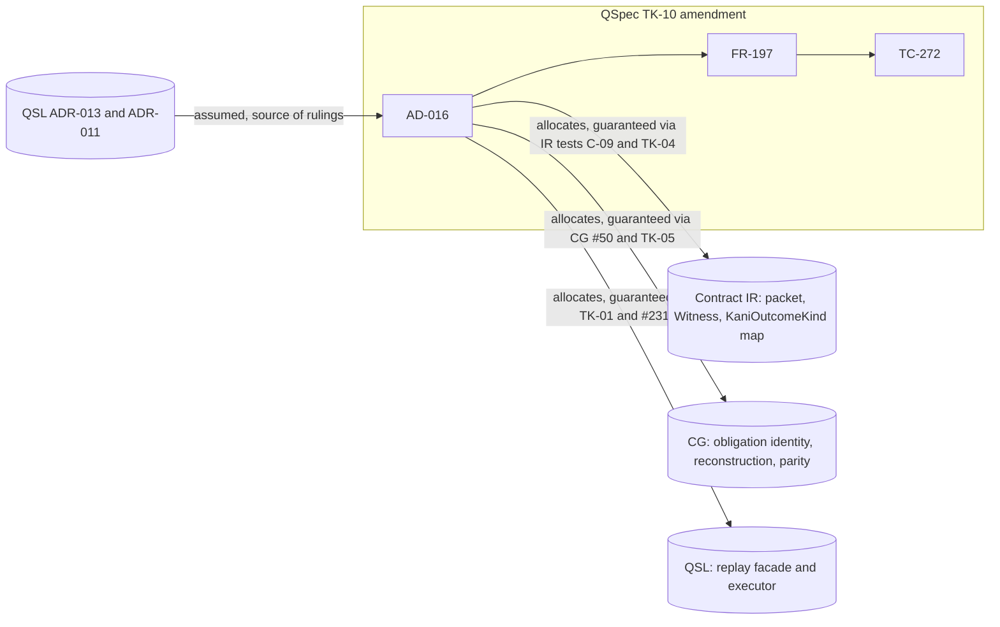

## Summary

The diff carries the whole TK-10 set (QC-7, QC-13 to QC-17, QC-20) and the
coordinator addition (QC-20 rationale in AD-016, FR-197 AC-6 to AC-10,
TC-272). It carries nothing that belongs to another ticket: FR-201 (TK-07,
QC-4), FR-323 and FR-331 (TK-06, QC-1, QC-6, QC-8, QC-9) and ADR-011 E7 to E9
are untouched. Two items go beyond the QC list. The arrow 7 routing text
(layer-6 `replay` facade, `QualifiedName`) is named in the brief and matches
ADR-011 E9, but cites no source. The FR-197 Description edit is a settled
alignment. The main boundary defect: the per-arm replay-result types and the
backend-evidence verdict that FR-197 AC-6 to AC-10 test have no named owner,
and they depart from ADR-013 O-27's "one typed per-item result".

## Verdict

**ACCEPT WITH FINDINGS**: FND-001 (medium) should be fixed in this PR. The low
findings can be fixed in this PR or recorded.

## Findings

| ID | Severity | Summary | Refs |
| --- | --- | --- | --- |
| FND-001 | medium | FR-197 requires a distinct replay-result type per `ReplaySource` arm and a backend-evidence verdict constructible only from the `Witness` arm (AC-6 to AC-10). No AD-016 row names the owner of these types. AD-016 Replay ownership lists Packet, Witness shape, reconstruction/parity comparator and executor only. ADR-013 O-27 says QSL's executor produces "one typed per-item result" and #231 builds "the common result type", so an implementer following ADR-013 builds one type and fails TC-272 RS-04 to RS-06. Fix: add a Replay ownership row "Replay results and backend-evidence verdict" naming the owner of each type (for example: per-arm result types QSL #231, backend-evidence verdict CG parity comparator), and file a QSL follow-up so ADR-013 O-27 and #231 state per-arm result types. Link the follow-up in the PR body. | AD-016 Replay ownership, Replay source; FR-197 AC-6 to AC-10; TC-272; QSL ADR-013 O-27, §7 #231 |
| FND-002 | low | Arrow 7 Owner, Typed in → out and the Native executor row add the layer-6 `replay` facade, "reached only through", and `QualifiedName` selection against the recompiled package. These are not in the TK-10 QC list; ADR-013 §Context says the `QualifiedName` key "keeps arrow 7 unchanged". The text agrees with ADR-011 E9 and ADR-013 TK-01 and O-26, and ownership is unchanged, but the AD cites none of them. Fix: cite ADR-011 E9 and ADR-013 OQ-5, O-26 and TK-01 at the arrow 7 Owner or Typed in → out cell. | AD-016 arrow 7; Replay ownership Native executor; ADR-011 E9; ADR-013 OQ-5, O-26, TK-01 |
| FND-003 | low | QC-14 says "the AD-016 seed vector is regenerated". The diff replaces `obligationIdentitySha256` with an OPEN marker for WP9 instead. The deferral is forced, because the FR-201 digest domain (QC-4, TK-07) does not exist yet. The marker names neither the identity's owner (CG, TK-05) nor the ticket that unblocks it (TK-07). Fix: extend the marker to name CG obligation conformance (ADR-013 TK-05) as the producer and QC-4 (TK-07) as the prerequisite, and note in the PR body that QC-14's regeneration clause is deferred. | AD-016 seed counterexample vector; ADR-013 QC-4, QC-14, TK-05, TK-07 |
| FND-004 | low | QC-14 changes "Obligation id" to "Obligation identity" in arrow 5 and arrow 6, but arrow 7 "Identity retained" still reads "Obligation id, node id". Fix: change the arrow 7 cell to "Obligation identity, node id". | AD-016 arrow 5, 6, 7; ADR-013 QC-14 |
| FND-005 | low | The new arrow 6 note says the FR-331 result value for the refusal and unsupported rows "is FR-331's (QSL ADR-013 QC-9)". QC-9 is open (TK-06), but the text carries no `OPEN` marker, and the arrow 6 refusal cell's OPEN now covers only the catalog-code table. Fix: mark it `OPEN — decided in FR-331 (QSL ADR-013 QC-9, TK-06)`. | AD-016 arrow 6, KaniOutcomeKind map; ADR-013 O-16, QC-9, TK-06 |
| FND-006 | low | TC-272 RS-09 tests that deserializing a packet holding both a transcript and stored values refuses. No FR-197 AC states this, and the rule belongs to the IR packet owner (ADR-013 O-25, TK-04), not the replay boundary. Fix: move RS-09 to an IR packet test under TK-04, or add an FR-197 AC that the replay boundary refuses a two-arm packet before replay and trace RS-09 to it. | TC-272 RS-09; FR-197; AD-016 Replay ownership Packet; ADR-013 O-25, TK-04 |
| FND-007 | low | The producer of `Input`-arm packets is not named, and its definition differs. AD-016 Replay source says a counterexample "without" a backend transcript is `Input`; FR-197 says one "that ran no backend". Arrow 6 emits only `Witness`, so `Input` packets enter from outside the arrow chain with no owner. Fix: use one definition in both files (ADR-013 O-25: "did not come from a backend transcript (a corpus counterexample)"), and name the component that builds `Input` packets in the Packet row. | AD-016 Replay source, arrow 6; FR-197 Replay source; ADR-013 O-25 |

## TK-10 set coverage

| Item | ADR-013 source | Diff location | Result |
| --- | --- | --- | --- |
| QC-7 | §8 QC-7, TK-10 | AD-016 arrow 7 Accounting (parity carrier = `ReplaySource` arm, distinct result types, no flag) | Present |
| QC-13 | §8 QC-13, O-25 | Replay ownership Witness shape (`transcript` only, four derived fallible methods); arrow 6 Identity retained | Present |
| QC-14 | §8 QC-14, O-09 | Arrow 5 Identity retained; seed vector `obligationIdentitySha256` | Present; regeneration deferred (FND-003); arrow 7 residue (FND-004) |
| QC-15 | §8 QC-15, O-05, T-6 | Kernel row gains exactly the six digest newtypes, constructor from a QSL digest, no `check`/`model` dependency | Present, exactly six |
| QC-16 | §8 QC-16, O-16 proof column | Arrow 6 KaniOutcomeKind closed set and category map, plus the `tested`, parity-disagreement and `failed` rows of the proof column | Present; QC-9 residue unmarked (FND-005) |
| QC-17 | §8 QC-17, O-04 | Kernel row is the only node-id listing; Semantic identity row keeps `DeclarationKey` only; round-trip test split | Present, no type rename |
| QC-20 | §8 QC-20, O-25 | Arrow 6 Typed in → out; Replay ownership Packet row; arrow 7 Typed in → out | Present |
| Coordinator addition | Brief (owner delegation) | AD-016 Replay source section; FR-197 Replay source and AC-6 to AC-10; TC-272; tests.md V1-BACK-006, AC rows and TC-272 row | Present; owner gap (FND-001) |
| Supporting edits | — | AD-016 frontmatter adds FR-197 and ADR-013; FR-197 frontmatter adds AD-016; Witness row records merge sha `954c2f2`; FR-197 Description aligned to arrow 7 | In scope |
| Arrow 7 routing | ADR-011 E9, ADR-013 TK-01 | Arrow 7 Owner, Typed in → out; Native executor row | Beyond QC list, consistent, uncited (FND-002) |

Nothing else changed. No other artifact appears in the diff.

## System context

## Responsibility allocation

| Requirement or row | Owning component | Class |
| --- | --- | --- |
| AD-016 arrow 5 obligation identity (QC-14) | CG `kani_obligations` | core |
| AD-016 arrow 6 KaniOutcomeKind map (QC-16) | IR `src/kani/outcome.rs` | core |
| AD-016 Packet and Witness shape (QC-13, QC-20) | IR `src/kani` | core |
| AD-016 arrow 7 parity carrier (QC-7) | CG replay adapter | core |
| AD-016 arrow 7 executor | QSL layer-6 `replay` facade → `CheckedPackage::call` | core |
| AD-016 kernel row (QC-15, QC-17) | QSL `quire-exact` | core |
| FR-197 AC-6 to AC-10 result types and verdict | Unassigned (FND-001) | core |
| TC-272 | QSpec, verifying FR-197 | cross-cutting |

## Round 2 dispositions

Evaluated against the tree committed with these records (fixes in `201b4a4`, plus the TC-272 RS-13 compile-fail case). Paths are relative to `spec/`.

| Finding | Disposition | Evidence |
| --- | --- | --- |
| FND-001 | partially resolved | AD-016 Replay ownership, Replay result and Backend-evidence verdict rows. Deferred, owner QSL #244: the ADR-013 O-27, QC-7 and QC-14 wording follow-up, named in the PR body. IR `witness_backed` removal is IR TK-04 (IR #144); AD-016 arrow 7 Authority states only that TK-04 (IR #144) implements this contract |
| FND-002 | resolved | AD-016 arrow 7 Owner cites QSL ADR-011 E9 and QSL ADR-013 O-26, OQ-5 |
| FND-003 | resolved | AD-016 seed vector: `obligationIdentitySha256` and `harnessSha256` both `OPEN — decided in QSL ADR-013 TK-05`, after TK-07 (QC-14) |
| FND-004 | resolved | AD-016 arrow 7 Identity retained: "Obligation identity, node id" |
| FND-005 | resolved | AD-016 arrow 6 note: `OPEN — decided in QSL ADR-013 TK-06` for the FR-331 result value of the refusal and unsupported rows (QC-9) |
| FND-006 | resolved | FR-197-AC-14; TC-272 RS-09 (both arms), RS-10 (neither) |
| FND-007 | deferred | One definition in both files: "did not come from a backend transcript (a corpus counterexample)" (O-25). Deferred, owner WP9: AD-016 Packet row marks `OPEN — decided in WP9` for the component that builds `Input` packets |

Rows for FND-001, FND-007 were updated after the PR #140 review at `9e52406`.
