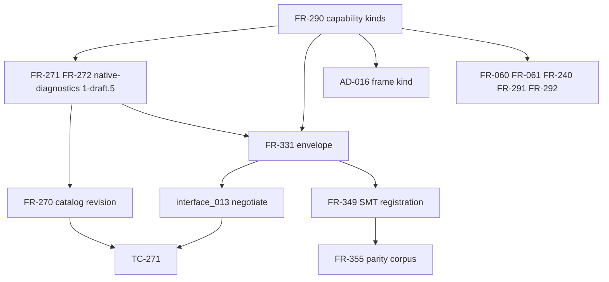

## Summary

ACCEPT WITH FINDINGS. The diff makes FR-290 the one ten-member capability-kind
vocabulary (`quire.capability-kind/v1`). It adds the per-item `candidates`
field and the tool-absence `unsupported` result to FR-331. It publishes the
matching causes in native-diagnostics `1-draft.5`. This answers ADR-012 §13.3
questions 1 to 3 and unblocks QSL #229 and the #212 gate. The ordering is sound:
vocabulary, then catalog codes, then envelope, then backend registrations.

One high finding blocks conforming implementations. FR-290 refuses any carrier
that does not declare the vocabulary identity, and FR-331 (owned by QSpec)
names no member that declares it. Four medium findings are open. Three leave a
downstream owner without a definition: the candidate member identity, the
two-valued extent, and a registered backend with no CG arm. The fourth is the
warning content when a multi-kind item has no single backend that covers all
its kinds.

## Classification

| Requirement | Class | Rationale |
| --- | --- | --- |
| FR-290 | Enablement | The vocabulary, vocabulary identity, claim-form assignment, advertised-mode table, candidate-set rule and tool-absence rule that every other item consumes |
| FR-271, FR-272, native-diagnostics `1-draft.5` | Enablement | Catalog codes and causes (`invalid_capability`, `unbounded-extent`, `tool-unavailable`) that refusals and warnings carry |
| FR-270 | Enablement | Revision pin of the catalog |
| FR-331 | Enablement | Wire envelope carrying (kind, mode) advertisements, extent, `candidates` and the `unsupported` result |
| interface_013 | Enablement | `negotiate` operation boundary over the candidate set |
| AD-016 | Enablement | Places the frame obligation under `operation-contract`; keeps the one negotiation point |
| FR-060, FR-061, FR-240, FR-291, FR-292 | Feature | Protocol claims narrowed to the `protocol` family; behavior otherwise unchanged |
| FR-349 | Feature | SMT backend registers (kind, mode) pairs; obligation forms move to its negotiation arm |
| FR-355 | Feature | Parity corpus keyed on discharged obligation forms |
| TC-266, TC-270, TC-271 | Verification | Evidence for the above; TC-271 is new |

## Dependency graph

## Topological order

1. FR-290 (enablement).
2. FR-271, FR-272 and native-diagnostics `1-draft.5`, then FR-270 (enablement).
3. FR-331, then interface_013 (enablement). AD-016 can run in parallel.
4. FR-060, FR-061, FR-240, FR-291, FR-292 and FR-349, in parallel (features).
5. FR-355, after FR-349.
6. TC-266, TC-270 and TC-271.

## Cycles

There is one documentation cycle. FR-290-AC-8 needs the FR-331 `unsupported`
result. FR-331-AC-4 and FR-331-AC-6 settle "under FR-290", and FR-290 names
FR-331 as its carrier. The cycle is benign because both land in one diff and
FR-331 defines no rule of its own; it only carries FR-290's rules. The
prerequisite direction is FR-290 → FR-331. FR-331's Dependencies section
already says so, so no finding is raised.

## Downstream consumers

| Owner | Consumes from this diff | Action required |
| --- | --- | --- |
| QSL #229 | FR-290 ten kinds and `quire.capability-kind/v1`; the unknown-kind refusal; native-diagnostics `1-draft.5` causes; the FR-331 tool-absence `unsupported` result | Align `Capability` to the ten labels, with no four-kind reader. Adopt the tool-absence outcome and catalog codes that QSpec now fixes; #229 no longer decides them. Answer ADR-012 §13.3 Q1 to Q3 from FR-290 and FR-331. |
| QSL #213 | FR-290 kind set and families | Define the canonical `Capability` type over the ten members. Families stay descriptive, never a second enum. |
| QSL #185 | FR-290 candidate-set rule, (kind, mode) advertisements, FR-331 `candidates` | Build the registry to compute `candidates` in canonical order and mark unknown-backend. Needs FND-002 answered for the element identity. |
| QSL #222 | FR-290 advertised-mode table and extent field | Own extent representation and the "finite bound available" predicate. Reconcile its extent vocabulary with the two-valued FR-331 extent (FND-003). |
| QSL PR #234 (ADR-012) | FR-290 claim-form assignment | Remove the conditional wording in §7.3, §7.4, §12.1, §12.2 and §13.3. Sum/case clauses are `value-validity` and the exhaustiveness obligation needs no kind. The frame obligation is `operation-contract`. The solver-absence result is FR-331 `unsupported`. |
| quire-contract-codegen (CG, Codegen #86) | FR-331 `candidates`, the candidate disposition table, the advertised-mode table, tool absence, `invalid_capability` causes | Implement `negotiate_*` over `candidates` and extent. Implement the post-routing adapter probe that emits `tool-unavailable`. Map any unknown `BackendId` to a catalog cause (FND-004). |
| quire-contract-ir (FR-029, IR #109) | FR-331 result `unsupported`; FR-349 obligation forms; the Kani descriptor wording | Map `KaniOutcomeKind::Unavailable` to FR-331 `unsupported`/`tool-unavailable`. Expose the FR-346/347/348/147 obligation form on each lowered item so a negotiation arm can settle it. |
| quire-protocol | FR-290 `protocol` family; FR-291 and FR-292 narrowed to protocol-family members | Advertise only protocol-family kinds under `quire.capability-kind/v1`. Refuse non-protocol labels in fragment and backend selections. |
| quire-analyze #40 | FR-290 descriptors, (kind, mode) pairs | Register the implication backend with explicit (kind, mode) pairs, for example (`value-validity`, `bounded`/`unbounded`), and a CG `negotiate_*` arm. |
| quire-runtime (RT), QSL, IR, CG vendors | native-diagnostics `1-draft.5` | Re-vendor the catalog (QSL `resources/native-v1/VENDOR.json`, RT and the other vendored copies). Extend each exhaustive `catalog_code` totality test to `invalid_capability` and the two new `unsupported_projection` causes. |

## Findings

| ID | Severity | Summary | Refs |
| --- | --- | --- | --- |
| FND-001 | high | FR-290 refuses every carrier that does not declare `quire.capability-kind/v1` and leaves the member to "that format's owner". FR-331 is a QSpec format and names no such member, so under FR-290-AC-1 every conforming manifest and request is refused. FR-240/FR-061 results carry a kind with the same gap. Fix: in FR-331, state that `contract_version` `quire.backend-provider/v1` declares `quire.capability-kind/v1` for every kind it carries, or add an explicit member. Do the same in FR-240 for protocol results. | FR-290; FR-331; FR-240; TC-271 CK-03 |
| FND-002 | medium | FR-331 `candidates` is a set of "registered backend identities ... in ascending identity order", but the identity is not defined. ADR-012 §7.1 (ADR-013 O-19) uses `backend{identity, manifest_digest}` sorted by (identity, manifest digest). QSL #185 and CG cannot agree on the bytes that FR-331-AC-5 hashes. Fix: define a candidate member as the manifest's provider identity plus manifest digest, sorted by that pair, or cite the O-19 member. | FR-331; FR-331-AC-5; QSL #185; ADR-012 §7.1 |
| FND-003 | medium | FR-290 and FR-331 fix the request extent as exactly `bounded` or `unbounded`, but hand extent representation to QSL #222. ADR-012 §1.1 lists finite, bounded and unbounded extents. The two-valued wire field partly decides what #222 owns. Fix: state that the FR-331 extent is the #222 extent projected onto the advertised-mode axis, and name #222 as the owner of that projection. | FR-290 Advertised mode; FR-331; QSL #222 |
| FND-004 | medium | `unknown-backend` covers only a backend the request names that is not in the registry. ADR-012 §7.2 also settles `invalid-request` when CG has no closed backend kind for a registered descriptor's `BackendId`. No catalog cause covers that case. Fix: extend `unknown-backend` in native-diagnostics, FR-272 and FR-290 to cover "registered but no negotiation arm", or add a sibling cause. | native-diagnostics 1-draft.5; FR-272; CG `negotiate_*` |
| FND-005 | medium | An empty candidate set with no named backend warns with "every required kind that ... every registrant leaves unadvertised". For an item that requires kinds A and B, where one registrant advertises only A and another only B, that set is empty, so the warning names nothing. This breaks the settled rule that the warning names the capability. Fix: name every required kind in that case, or name each registrant's missing kinds. Align the native-diagnostics wording ("no registrant advertises"), which also misstates the named-backend case. | FR-290 Candidate set; native-diagnostics 1-draft.5; FR-272 |
| FND-006 | low | TC-271 is P0 in `spec/complete-v1/tests.md` and P1 in `spec/protocol/tests.md`. Fix: use one priority in both matrices. | spec/complete-v1/tests.md; spec/protocol/tests.md |
| FND-007 | low | TC-060 ("Enumerate every FR-290 member") and TC-061 ("every FR-290 claim kind") are unchanged but now reach all ten members, while FR-060 and FR-061 accept only the protocol family. FR-290-AC-2 and AC-3 now range over ten kinds but are still verified only by the protocol-scoped TC-060 and TC-061. Fix: scope TC-060 and TC-061 to the protocol family, and add TC-271 to the FR-290-AC-2 evidence or scope AC-2 to the family. | TC-060; TC-061; FR-290-AC-2 |

## Round 2 dispositions

Evaluated against the uncommitted working tree on 5d3aa25. Paths are relative to the repository root.

| Finding | Disposition | Evidence |
| --- | --- | --- |
| FND-001 | resolved | `spec/objects/interfaces/FR-331-backend-provider-envelope.md:26,40,52`; `spec/objects/protocol/FR-290-protocol-claim-kind.md:69-77`; FR-240:142-143 |
| FND-002 | resolved | Candidate = (backend identity, manifest digest), ordered bytewise by identity then digest, FR-290:147-150 and FR-331:29 |
| FND-003 | resolved | The item carries the #222 extent and #222's `bounded`/`unbounded` classification; #222 owns both, FR-290:119-125; FR-331:28 |
| FND-004 | resolved | "a registered backend with no negotiation arm" settles `unknown-backend`, FR-290:174; native-diagnostics:97; FR-272 row; NG-04 (TC-271:48) |
| FND-005 | resolved | One kind per item, FR-290:86; the empty-set warning names the item's kind and named backend, FR-290:176; native-diagnostics:96 |
| FND-006 | resolved | P0 in both matrices, `spec/protocol/tests.md:259`, `spec/complete-v1/tests.md:1154` |
| FND-007 | open | low. TC-060 and TC-061 are scoped to the protocol family (TC-060:21, TC-061:67-70), which resolves the first half. FR-290-AC-2 and AC-3 now cite TC-271 (FR-290:230-231), but TC-271 has no vector for independent outcomes or the global-premise refusal across families (TC-271:38-64). The trace is vacuous; see SR-610 FND-004. Fix: add that vector to TC-271. |

Round 2 verdict: ACCEPT WITH FINDINGS
