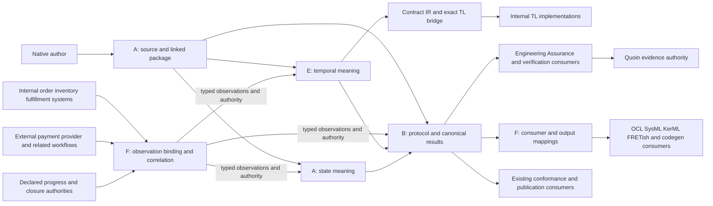

## Summary

The system boundary preserves one native clause language, enterprise workflows
across internal/external systems, related instances and finite population/window
obligations. Its integration still lacks one exact correspondence: population
windows to native observation/clock coverage. Result-authority conflicts
are recorded separately in SR-401.

## Findings

| ID | Severity | Summary | Refs | Escape Cause |
| --- | --- | --- | --- | --- |
| FND-001 | high | E supports event positions, rational-period samples and timestamp ticks with inclusive temporal intervals. An ordered population/window member set does not define which temporal record positions/valuations or boundary coverage it supplies. IT-010-SC-06 explicitly requires a selected F mapping, but none is supplied; timestamps/member IDs alone cannot create it. Owner: F for the observation-range mapping, with E's clocks and A's binding admission. Define all three selected clock cases and both endpoints without reducing v1 to one clock or a snapshot-only workflow. | FR-090; FR-094-AC-1/2; observation-contract.md, Scope premises; IT-010-SC-06 and Dependencies; TC-035 | missing-requirement |

## Concrete boundary cases

For FND-001, use a half-open `[00:00:00Z,00:00:30Z)` window and E's
`eventually[0,30] holds(p)` with one-second timestamp ticks. A witness exactly
at 30 lies outside that window and inside the native interval; truthful
missing coverage is incomplete and falsely relabelled closure refuses.
An explicitly selected covering window can admit it. A decisive admitted
witness at 29 remains settled even without the upper boundary, subject to the
SR-401 support rule. Also bind an authoritative two-event sequence with no UTC
timestamps, and a fixed-sample stream with rational period: the contract must
state how their populations/windows relate to event positions/sample indices,
or identify the additional required input, without inventing elapsed time.
Two observations of the same object must retain separate record/position and
anchor identities even if window membership lists that object only once.

## System context

The diagram includes semantic interfaces, not a proposed executable deployment.
Evaluators observe supplied actions; they do not send messages, invoke operations,
run compensation, deploy monitors or certify consuming systems. Internal and
external participants receive the same identity checks; neither is presumed
fully observable. One provider, trace ID or workflow cannot replace the selected
enterprise relationship/population scope.

## External dependencies

`Guaranteed` below means the specification requires a named contract check;
every listed integration case remains planned, so this is not a claim that a
producer or consumer already passed it. `Assumed` denotes an explicitly selected
premise whose real-world truth this language evaluator cannot itself establish.

| Dependency | Assumed or Guaranteed | Named contract and boundary |
| --- | --- | --- |
| F population/window mapping | Guaranteed, planned; incomplete contract | FR-112 and IT-010-SC-06. FND-001 must supply the selected mapping before integration. |
| Internal/external observation providers | Assumed real-world fidelity; guaranteed binding checks, planned | Declared source/schema/binding identity under FR-110/111, TC-140/141 and IT-050. Matching syntax never proves a business effect or complete visibility. |
| Progress/closure authority | Assumed authority premise; guaranteed scoped consistency checks, planned | observation-progress.md, FR-113/094, TC-143/115 and IT-050. A valid record cannot manufacture authority or cover another source/window. |
| Channel delivery and visibility premises | Assumed declared operating premises; guaranteed conformance checks, planned | FR-053/054 and TC-053/054. No implicit reliability, synchronized clock, cross-channel FIFO or exactly-one business effect. |
| Canonical protocol and portable verification consumers | Guaranteed, planned | FR-061/062, FR-115/116, external quire-verification FR-007, IT-020/021/051. Canonical results retain facts omitted by the narrower derived projection. |
| Contract IR and TL | Guaranteed, planned for admitted mapping subset | FR-095, contract-IR #63/#64, IT-040/041. Their versioned bridge cannot choose native meaning or admit unsupported timestamped/past lowering. |
| Engineering Assurance and Quoin | Guaranteed, planned | FR-061/062/115 and IT-020/021/051 consume execution/finding interfaces; Quoin retains evidence and verification-method ownership. No new local evidence store or runner. |
| OCL/SysML/KerML/FRETish targets and codegen | Guaranteed loss accounting, planned; no target equivalence assumed | FR-116, output-mapping contract, TC-146 and IT-051. Target parsing does not discharge semantic preservation or native execution. |
| Existing publication/conformance consumers | Guaranteed claim boundary, planned | FR-020, TC-020 and the capability inventory. Partial support cannot be relabelled full enterprise v1. |

## Responsibility allocation

Each local in-scope FR/StR/NFR has one accountable owner/component and one
responsibility class. Multiple collaborating owners on a finding do not create
duplicate requirement ownership.

| Requirement | Owning component | Class |
| --- | --- | --- |
| StR-002 | A: composed language standard | core |
| FR-020 | A: standard capability claim contract | cross-cutting |
| FR-030 | A: native linker | core |
| FR-031 | A: assessment dispatcher | core |
| FR-032 | A: versioned language/interchange contracts | cross-cutting |
| FR-033 | A: shared predicate checker | core |
| FR-034 | A: cross-family predicate linker | core |
| FR-035 | A: ecosystem request binder | core |
| FR-036 | A: native lexer/source correspondence | core |
| FR-037 | A: shared native parser | core |
| FR-038 | A: lexical resolver | core |
| FR-039 | A: exact literal admission | core |
| FR-040 | A: state profile admission | core |
| FR-041 | A: state query evaluator | core |
| FR-042 | A: state anchor checker | core |
| FR-043 | A: finite graph evaluator | core |
| FR-044 | A: numeric definedness checker | core |
| FR-045 | A: native control/presence evaluator | core |
| FR-046 | A: invocation/frame validator | core |
| FR-047 | A: typed diagnostic contract | cross-cutting |
| FR-048 | A: temporal source integration | core |
| FR-049 | A: choreography source integration | core |
| FR-050 | B: protocol subject linker | core |
| FR-051 | B: communication/effect binder | core |
| FR-052 | B: finite protocol control representation | core |
| FR-053 | B: protocol choice admission | core |
| FR-054 | B: channel premise admission | core |
| FR-055 | B: protocol activation evaluator | core |
| FR-056 | B: compensation registration evaluator | core |
| FR-057 | B: commit/recovery evaluator | core |
| FR-058 | B: retry/partial recovery evaluator | core |
| FR-059 | B: global conformance evaluator | core |
| FR-060 | B: protocol claim dispatcher | core |
| FR-061 | B: canonical result producer/reader contract | cross-cutting |
| FR-062 | B: portable verification projection | cross-cutting |
| FR-090 | E: temporal profile/clock contract | core |
| FR-091 | E: bounded future evaluator | core |
| FR-092 | E: bounded past evaluator | core |
| FR-093 | E: temporal activation/capture contract | core |
| FR-094 | E: temporal lifecycle interpreter | core |
| FR-095 | E: native-to-TL correspondence contract | core |
| FR-110 | F: observation binder | core |
| FR-111 | F: related-instance correlation | core |
| FR-112 | F: assessment population/completeness binding | core |
| FR-113 | F: progress/lateness/restore input boundary | core |
| FR-114 | F: replay/incremental assessment integration | core |
| FR-115 | F: observation result adapter | cross-cutting |
| FR-116 | F: result consumer/output adapter contract | cross-cutting |
| FR-130 | A: composed package-reference interpretation | core |
| NFR-010 | A: composed processing accounting | infrastructure |
| NFR-020 | B: protocol resource accounting | infrastructure |
| NFR-021 | B: protocol reproducibility contract | cross-cutting |
| NFR-040 | E: temporal state/work budget contract | infrastructure |
| NFR-050 | F: observation retention accounting | infrastructure |
| NFR-051 | F: replay provenance contract | cross-cutting |
| NFR-052 | F: executable dependency containment | cross-cutting |

## Preserved boundaries and acceptance

F's correction through 921993b is integrated, while its older definition
selections still need the successor closure recorded in SR-403.
An exact delivered interface can remain contradictory or incomplete for a
consumer; delivery and contract agreement are separate facts.

General projection, realizability, refinement and assume-guarantee analysis keep
their explicitly separate capability requests. Required state, bounded temporal,
finite global choreography, related instances and selected population/window
semantics remain in v1. Existing Quoin implementation is contained; executable
production/qualification paths remain Rust under the owner directive. Historical
source-ruling bytes and adopted state artifacts are not modified or restamped.

The findings require contract correspondence and planned discriminators before
dependent implementation. No build, runtime test, hosted CI, external message,
external repository edit, implementation readiness or qualification claim is
part of this requirements review.
