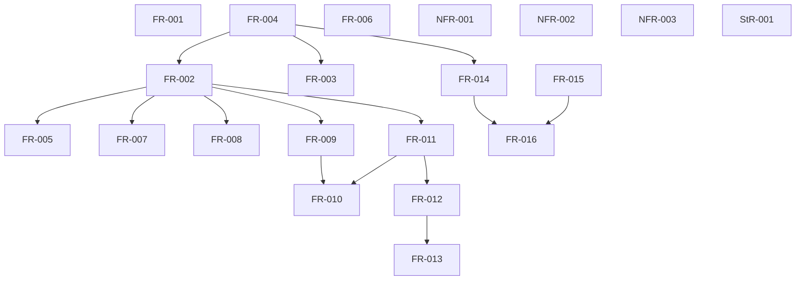

## Summary

The proposed prerequisite DAG is acyclic and classifies every FR/StR/NFR. It exposes phase order and separates final qualification dependencies from independent implementation slices.

## Verdict

**CONDITIONAL** — Findings require disposition before the affected implementation or acceptance gate. This is not owner acceptance.

## Findings

| ID | Severity | Summary | Refs |
| --- | --- | --- | --- |
| FND-001 | medium | Requirements currently link stories and design context but lack a complete explicit prerequisite graph. Incorporate the reviewed ordering into formal task planning; external contract adoption must remain a gate. | FR Dependencies sections; this review; IT-001/IT-002 |

## Scope and provenance

Reviewed quire-specification. The owner selected base plus all seven Quoin analyses, and declined the optional intent↔test↔code semantic step in `/gap-analysis`. Ordinary requirements consistency, EARS conformance, and the separate current-code review remain in scope. The assignment prohibits spawning additional agents, so these analyses were performed sequentially by Agent A; no independent reviewer acceptance is implied.

The installed Quoin 0.20.0 `spec-review/SKILL.md` and its analysis skills govern these artifacts. The SpecReview authoring pack was fetched once for this repository and its process skeleton/schema was used. IDs in this report are local to this repository unless qualified.

These are new repositories. Missing formal plans, TC records, suites, and matrices are workflow setup/readiness debt. Unimplemented LC02–LC05 stages and unqualified shared consumers are known remaining work; they are not reported as regressions or hidden stubs. No completion status is fabricated.

## Classification

| Requirement | Class | Rationale |
| --- | --- | --- |
| [FR-001](../functional/foundation/FR-001-select-native-profile.md) | feature | States observable native behavior or an operator-facing quality/acceptance guarantee. |
| [FR-002](../functional/foundation/FR-002-resolve-owned-declarations.md) | enablement | Provides a shared checked representation/boundary consumed by downstream behavior. |
| [FR-003](../functional/foundation/FR-003-bind-source-correspondence.md) | enablement | Provides a shared checked representation/boundary consumed by downstream behavior. |
| [FR-004](../functional/foundation/FR-004-separate-artifact-identities.md) | enablement | Provides a shared checked representation/boundary consumed by downstream behavior. |
| [FR-005](../functional/foundation/FR-005-guard-optional-values.md) | feature | States observable native behavior or an operator-facing quality/acceptance guarantee. |
| [FR-006](../functional/foundation/FR-006-preserve-control-evaluation.md) | feature | States observable native behavior or an operator-facing quality/acceptance guarantee. |
| [FR-007](../functional/foundation/FR-007-prove-integer-definedness.md) | feature | States observable native behavior or an operator-facing quality/acceptance guarantee. |
| [FR-008](../functional/foundation/FR-008-preserve-sequence-semantics.md) | feature | States observable native behavior or an operator-facing quality/acceptance guarantee. |
| [FR-009](../functional/foundation/FR-009-preserve-object-identity.md) | feature | States observable native behavior or an operator-facing quality/acceptance guarantee. |
| [FR-010](../functional/foundation/FR-010-evaluate-exact-reachability.md) | feature | States observable native behavior or an operator-facing quality/acceptance guarantee. |
| [FR-011](../functional/foundation/FR-011-validate-populations.md) | feature | States observable native behavior or an operator-facing quality/acceptance guarantee. |
| [FR-012](../functional/foundation/FR-012-bind-operation-observations.md) | feature | States observable native behavior or an operator-facing quality/acceptance guarantee. |
| [FR-013](../functional/foundation/FR-013-validate-operation-frames.md) | feature | States observable native behavior or an operator-facing quality/acceptance guarantee. |
| [FR-014](../functional/foundation/FR-014-read-exact-wire.md) | enablement | Provides a shared checked representation/boundary consumed by downstream behavior. |
| [FR-015](../functional/foundation/FR-015-preserve-canonical-domains.md) | enablement | Provides a shared checked representation/boundary consumed by downstream behavior. |
| [FR-016](../functional/foundation/FR-016-migrate-explicitly.md) | feature | States observable native behavior or an operator-facing quality/acceptance guarantee. |
| [NFR-001](../non-functional/NFR-001-preserve-versioned-meaning.md) | feature | States observable native behavior or an operator-facing quality/acceptance guarantee. |
| [NFR-002](../non-functional/NFR-002-classify-resource-incompleteness.md) | feature | States observable native behavior or an operator-facing quality/acceptance guarantee. |
| [NFR-003](../non-functional/NFR-003-qualify-reference-bindings.md) | feature | States observable native behavior or an operator-facing quality/acceptance guarantee. |
| [StR-001](../stakeholder/StR-001-native-assessment-trust.md) | feature | States observable native behavior or an operator-facing quality/acceptance guarantee. |

## Explicit prerequisite edges

The following is the reviewer's proposed logical ordering, derived from the requirement Inputs/Outputs and acceptance contracts. It makes those prerequisites explicit in this review; it does not pretend that the requirement frontmatter already declares a complete dependency DAG. Traceability, `constrains`, and `satisfied_by` edges are not treated as execution dependencies. StR/NFR guarantees apply throughout implementation and require final validation; their appearance as unconstrained nodes is not a claim that their evidence is complete.

| Prerequisite | Dependent | Why the contract requires it |
| --- | --- | --- |
| FR-004 | FR-002 | Import binding uses independent artifact identities. |
| FR-004 | FR-003 | Source correspondence binds selected source artifacts. |
| FR-004 | FR-014 | The wire reader implements the ArtifactRef/SemanticRef record shapes. |
| FR-002 | FR-005 | Optional facts require resolved field and snapshot typing. |
| FR-002 | FR-007 | Integer bounds come from the selected declaration authority. |
| FR-002 | FR-008 | Sequence element/bound metadata comes from the selected model. |
| FR-002 | FR-009 | Object identity includes declared type/universe identity. |
| FR-002 | FR-011 | Population validation needs selected declared types. |
| FR-009 | FR-010 | Visited/target equality uses the declared object key. |
| FR-011 | FR-010 | Reachability consumes a complete validated population. |
| FR-011 | FR-012 | Invocation observations refer to validated pre/post populations. |
| FR-012 | FR-013 | Frame validation needs one bound invocation and its object delta. |
| FR-014 | FR-016 | Migration accepts exact versioned reference records. |
| FR-015 | FR-016 | Preserved aspects must identify their canonical domain. |

## Dependency graph

## Topological order

1. FR-001, FR-004, FR-006, FR-015, NFR-001, NFR-002, NFR-003, StR-001.
2. FR-002, FR-003, FR-014.
3. FR-005, FR-007, FR-008, FR-009, FR-011, FR-016.
4. FR-010, FR-012.
5. FR-013.

No cycles occur in the proposed graph. Every FR/StR/NFR is classified exactly once. The ordering is logical, not a schedule, and no enablement is placed after a feature that depends on it.

## External gates

FS02/FS03/FS05 definition acceptance, the existing typed-model view/binder contract, B's independent shared-reference consumer and C's opaque extraction adapter remain explicit external gates. Legacy contract-IR conformance does not discharge them. Keep these gates on their existing private owning tickets; no competing binder is justified.
