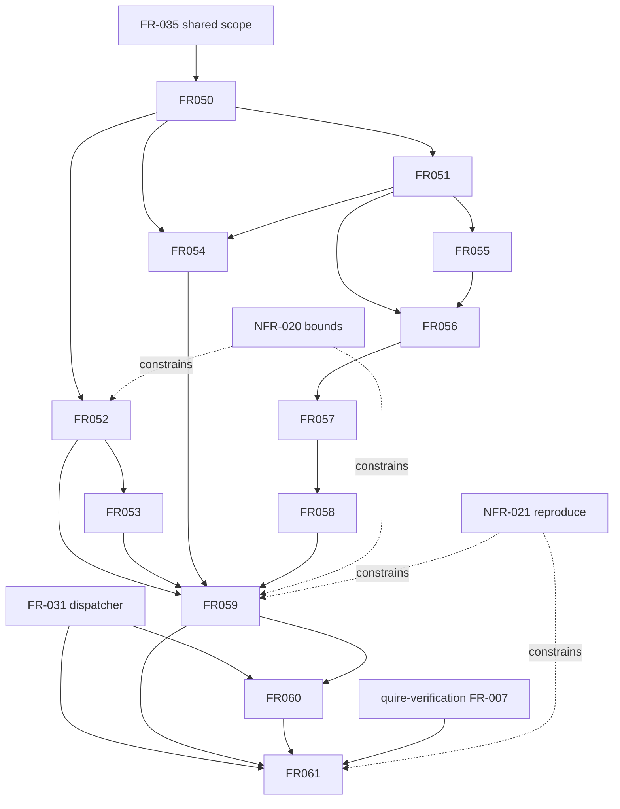

## Summary

The logical prerequisite graph is acyclic. Representation and binding enable
global conformance; compensation builds in effect/activation/registration/order;
advanced claim separation and shared results follow conformance. External
producer contracts gate only their affected implementation slices.

## Findings

| ID | Severity | Summary | Refs |
| --- | --- | --- | --- |
| FND-001 | medium | Resolved: local prerequisites are now machine-readable `depends_on` relationships rather than prose-only ordering. | FR-050..FR-061 |

## Classification

| Requirement | Class | Rationale |
| --- | --- | --- |
| FR-050 | enablement | Links exact protocol subjects. |
| FR-051 | enablement | Establishes communication/effect correspondence. |
| FR-052 | enablement | Builds finite causal control. |
| FR-053 | feature | Admits/refuses choices by ownership and visibility. |
| FR-054 | enablement | Defines channel conformance premises. |
| FR-055 | enablement | Establishes obligation activation and captures. |
| FR-056 | feature | Registers compensation after successful effects. |
| FR-057 | feature | Checks commit and recovery meaning. |
| FR-058 | feature | Evaluates retries, duplicates and partial recovery. |
| FR-059 | feature | Produces finite global conformance. |
| FR-060 | feature | Separates requested protocol-analysis claims. |
| FR-061 | enablement | Defines the shared result consumed across families. |
| NFR-020 | feature | Bounds every protocol implementation stage with observable resource-incomplete outcomes. |
| NFR-021 | feature | Requires deterministic reproduction of externally consumed results. |

## Dependency graph

## Topological order

1. Existing FR-031/FR-035, quire-verification FR-007 and cross-owner A/D contracts.
2. FR-050, then FR-051 and FR-052.
3. FR-053, FR-054 and FR-055.
4. FR-056, FR-057 and FR-058.
5. FR-059.
6. FR-060 and FR-061.

NFR-020/021 apply from interface design through final validation. IT-020 gates
the compiler/representation seam; IT-021 gates the observation/result seam.
E03 gates adoption of a specific library, not specification or a first-party
bounded conformance implementation. No cycle exists.
