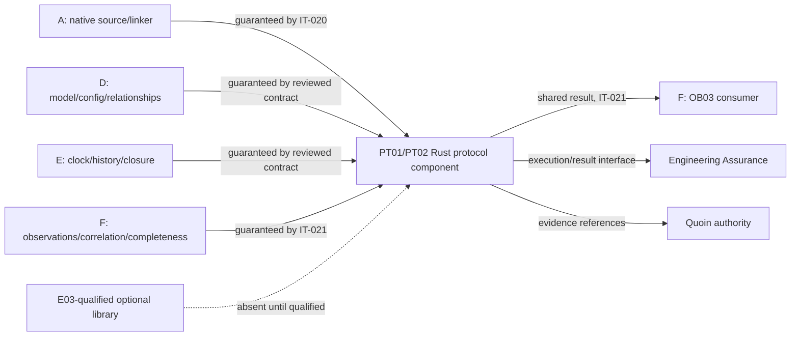

## Summary

Responsibility is allocated without a second source language, model, temporal
system, observation binder, runner, evidence store or method catalog. The PT01/
PT02 component owns protocol representation, compensation/conformance semantics
and shared results; every producer and consumer seam is named.

## Findings

| ID | Severity | Summary | Refs |
| --- | --- | --- | --- |
| FND-001 | medium | Resolved: the initial external-library disposition was implicit. The protocol contract now records no adopted dependency and requires exact E03 version/license/profile qualification before a candidate can become an implementation dependency. | protocol-contract.md; E03 |
| FND-002 | medium | Resolved: missing producer behavior now refuses or reports unsupported and explicitly prohibits local stubs, source-text adapters and inferred defaults. | protocol-contract.md; IT-020; IT-021 |

## System context

## External dependencies

| Dependency | Type | Assumed or Guaranteed | Contract |
| --- | --- | --- | --- |
| Native compiler/linker | typed linked package | guaranteed | IT-020 after Agent A integration |
| Model/config/relationship producer | typed identities and finite population scope | guaranteed | D-owned reviewed producer contract |
| Temporal producer | clock, capture, progress and closure meaning | guaranteed | E-owned reviewed producer contract |
| Observation producer | bindings, correlation, membership and completeness | guaranteed | F-owned contract plus IT-021 |
| Engineering Assurance | bounded execution/result retention | guaranteed when published | IT-021; current Rust port remains in progress |
| Quoin | evidence authority and method catalog | guaranteed through existing versioned interface | existing Quoin contracts |
| Optional protocol/analysis library | specialized algorithm | assumed absent | E03 must qualify exact Rust version/license/profile before adoption |

## Responsibility allocation

| Requirement | Owning component | Class |
| --- | --- | --- |
| FR-050..FR-054 | PT01 protocol linker/representation | core |
| FR-055..FR-059 | PT02 conformance evaluator | core |
| FR-060 | composed assessment dispatcher with PT02 claim semantics | core |
| FR-061 | shared result contract/strict reader | cross-cutting |
| NFR-020 | PT01/PT02 Rust implementation | cross-cutting |
| NFR-021 | PT02 result producer/strict consumers | cross-cutting |

Agent A owns syntax and common predicates; D/E/F own their producer meaning; F
owns OB03 integration. The protocol evaluator observes and reports behavior but
does not execute messages, operations or compensation.

