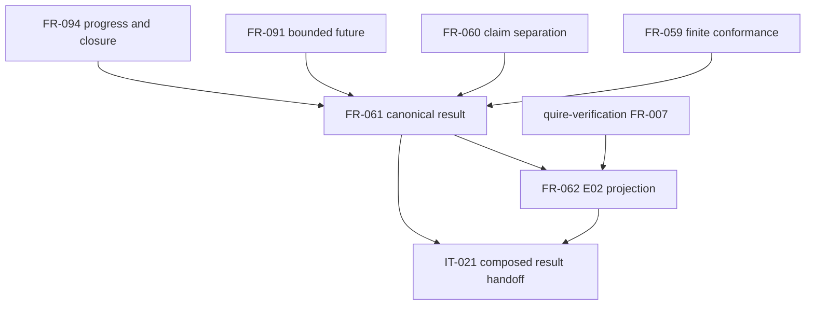

## Summary

The scoped graph is acyclic. Canonical result semantics enable the projection;
the projection consumes, but does not redefine, quire-verification FR-007. The
implementation prerequisites are explicit and do not justify local substitutes.

## Findings

| ID | Severity | Summary | Refs |
| --- | --- | --- | --- |
| FND-001 | low | No dependency cycle or hidden implementation prerequisite remains in the scoped graph. | FR-061; FR-062; IT-021 |

## Classification

| Requirement | Class | Rationale |
| --- | --- | --- |
| FR-061 | enablement | Defines the canonical result and strict-reader invariants used by all protocol consumers. |
| FR-062 | enablement | Defines the compatibility projection consumed by verification assessment. |
| IT-021 | feature evidence | Exercises observation input, protocol result, projection and strict consumers together. |

## Dependency graph

## Implementation order

1. Adopt the composed semantic baseline and authorize private `quire-protocol`
   setup #33.
2. Implement the FR-061 Rust result/strict-reader model.
3. Consume the accepted E02 and Engineering Assurance Rust interfaces and
   implement FR-062.
4. Execute TC-061/TC-064 and IT-021 through shared assurance infrastructure.
