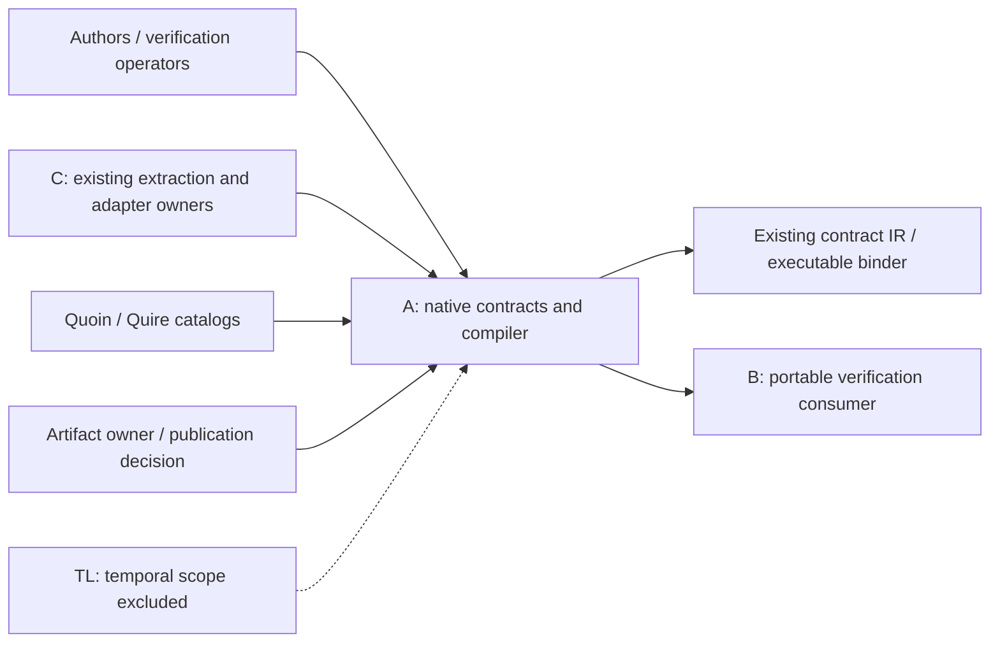

## Summary

Every FR/StR/NFR has one owning component and responsibility class. External producer regression evidence is bounded explicitly; native model, portable result and extraction qualification are still external dependencies.

## Verdict

**CONDITIONAL** — Findings require disposition before the affected implementation or acceptance gate. This is not owner acceptance.

## Findings

| ID | Severity | Summary | Refs |
| --- | --- | --- | --- |
| FND-001 | medium | B/C native shared-reference, typed-model and extraction adoption remains assumed. Preserve concrete producer/consumer qualification gates before treating these boundaries as guaranteed. | IT-001/IT-002; external dependency table |

## Scope and provenance

Reviewed quire-specification. The owner selected base plus all seven Quoin analyses, and declined the optional intent↔test↔code semantic step in `/gap-analysis`. Ordinary requirements consistency, EARS conformance, and the separate current-code review remain in scope. The assignment prohibits spawning additional agents, so these analyses were performed sequentially by Agent A; no independent reviewer acceptance is implied.

The installed Quoin 0.20.0 `spec-review/SKILL.md` and its analysis skills govern these artifacts. The SpecReview authoring pack was fetched once for this repository and its process skeleton/schema was used. Provenance, coverage output, advisor output, and actual method catalog preserve the deterministic inputs. IDs in this report are local to this repository unless qualified.

These are new repositories. Missing formal plans, TC records, suites, and matrices are workflow setup/readiness debt. Unimplemented LC02–LC05 stages and unqualified shared consumers are known remaining work; they are not reported as regressions or hidden stubs. No completion status is fabricated.

## In-scope responsibilities

A owns the native profile, state/operation meaning and shared model/source/reference/canonical-domain contracts. Detailed prose and fixture hypotheses require explicit qualification. Implementation of other owners' existing repositories stays with them.

## System context

## External dependencies

| Dependency / actor | Boundary | Assumed or guaranteed | Contract and limit |
| --- | --- | --- | --- |
| Specification author / verification operator | Selected source, profile, inputs and work budgets | assumed | FR-001/StR-001; inputs are validated, caller intent is not inferred. |
| Existing contract-IR owners | Typed-model view, canonicalization and executable binding | guaranteed for inspected legacy regression baseline only | 17 canonicalization/binding tests and 99 conformance rows observed in prerequisite inspection. Proposed native projection remains assumed/unqualified. |
| Agent B / portable verification consumer | Method/plan/result envelopes and independent reference joins | assumed | Standard IT-002; private verification PR6 still uses the older revision/profile shape. A-v2 adoption not established. |
| Agent C / existing Quire extraction | Opaque body, selected source region/map and existing-repository adapter | assumed | Language IT-003; CO01 ownership/amendment proposal. No second Markdown expression compiler. |
| TL session / temporal work | Temporal capability and clock semantics | assumed and excluded from this profile | No temporal capability is inherited by a finite-state syntax result. |
| Quoin/Quire catalog tools | Authoring, grammar, trace and method analysis | assumed with observed limitations | Recorded versions/manifests; DuplicateArchetype/DuplicateInverseEdge remain external diagnostics. |
| Artifact owner / publication decision | Accepted review, included-file rights and standard grant | assumed, not approved by this review | NFR-004; AGPL-3.0-only applies to new implementation, standard prose grant deferred. |

## Responsibility allocation

| Requirement | Owning component | Class |
| --- | --- | --- |
| [FR-001](../functional/foundation/FR-001-select-native-profile.md) | A: language profile contract | core |
| [FR-002](../functional/foundation/FR-002-resolve-owned-declarations.md) | A: model/import contract | core |
| [FR-003](../functional/foundation/FR-003-bind-source-correspondence.md) | A: source correspondence contract | cross-cutting |
| [FR-004](../functional/foundation/FR-004-separate-artifact-identities.md) | A: shared artifact/semantic references | cross-cutting |
| [FR-005](../functional/foundation/FR-005-guard-optional-values.md) | A: state/operation semantics | core |
| [FR-006](../functional/foundation/FR-006-preserve-control-evaluation.md) | A: state/operation semantics | core |
| [FR-007](../functional/foundation/FR-007-prove-integer-definedness.md) | A: state/operation semantics | core |
| [FR-008](../functional/foundation/FR-008-preserve-sequence-semantics.md) | A: state/operation semantics | core |
| [FR-009](../functional/foundation/FR-009-preserve-object-identity.md) | A: state/operation semantics | core |
| [FR-010](../functional/foundation/FR-010-evaluate-exact-reachability.md) | A: state/operation semantics | core |
| [FR-011](../functional/foundation/FR-011-validate-populations.md) | A: state/operation semantics | core |
| [FR-012](../functional/foundation/FR-012-bind-operation-observations.md) | A: state/operation semantics | core |
| [FR-013](../functional/foundation/FR-013-validate-operation-frames.md) | A: state/operation semantics | core |
| [FR-014](../functional/foundation/FR-014-read-exact-wire.md) | A: closed interchange contract | infrastructure |
| [FR-015](../functional/foundation/FR-015-preserve-canonical-domains.md) | A: canonical-domain compatibility contract | cross-cutting |
| [FR-016](../functional/foundation/FR-016-migrate-explicitly.md) | A: explicit migration contract | cross-cutting |
| [NFR-001](../non-functional/NFR-001-preserve-versioned-meaning.md) | A: historical contract compatibility | cross-cutting |
| [NFR-002](../non-functional/NFR-002-classify-resource-incompleteness.md) | A: outcome/resource contract | cross-cutting |
| [NFR-003](../non-functional/NFR-003-qualify-reference-bindings.md) | A: binding integrity contract | cross-cutting |
| NFR-004 | A: review/rights record for owned artifacts | cross-cutting |
| [StR-001](../stakeholder/StR-001-native-assessment-trust.md) | A: finite-state acceptance contract | core |

## Architecture assessment

The present split is sound: one declarative token vocabulary, a parser-owned syntax tree, immutable source and source maps, then separately checked linked/evaluable representations. Keep executable binding in its existing owner. Avoid a service/event bus, plugin framework, parallel evaluator or extra crate merely to fill a diagram. Strengthen the actual seams with typed identities, standard error traits, explicit budgets and consumer contract tests. The current-code specifics are in the language code review; the unimplemented stages are planned responsibilities, not hidden capabilities.
