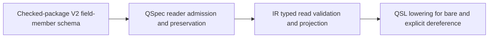

## Summary

The dependency order is acyclic: the V2 member schema and QSpec reader admission define and preserve the mode; IR typed read validation/projection consumes it; QSL lowering emits it for bare versus explicit reads. The existing catalogued `record.project` field member and FR-466 operator list remain unchanged.

## Dependency Graph

## Findings

| ID | Severity | Summary | Refs |
| --- | --- | --- | --- |
| FND-001 | low | No dependency cycle or missing prerequisite within the QSpec change. The IR and QSL consumer work is a downstream follow-up and is not represented as completed here. | FR-322-AC-34 |
